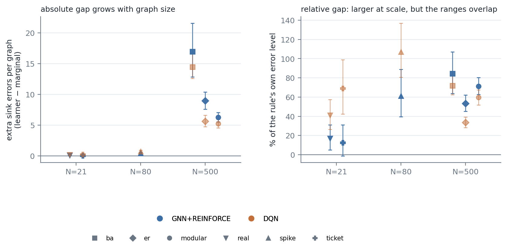
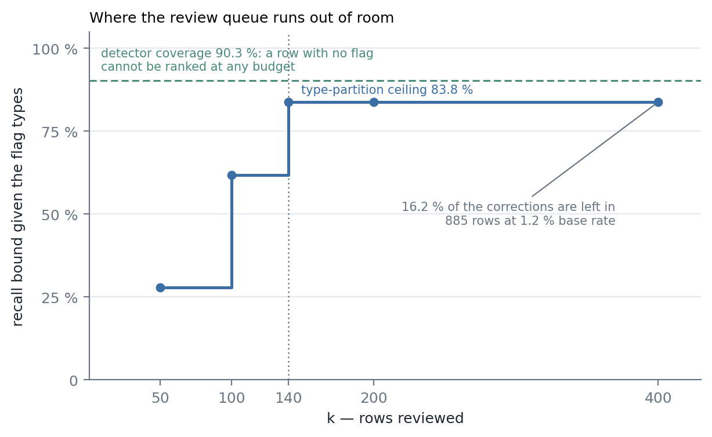
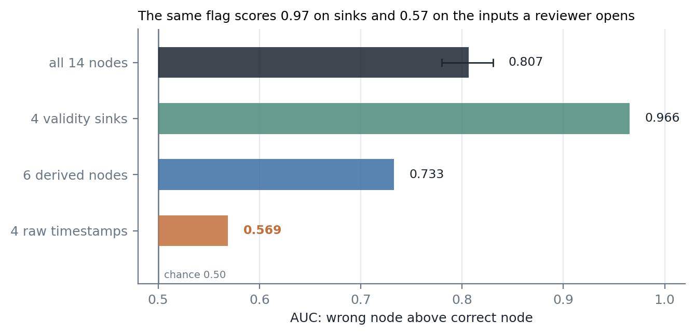

# The signal, not the scheduler

**Budgeted review of dependent AI outputs: a benchmark, a negative result, and a measured boundary**

<b>Language:</b> <b>English</b> · <a href="https://cyracaid.github.io/rl-oversight-dag/PAPER_DRAFT_CN.html">中文</a> · <a href="https://cyracaid.github.io/rl-oversight-dag/PAPER_DRAFT_KO.html">한국어</a>

Draft v0.1 · 2026-11-24 · every number in this draft is traceable to a committed file
(Appendix A) and reproducible from the commands in it. No number was independently
verified by a second person; §9.3 says what that costs.

---

## Abstract

When AI-produced values depend on each other, a human reviewing only some of them
has to decide *which* one to open. We formalise this as budgeted node selection on a
dependency DAG and build a benchmark whose purpose is to let a method fail visibly:
six graph families, eight reference baselines, frozen seed blocks, paired intervals.

Learned policies lose. Three architectures (GNN+REINFORCE, DQN, PPO), five seed
blocks and a 10× training budget all leave a one-step mean-field rule (`marginal`)
ahead on held-out graphs — PPO by +0.35 to +0.47 errors per graph, the 10× run by
+0.262 [+0.165, +0.365] — with every interval excluding zero. Per-review credit assignment improves *training*
(4.549 → 2.926 errors, 5/5 seeds) and still loses in deployment (+0.180
[+0.021, +0.377] to a deterministic two-step rule). Both statements hold at once.

We then spend four pre-registered experiments on the rule's remaining gap to an
oracle and close every mechanical explanation: not the one-step value (−0.049
recovery), not the belief's probability scale (−1 error of 978), not the horizon —
exact five-step planning *inside the rule's own model* is worth 0.030 errors against
a 5–7-error gap to the oracle. What is left is information the confidence channel
does not carry.

The real-data study explains why. On a year-long sleep-diary pipeline the review
queue has a measurable information ceiling: 90.3 % of human-confirmed errors are
even reachable by a detector that flags rows, and a type-only policy exhausts 83.8 %
of the queue by k = 140. The pipeline's own confidence signal discriminates wrong
from correct *nodes* at AUC 0.807 pooled — but most of that comes from four
validity sinks that are wrong exactly when their own check fires, and on the four
raw timestamps a reviewer would actually open it is 0.569, with the correct source
never ranked first (hit@1 = 0.003 against 0.071 chance). The scheduler is not the
bottleneck; the observation is. Three of four defect classes are cheaper to fix at
data capture than at review, and one cannot be fixed by review at all.

---

## 1. Introduction

The setting is common and under-specified. A pipeline emits values that depend on
other values: a parsed date produces a duration, durations produce a rate, the rate
produces a conclusion. Some values are wrong. A reviewer can open a bounded number
of them, and correcting one removes the errors it caused downstream.

The natural instinct is to learn the reviewer. We tested that instinct, and this
paper is mostly the record of it not working, plus the measurements that explain
why. We think that record is the useful artefact, because the failure is not a
tuning failure: it survives three architectures, five disjoint seed blocks, a 10×
compute increase, a better reward, and an exact solver.

**Contributions.**

1. **A benchmark that can show a method failing.** Six families (four synthetic —
   one at N=80, three at N=500 — and two pipeline DAGs at N=21), eight baselines
   from "no review" to a truth-reading reference, frozen splits and a
   spent-once reporting block. §3.
2. **A negative structural result with a mechanism.** A deployable one-step
   mean-field rule beats every learned policy we trained, on every family, in every
   training seed. §4. The mechanism is not the optimiser: the ablation that destroys
   the confidence signal costs more than any scheduling change recovers. §5.
3. **A closed accounting of the rule's own gap.** Four pre-registered experiments
   remove the one-step value, the belief scale, and the planning horizon, including
   an exact dynamic program of the rule's own model. §6.
4. **An external-validity study that locates the boundary, with a ceiling.** On real
   records the reviewable population is small and the queue has a provable
   information ceiling; the confidence signal points at consequences rather than
   causes. §7.

**What this paper does not claim.** That RL reduces human review by any percentage.
That claim was carried by early pilot seeds and has been retired; every number in
this draft comes from a block that was frozen before the run. Nor do we claim the
gap to the oracle is fully explained — §6.4 names the one explanation still open.

---

## 2. Formulation

A record is a DAG `G = (V, E)` with a fixed partition into sources (raw fields),
derived nodes, and declared sinks. Each node `v` publishes a confidence score
`c_v ∈ [0,1]`. Hidden from the policy: which nodes carry a *local source error*,
the edge "coins" that propagate it, the reviewer's uniform draws, and the true sink
values.

Propagation is monotone: an error at `u` reaches a descendant `v` by independent
edge failures, so a single source produces a subtree of wrong values. A review of
`v` corrects a local source error at `v` with probability `p_catch` (0.9 in the
frozen suite); inherited errors persist until their own source is corrected. Sinks
are recomputed after each correction using the same coins across policies (common
random numbers), so paired differences are exact.

A policy selects `B` distinct nodes, one per step, without replacement, and is
scored by the number of sink errors remaining. Reward is terminal, `-sink_errors`.

The policy observes public state only: node type, published confidence, normalised
sink reach, posterior source probability, mean-field propagated error probability,
reviewed flags, remaining budget, and geometry. This restriction is what makes the
comparison meaningful — a truth-reading policy is included as a *reference point*,
not as a bound (§3.4).

---

## 3. Benchmark

### 3.1 Families

| family | n | budget | sinks | role |
|---|---:|---:|---|---|
| `spike` | 80 | 16 | last layer (20) | primary study |
| `modular` | 500 | 50 | childless | scale, community structure |
| `ba` | 500 | 50 | childless | scale, hubs |
| `er` | 500 | 50 | childless | scale, random |
| `real` | 21 | 8 | 4 declared | sleep pipeline topology |
| `ticket` | 21 | 8 | 4 declared | synthetic ticketing prior |

`n` and `B` are frozen per family: a run at another budget is a different benchmark
and is labelled as such.

### 3.2 Seed discipline

Every experiment spends a block that was named in a `PREREGISTER_*.md` before its
first seed, and the reporting block (90000–90099) has been read once. A block is
retired once it has chosen a method or a threshold. Blocks 4600–4799 are void
(smoke runs only) and are excluded everywhere.

This matters for reading the tables: raw means differ across blocks even for the
same policy (confirmation block A is an easier set: 1.130 → 0.885 for `marginal`),
while *paired* deltas transfer. Every claim below is stated as a paired delta.

### 3.3 Baselines

Eight layers: no review; random; three static heuristics (confidence-lowest, hub,
confidence × sink-reach); a type-prior policy (highest base rate for the node type);
the graph-aware mean-field rule `marginal`; the truth-reading reference `oracle`; and
learned policies (GNN+REINFORCE, DQN, PPO). `structural` (confidence × sink reach) is
the external proxy for influence-weighted uncertainty sampling and is named as such
rather than as a new baseline.

The type-prior layer is load-bearing: it drops the confidence score and loses by
2.73 errors on `spike`, which is what shows the published score carries real
information and that removing it is not a neutral ablation.

### 3.4 The reference point is not a bound

`oracle` is truth-reading `marginal`: it knows the true error state and runs the
same one-step rule. It is a reference, not an optimum. In the real-data replays a
greedy oracle is beaten by a learned policy that ignores a two-night evidence rule
(§7.6), which is only possible because the oracle is greedy.

### 3.5 Standing table

Mean residual sink errors, 100 graphs per family, paired intervals:

| family | `marginal` | `confidence` | `type_prior` | reference | headroom |
|---|---:|---:|---:|---:|---:|
| `spike` | **0.66** | 1.03 | 3.76 | 0.52 | 0.14 |
| `modular` | **8.78** | 10.59 | 26.09 | 3.78 | 5.00 |
| `ba` | **20.13** | 29.65 | 67.76 | 13.28 | 6.85 |
| `er` | **16.76** | 21.75 | 37.60 | 9.84 | 6.92 |
| `real` | **0.47** | 0.50 | 1.79 | 0.39 | 0.08 |
| `ticket` | **0.29** | 0.32 | 0.90 | 0.28 | 0.01 |

Against `confidence` on `spike`: `marginal` +0.37 [+0.20, +0.56], 21 W / 77 T / 2 L.

The headroom column is the whole argument of the next three sections: it is 0.14 at
N=80 and 5–7 at N=500. Whatever is costing those errors is a property of the graph
size, not of the policy's action space.

**A warning the table already contains.** On `ba` the mean gain over `confidence` is
+9.52 but the split is 39 W / 16 T / 45 L. Mean and win rate tell different stories;
both are reported wherever they disagree.

---

## 4. The learner loses

### 4.1 Three architectures

All at equal budget, on held-out graphs, three training seeds each. Δ = learned −
`marginal`, so positive is worse.

| family | `marginal` | GNN Δ [95 % CI] | DQN Δ [95 % CI] |
|---|---:|---|---|
| `spike` | 0.66 | +0.403 [+0.260, +0.587] | +0.707 [+0.533, +0.903] |
| `real` | 0.47 | +0.080 [+0.023, +0.147] | +0.193 [+0.123, +0.270] |
| `ticket` | 0.29 | +0.037 [−0.003, +0.090] | +0.200 [+0.123, +0.287] |
| `modular` | 8.78 | +6.257 [+5.513, +7.057] | +5.227 [+4.553, +5.920] |
| `er` | 16.76 | +8.947 [+7.557, +10.393] | +5.633 [+4.733, +6.597] |
| `ba` | 20.13 | +16.970 [+12.817, +21.557] | +14.450 [+12.563, +16.730] |

All 36 (family, learner, seed) cells have a positive point estimate; 34 of 36
intervals exclude zero on the losing side, and the two exceptions are ties (96–97
of 100 graphs identical), not wins.

The gap **grows with graph size**: +0.04 to +0.08 at N=21, +5.2 to +17.0 at N=500.
That ordering is evidence against a pure sample-size explanation, since the larger
families give the learner *more* nodes per episode, not fewer. It is consistent with
a mechanism: the observation carries per-node confidence and local geometry, and the
multi-hop propagation that separates `marginal` from `oracle` has to be re-derived
from terminal reward alone. We state the mechanism as a hypothesis this data does
not separate from alternatives.

Divided by the rule's own error level the same difference is 13–69 % at N=21,
61–107 % at N=80 and 34–84 % at N=500: larger at scale, but with ranges that
overlap, so the absolute ordering is the sharper statement and the one we make.

*Figure 1. The deficit tracks graph size, not the learner. Filled markers are the
GNN aggregate, pale markers DQN; whiskers are paired intervals over 100 graphs. The
right panel divides the same difference by the rule's own error level — larger at
scale, but the ranges overlap across sizes, which is why §4.1 states the absolute
form.*

A 10× training budget tests the same explanation from the other side. On the N=80
confirmation block, ten thousand episodes instead of one thousand moves the GNN from
1.185 / 1.325 / 1.275 to 1.155 / 1.140 / 1.145 against an unchanged `marginal` at
0.885: the paired gap narrows from +0.377 to **+0.262 [+0.165, +0.365]** and the
seed spread collapses. More compute shrinks the deficit and does not remove it,
which is the behaviour we would expect if the missing term were information rather
than optimisation.

### 4.2 PPO, on a block nobody had read

The fair objection is that REINFORCE and DQN are the wrong optimiser. Every
hyperparameter was frozen before the implementation existed, on block 4200–4399.

| seed | PPO | `marginal` | Δ [95 % CI] | W/T/L |
|---|---:|---:|---|---|
| s1 | 1.225 | 0.875 | +0.350 [+0.230, +0.480] | 2/160/38 |
| s2 | 1.335 | 0.875 | +0.460 [+0.335, +0.600] | 3/138/59 |
| s3 | 1.340 | 0.875 | +0.465 [+0.325, +0.620] | 2/148/50 |

Three seeds, all positive, all intervals exclude zero. The pre-registered size
prediction was that PPO would land *between* `marginal` and the REINFORCE GNN; it
landed at the REINFORCE level or slightly beyond. That prediction is reported as
missed.

### 4.3 A better reward that does not deploy

Per-review credit assignment replaces the episode-level return with a per-step
allocation. It works, and it does not help:

| claim | evidence | verdict |
|---|---|---|
| the reward change improves the trained model | 4.549 → 2.926 errors, −1.623 [−2.136, −1.033], 5/5 seeds | supported |
| the improved model wins in deployment | 2.945 vs a two-step rule 2.765, rule ahead by 0.180 [0.021, 0.377] | contradicted |

Both are true simultaneously, and any summary that reports only one of them is
wrong. This is the sharpest form of the section's claim: the training signal was
the part we could improve, and improving it moved the deployment number in the wrong
direction.

---

## 5. Locating the headroom

If the learner is not the problem, what is? Two ablations, on the same environment,
answer directly.

**Destroys the signal.** Train the same GNN with the confidence score replaced by
uniform noise: 3.78 errors (per-seed 3.30 / 5.20 / 2.85), worse than a static
threshold (2.30 on the same line). A learned policy without a usable signal is worse
than a one-line rule.

**Perfects the signal.** Give the same learner a confidence score that reveals the
true error: 0.72 (0.80 / 0.70 / 0.65), against an unimpaired 1.38 (1.30 / 1.95 /
0.90).

> These two rows are from the `experiments/` replica line, not from the frozen
> `role3 improvement/` line, so their raw values are not comparable to §3.5. The
> *direction* is what the section claims, and it replicates across both lines.

The scheduler's share of the remaining error is therefore small, and the confidence
model's share is large. Everything after this point asks the same question in a
harder setting: **given that the rule's model is wrong, can a policy tell?**

### 5.1 Five pre-registered steps on signal trust

Each step moved the decision variable somewhere new, on graphs no earlier run had
used, with the verdict computed by code.

| step | block | verdict | measured effect |
|---|---|---|---|
| global gate | 3000–3199 | boundary measured | harmless −1 shift: fires 195/200, **+1.82** errors; masked +3: 0/200, **+3.21** |
| gate repair (`verify`) | 3200–3399 | **failure** | −0.015 at −1, but 5 of 13 fired cells worse than trusting |
| per-node (`shrink`) | 3400–3599 | success | +0.105 at −1; **−0.370** where errors are masked; +0.45 / +0.72 under a harmless global +2 / +3 |
| per-graph (`scope`) | 3600–3799 | success | +0.005 at +3 where per-node costs +0.81; 112-cell mean 1.303 → **1.203**; at −4 returns to the clean oracle (0.94 vs 3.86) |
| boundary | 3800–3899 | **partial** | off-grid δ holds (mean \|δ error\| 0.174; 12/12 cells beat per-node); two simultaneous δ collapse (−0.016; trust 2.15 / per-node 1.89 / per-graph 1.87) |

The narrow, measured claim: with 16 reviews a policy can estimate whether its
confidence scores are usable, and stay safe when they are not. The decision variable
belongs at the node when the question is "which node moved" and at the graph when
the question is "did everything move". When two layers move by different amounts,
both single-δ families fall back to plain trust — and that is reported as
*unresolved*, not as a win.

### 5.2 A prediction we got backwards

Every run above assumed reviewers catch 90 % of the errors they open. Sweeping
`p_catch` over 0.60 / 0.75 / 0.90 / 1.00 (block 4000–4199) kept the direction — the
rule beats confidence ordering in all four cells, +0.255 [+0.150, +0.375] to +0.530
[+0.370, +0.705] — and **inverted** the pre-registered size prediction: the lead
grows as reviewers become *more* reliable. The reference point moves the same way
(+0.355 → +0.820), so the environment contracts rather than the rule improving. The
frozen verdict is `inverted` and it is reported as a failed prediction.

---

## 6. The ceiling inside the rule's own model

`marginal` loses 5–7 errors per graph to the reference at N=500. Three explanations
were available; all three were frozen and measured on fresh blocks, and the third
was additionally solved exactly rather than approximated.

**6.1 The one-step value is not the problem.** The mean-field score double-counts a
source error with two open paths. Re-ranking the mean-field top 16 by a sampled
paired counterfactual gain (256 particles, block 4400–4599) gives recovery −0.049
[−0.087, −0.015]: it changed the action on 45 of 200 graphs and lost 30 of them.
Better scoring *inside* the shortlist costs more than it recovers.

**6.2 The belief's numbers are not the problem.** Holding the belief's ranking
bit-identical and distorting only its values with `q = sigmoid(γ · logit(b))`
(4800–4999) gives `policy-bound` on modular: the best cell (γ = 1.25) is +0.016
[−0.055, +0.072], wins 46 graphs, loses 12, and moves the aggregate by **−1 error of
978**. γ = 0.5 costs 1.49 errors. On `spike` the label is `calibration-partial` but
it closes **0 of 49** errors.

**6.3 The horizon is not the problem.** Depth-two planning on the same mean-field
model, public inputs only (5200–5399): the catch-only variant leaves 191 of 200
modular actions unchanged and closes −5 of 923 errors, recovery −0.009 [−0.023,
+0.001]. The two-branch variant is worse by an order of magnitude (−0.833 [−1.071,
−0.621]; 485 of 923 errors lost) because the environment's miss update is a
heuristic: a planner reads "this node will probably be missed, so its belief will
drop" as an improvement. That is a statement about the update, not about planning.

**6.4 The exact optimum agrees.** A dynamic program over the rule's own belief model
(block 5000–5023, five predictions frozen first) gives `dp − marginal` = −0.030
[−0.065, −0.008] on `real` (4.2 % of the rule's residual) and −0.002 on `ticket`,
against a 5–7-error gap. Planning value is
sub-linear (ratio 1.81), `dp₃` equals exhaustive greedy to 1e-9, and the saturation
test holds on both families. The first run sat on the model-selection block
60000–60023; it is kept as a sensitivity check and moves no verdict
(`outputs/dp-ceiling-fresh/AMENDMENT.md`).

So the gap is not lookahead, not the one-step value, and not the probability scale.
What remains is **information the confidence channel does not carry**. The one
explanation still untested is a belief with more information than the public score;
we do not claim it closes anything.

One correction belongs in this section rather than in a footnote. The planning
prediction was originally tested as a *signed* comparison `dp − greedy ≤ 0.02`,
which passes for any gain at all. It now tests magnitude against the falsification
bound the pre-registration itself fixed. The corrected verdict is weaker, and moving
to a clean block makes it weaker still (`holds — nominal 0.02 missed by 0.0083`, four
times the first run's 0.0019, still inside the 0.05 bound the pre-registration fixed
for falsification). Both amendments are committed next to the results. A post-hoc
edit that files its own result closer to falsification is not a degree of freedom
spent on the answer; leaving the signed test in place would have been.

**What the ceiling is, exactly.** The DP is the optimum of the *mean-field model the
rule optimises*, not of the POMDP, and it uses a node-local miss update (identical
on source nodes). "0.030 short of optimal" therefore means short of optimal inside
our own approximation. A better model could move the ceiling; that is the open cell.

### 6.5 What a delivery can say about its own coverage

A policy that reports only a count of remaining errors hands the reviewer a claim he
cannot check. The pre-registered *receipt* axis (block 5400–5599) asks a narrower
question: for every sink that is still wrong, can the policy say whether that sink
was `partial` (some upstream source reviewed) or `untouched` (none)? Let *declared
share* be the fraction of surviving sink errors carrying either label. The
complement sits in sinks whose every upstream source was reviewed and whose catch
roll still missed.

| family | policy | errors/graph | surviving sink errors | declared | false-inspected | declared share |
|---|---|---:|---:|---:|---:|---:|
| `spike` | `marginal` | 0.965 | 193 | 188 | 5 | **0.974** |
| `spike` | `oracle` | 0.725 | 145 | 124 | 21 | 0.855 |
| `modular` | `marginal` | 8.835 | 1767 | 1587 | 180 | 0.898 |
| `modular` | `oracle` | 3.895 | 779 | 663 | 116 | 0.851 |
| `real` | `marginal` | 0.450 | 90 | 88 | 2 | **0.978** |
| `real` | `oracle` | 0.365 | 73 | 57 | 16 | 0.781 |
| `ticket` | `marginal` | 0.275 | 55 | 46 | 9 | 0.836 |
| `ticket` | `oracle` | 0.245 | 49 | 29 | 20 | 0.592 |

Five predictions were frozen first. Three hold: the receipt changes no action (0
mismatching runs), its fidelity is 1.000 everywhere, and every family contains at
least one false-inspected sink. Two carry information. The oracle's declared share
is *lower* than the rule's on `modular` (0.851 vs 0.898), because a better policy
leaves fewer errors and proportionally more of them in the catch-miss bucket. And
the one prediction that failed failed by 0.002: `modular` was predicted at ≥ 0.90
and came in at 0.898 (1587 of 1767). The threshold was not moved afterwards.

That shortfall is the result. On `modular`, 10.2 % of surviving errors sit in sinks
whose every upstream source was reviewed; under the oracle the same bucket is
14.9 %. Reviewing more does not make the receipt truer, because `p_catch = 0.9` means
"inspected" cannot mean "clean". A delivery that reported coverage alone would
overstate itself *more*, the more it reviewed — which is the opposite of the
intuition the receipt is meant to serve, and the reason the number is reported as a
failed prediction rather than rounded into a pass.

The deletion test isolates the statement from the policy. Three arms run the
identical policy on identical episodes and differ only in what the delivery says: the
honest receipt, a `silent` arm with no fields for the question, and an `overclaim` arm
that answers anyway. The silent arm's columns are empty because the question has no
answer there, not a wrong one; the overclaim arm is wrong by exactly the number of
surviving errors in every cell. What separates a count of errors from a count of
*uncovered* errors is the reporting field, not the scheduler.

Scope, so this is not read as calibration: the receipt is about scope and never
about truth; no escalation policy was pre-registered (`judged` is 1.0 on every row);
and a sink the budget cannot reach is exactly what `untouched` reports. That last
one is a finding about the budget, not a defect of the receipt.

---

## 7. Real data: the boundary, and why the signal cannot point at a cause

The benchmark is synthetic. The rest of the paper is the external-validity study,
run on a year-long sleep-diary pipeline whose DAG we encoded from its operational
definitions (21 nodes, 4 declared sinks). All of it is marked *pilot* where the
sample is small, and all of it uses aggregates only.

### 7.1 The population

13,990 daily records, 237 participants, 2,652 usable nights. 75 human-confirmed
corrections, 0.54 % of records. The defects cluster by type: 57 of 75 (76 %) are
ordering errors, against 8 unlabelled rows and a long tail.

### 7.2 Within a record there is almost no scheduling problem

Replaying all 53 corrections that have four complete timestamps (22 dropped), 36
participants, on a 14-node reduction of the DAG:

- the replay is validated against the correction file's own derived columns,
  **159/159 cells** within 0.02 h;
- a corrected record has **5.92 of 14 nodes** wrong on average, and among the 37
  records with exactly one source defect that defect costs **1.84 of 4 conclusions**;
- with a root-cause reviewer, **two reviews clear the record** (0.08 residual), so
  the operational budget of 8 of 21 nodes is 4–8× more than the task needs;
- structure pays only at budget 1 (0.19 vs 0.42 for the threshold) and disappears at
  budget 2.

This is the first place the benchmark's premise fails: the graph is small enough
that ordering has little to exploit.

### 7.3 Across records, one bad night is diluted — and the QC rule is already there

With four conclusions per participant and a one-night budget: no review 0.582,
random 0.524, extreme-value 0.472, **the pipeline's existing QC flags 0.014**,
reference 0.000. Visible corruption is caught by the QC rule at **99.8 %**; silent
corruption at 2.9 %.

Anything adaptive has to beat 0.014, not random. Systematic bias is the real risk:
corrupting 25 % of a participant's nights changes a conclusion for 80.7 % of
participants; 50 % changes 94.0 %.

### 7.4 The review unit is not the bottleneck either

A block-review MDP over 196 participants and 2,372 nights, budget counted in nights
read, 20 paired seeds:

| corruption | budget | none | night QC | block3 QC | reference |
|---|---|---:|---:|---:|---:|
| visible ±12 h | 2 | 1.73 | 0.20 | **0.15** | 0.16 |
| visible ±12 h | 4 | 1.73 | **0.00** | 0.00 | 0.00 |
| silent 90 min | 2 | 0.23 | 0.18 | 0.13 | 0.09 |

The block advantage is a **budget-below-run-length effect**, not a structural one:
at budget 4 the per-night rule overtakes or ties it. Reporting the budget-2 row alone
would have been a true number supporting a false sentence.

### 7.5 Three of four defect classes are cheaper to fix before review

| defect | prevalence | fixable by review? |
|---|---|---|
| WASO = 0 on every night | 7 records, 3.6 % (82 nights) | **no** — the night is well-formed |
| nights reporting WASO = 0 | 933 nights, 39.3 % | no; report the zero share |
| ≥ 3 consecutive zero-WASO nights | 88 records, 44.9 % vs **69.3 expected** under a permutation null | no; the excess is ~18 records |
| one ±12 h shift repairs an order-breaking night | 20 records, 10.2 % | **no** — it is a validation rule |
| coverage (nights / span) | median 91.7 %, 21.4 % below 0.8 | no; report the denominator |

The 44.9 % run figure is the cautionary one: with zeros on 39 % of nights a 3-night
run occurs 35.4 % of the time by chance, so a rule that fires on it is wrong about
two thirds of the time unless it carries its null.

This is the concrete meaning of "the reviewable population is the residual".

### 7.6 The cross-night score is the thing that is learnable

A logistic model on 11 observable window features, 118 train / 78 held-out
participants, matches the hand-crafted score on the visible family (where the QC
rule already wins) and beats the per-night rule 1.5–2.9× on the silent families
(WASO→0 at budget 2: 0.014 vs 0.039). Held-out AUC 0.991 / 0.816 / 0.840.

The same experiment also demonstrates why the reference point is not a bound: on the
WASO family the learned policy beats the greedy oracle, because the oracle ignores a
two-night evidence requirement.

### 7.7 The queue has a provable ceiling

On the row-level review queue of the same pipeline (68 human-confirmed positives
over 203 participants):

- **Coverage.** A scheduler can only rank rows a detector flagged. 65 of 72
  corrections are in the queue (90.3 %); under a broader label set, 68 of 85
  (80.0 %). Infinite budget cannot exceed this. The missing part is a *detector*
  problem, not a review-allocation problem.
- **Type information.** Within a flag type the rows are exchangeable, so the best a
  type-only policy can do is take groups in decreasing positive rate. That ceiling
  is 27.9 % at k = 50, 61.8 % at k = 100, and **83.8 % at k = 140**, where it
  saturates: the remaining 16.2 % of errors sit in 885 rows at 1.2 % positive rate.
- **Power.** With 68 positives this queue cannot resolve differences below ~10
  percentage points; the two candidate orderings differ by +7.3 % [−8.9 %, +12.8 %].
  We report the interval, not the winning row.

*Figure 2. Where the queue runs out of room. The dashed line is the detector's
coverage — the corrections whose rows are never flagged and so cannot be ranked at
any budget. Within the flagged population, taking whole flag types in order of base
rate saturates because what is left is a large group at 1.2 %. Past the saturation
point the curve is flat by construction, not by measurement.*

Three plausible escapes were tested and all three failed: within-type features
(AUC 0.467, permutation p = 0.53), the best univariate rule (AUC 0.78 but precision
@100 = 3 %), and a participant-level ranking (AUC 0.868, paired Δ +7.3 % [−8.6 %,
+10.0 %] at k = 400). The base rate of the queue is 6.5 %.

The one escape that survives is about **cost, not recall**: the rule's witness names
the two conflicting timestamps, so a curator reads 2 fields instead of 4 — 96.6 % of
corrected fields inside the witness pair at half the reading cost. Under a time
budget this halves the price of the order block. It does not raise the 83.8 % ceiling.

The queue-level version of the same reporting question is §6.5: there the delivery
declares what it did *not* cover, and the bucket of errors it cannot vouch for grows
when the policy reviews more, not less.

### 7.8 The confidence signal points at consequences, not at causes

The calibration gap left by §3 was described as a data gap: fit the error model on
human-audited labels and the constants stop being invented. That is only half true,
and the half it gets wrong is the half the paper needs.

The correction file is all positives, so record-level calibration stays blocked.
Inside a record, however, the correct nodes are negatives, which is enough to ask
whether the pipeline's own signal ranks the wrong node above the right ones. On the
53 replayed records, using the exact flag rule every other real-data number here is
built on:

| what is measured | value | chance |
|---|---|---|
| AUC, all 14 nodes (wrong vs correct) | 0.807 [0.780, 0.831] | 0.50 |
| AUC, the 4 validity sinks | 0.966 | 0.50 |
| AUC, the 6 derived nodes | 0.733 | 0.50 |
| **AUC, the 4 raw timestamps** | **0.569** | 0.50 |
| localisation hit@1 / hit@3 for the source | 0.003 / 0.045 | 0.071 / 0.214 |
| mean rank of the source (of 14) | 6.4–6.7 | 7.5 |

The pooled 0.81 is the rule re-reading the consequence of the error: a validity
sink's value is wrong exactly when the check feeding it fires, so the same fact is
counted twice. On the four raw timestamps — the nodes a reviewer would actually
open — it is at chance. The top-ranked node is `SE_conclusion` in 51 of 53 records,
because the leaf score is defined as a *mean over its descendants*: by construction
a cause cannot outrank its effect.

*Figure 3. One flag rule, scored twice. Pooled AUC 0.807 is carried by the validity
sinks (0.966), whose values are wrong exactly when the check feeding them fires; on
the four raw timestamps a reviewer would actually open, the same rule is at chance
(0.569). The signal ranks consequences, and the reviewers' inputs are the causes.*

A continuous version of the same rule (hours past threshold rather than a flag) does
not fix it: AUC falls to 0.653 and hit@1 stays at 0.003, though the mean rank
improves to 4.2 and hit@3 to 0.25.

**Consequence.** More audited-correct rows would let us fit `P(record is bad)`; they
cannot make `P(node i is the cause)` identifiable from a consequence-scored signal.
The binding constraint is the *direction* of the observation, not its sample size.
What would change the answer is direct evidence on the raw timestamps — an
acquisition-side QC score, or a second reader's independent judgement — which the
export does not contain.

---

## 8. Related work

**Active and uncertainty sampling.** The static layer of our baseline matrix
(confidence × sink reach) is the influence-weighted uncertainty sampling of the
data-cleaning literature, and we name it as the external proxy rather than as a
contribution. The difference here is that correcting one node changes the value of
its descendants, so the reward is a graph functional, not a label count.

**Review of generated output.** Work on human oversight of model output usually
budgets *tokens* or *items*; our unit is a node in a typed dependency graph, so the
budget interacts with propagation. That interaction is the reason a one-step
mean-field rule is competitive at all.

**Belief-space control and active perception.** `marginal` is a one-step lookahead
in a mean-field belief; the DP ceiling in §6.4 is the exact solution of the same
belief MDP. The result that exact planning over that model buys 0.030 errors is a
statement about the model, not the planner, and it is why we frame the remaining gap
as an information problem.

**Queue-level triage.** The coverage and type-partition bounds in §7.7 are the
queue-level analogue of a recall ceiling: once the detector's output is fixed, the
policy's reachable set is fixed, and the achievable recall is a property of the flag
partition, not of the ordering.

---

## 9. Discussion

### 9.1 What we would do instead

The measurements converge on one recommendation, and it is not a scheduler. Fix the
capture: a 24-hour time input, an intake question about whether awakenings were
recorded, and a coverage denominator printed next to every mean. These remove three
of the four defect classes in §7.5 and are cheaper than any policy.

§6.5 is the same recommendation with a number attached: a delivery that states which
of its residual errors it did not cover, instead of only how many remain, converts an
unfalsifiable count into a checkable one — and stops overstating itself exactly when
it has reviewed the most.

### 9.2 When the method should not be used

- When the pipeline is small enough that two reviews clear a record (§7.2).
- When the existing deterministic rule already sits within 0.014 of the reference
  (§7.3).
- When the defects are conventions or missing fields (§7.5).
- When the detector's coverage ceiling is the binding number (§7.7).

In each case a learned scheduler is a real method applied to a problem that has
already been solved upstream.

### 9.3 Threats to validity

* **No second verifier.** Every number was produced by an AI agent from committed
  code and CSVs, and none has been independently re-derived by a person. The
  repository guards against *documentation* drift (a test fails if a published
  number disagrees with its artefact) but not against a shared misreading.
* **The reference point is greedy**, so "the rule loses 5–7 errors to the oracle"
  measures a gap to a heuristic, not to an optimum. §6.4 is the closest thing to a
  bound and it bounds the rule's own model.
* **The real-data replays are pilots.** 53 of 75 corrections replay; 13 usable
  nights make the correction-clustering test powerless, so it neither supports nor
  refutes the block hypothesis.
* **The queue study is row-level**, not graph-level; its ceiling is about the
  detector and transfers to the DAG formulation only as a statement about
  observations.
* **One post-hoc amendment** (§6.4) and one exploratory observable (§7.8,
  continuous severity) are labelled as such in place.

### 9.4 What would change our mind

A learned policy that wins on a spent-once block; a belief whose information content
exceeds the public score, closing part of the 5–7-error gap; a domain whose defects
are genuinely downstream-dependent and rare enough that review is the cheapest fix.
None of these is ruled out by this paper. What is ruled out is the claim that the
scheduler is where the error lives.

---

## 10. Reproducibility

- Frozen environment `role3-env-v3`, canonical measurements under
  `role2_규리/results/`, benchmark spec and standing table in `BENCHMARK_SPEC.md`.
- Every pre-registration is a committed file named before its first seed; the seed
  ledger in the repository records which block each experiment spent.
- Tests: `role3 improvement` 78 passing, `role2_규리` 4, and 20 test files under
  `experiments/` run by hand, including a documentation-drift guard that fails if a
  published number disagrees with its artefact.
- Real participant data never enters the repository. Only aggregates and fitted
  JSON are committed; the raw export and the correction files stay local.

---

## Appendix A — every number, and the file it comes from

| § | number | artefact |
|---|---|---|
| 3.5 | standing table, headroom | `BENCHMARK_SPEC.md` §6, `outputs/v3-baselines/benchmark_summary.csv` |
| 3.5 | `ba` 39 W / 16 T / 45 L | same |
| 4.1 | learned vs `marginal`, 36 cells | `outputs/v3-learned/learned_vs_marginal.md` |
| 4.2 | PPO three seeds | `outputs/ppo-v1/`, `PREREGISTER_PPO.md` |
| 4.3 | credit assignment 4.549 → 2.926; +0.180 deployment | `role2_규리/results/credit-v1/` |
| 5 | ablation 3.78 / 1.38 / 0.72 | `experiments/results.md` §7 (replica line) |
| 5.1 | five trust steps | `experiments/results.md` §3–4, `PREREGISTER_*`, blocks 3000–3899 |
| 5.2 | `p_catch` sweep, verdict `inverted` | `PREREGISTER_P_CATCH.md`, block 4000–4199 |
| 6.1–6.2 | counterfactual value, belief rescaling | blocks 4400–4599, 4800–4999 |
| 6.3 | depth-two planning | `PREREGISTER_PLANNING_V2.md`, block 5200–5399 |
| 6.4 | DP ceiling, P1–P5, amendment | `role3 improvement/outputs/dp-ceiling-fresh/{report,AMENDMENT}.md` |
| 6.5 | receipt table, 0.898 vs 0.90, 10.2 / 14.9 % | `role3 improvement/outputs/supervisor-v1/receipt_vs_silent.md` |
| 7.1–7.2 | 13,990 / 237; 53 replay; 159/159 | `experiments/replay_manual_corrections.py`, `runs/replay-manual-corrections/` |
| 7.3 | across-record replay, 99.8 % / 2.9 % | `experiments/cross_record_replay.py`, `runs/cross-record-replay/` |
| 7.4 | block review MDP | `runs/block-review-mdp/`, `BLOCK_REVIEW_NOTE.md` |
| 7.5 | capture checks | `experiments/capture_checks.py`, `CAPTURE_CHECKS_INTERPRETATION.md` |
| 7.6 | learned window scorer, AUC 0.991/0.816/0.840 | `runs/learned-window-scorer/` |
| 7.7 | coverage / type ceiling / power | `triage_bench/CEILING.md`, `triage_bench/outputs/ceiling.json` |
| 7.8 | localisation AUC 0.807 / 0.569, hit@1 0.003 | `experiments/REAL_CONFIDENCE_RANKING.md`, `runs/real-confidence-ranking/results.json` |
| Figs. 1–3 | plotted values only, no new numbers | `experiments/make_figures.py`, `figures/figure_data.json` |
