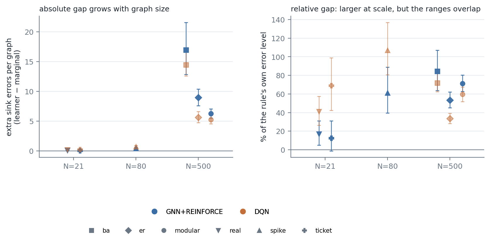
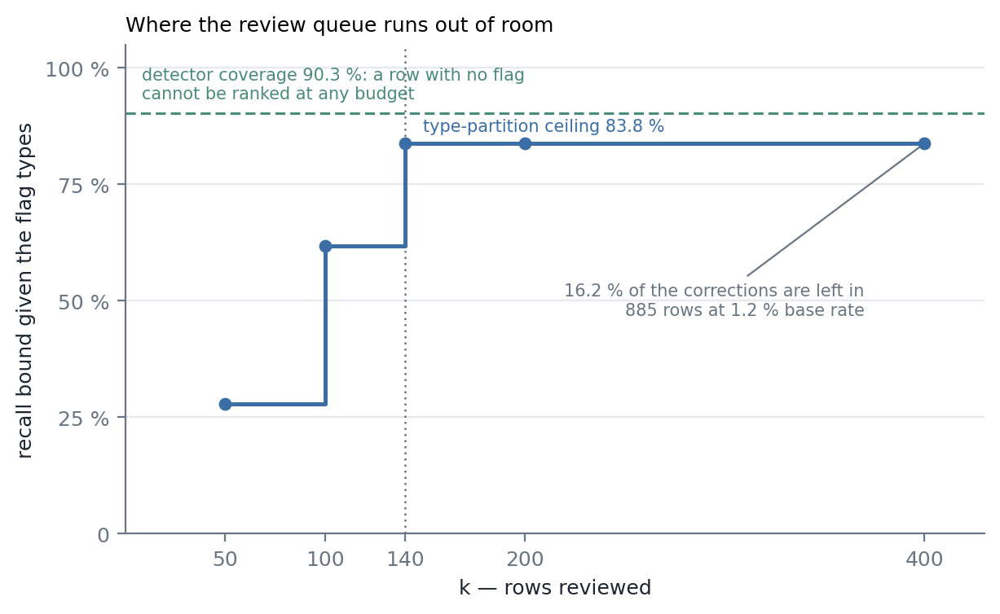
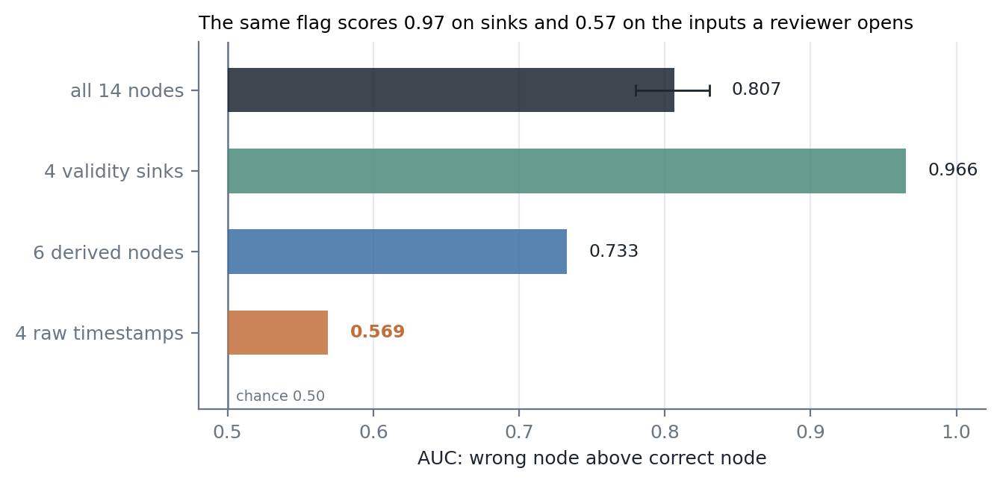

# 信号，而不是调度器

**对相互依赖的 AI 输出做预算受限的复核：一个基准、一个负结果、一条测出来的边界**

<b>语言：</b> <a href="https://cyracaid.github.io/rl-oversight-dag/PAPER_DRAFT.html">English</a> · <b>中文</b> · <a href="https://cyracaid.github.io/rl-oversight-dag/PAPER_DRAFT_KO.html">한국어</a>

草案 v0.1 · 2026-11-24 · 本草案中的每个数字都可追溯到已提交的文件（附录 A），都可用其中
的命令重新生成。没有任何数字被第二个人独立复核过 —— 代价写在 §9.3。

---

## 摘要

当 AI 产出的值彼此依赖时，只复核其中一部分的人必须决定*打开哪一个*。我们把它形式化为依赖
DAG 上的预算受限节点选择，并构建一个**让方法能显眼地失败**的基准：六个图族、八个基线、冻结的
种子区块、配对区间。

学习策略输了。三种架构（GNN+REINFORCE、DQN、PPO）、五个种子区块、10 倍训练预算，在留出图上
都让一条一步均值场规则（`marginal`）领先 —— PPO 每图 +0.35~+0.47 个错误，10 倍训练为
+0.262 [+0.165, +0.365]，所有区间都排除 0。逐次复核的信用分配改善了*训练*（4.549 → 2.926 个
错误，5/5 种子），在部署中依然输（比确定性两步规则差 +0.180 [+0.021, +0.377]）。两句话同时成立。

接着我们在规则与 oracle 之间的残余差距上花四次预注册实验，逐一关掉所有机械性解释：不是一步
价值（−0.049 回收），不是信念的概率刻度（978 个中的 −1 个），也不是视界 —— *在规则自己的模型
内部*做精确五步规划只值 0.030 个错误，而到 oracle 的缺口是 5~7 个。剩下的是置信度通道不携带的
**信息**。

真实数据研究解释了原因。在一年期睡眠日记流水线上，复核队列有可测量的信息上界：人工确认的
错误中只有 90.3 % 能被"给行打标记"的检测器触达，只用类型的策略在 k = 140 时耗尽队列的 83.8 %。
流水线自己的置信度信号以合并 AUC 0.807 区分错误*节点*与正确节点 —— 但其中大部分来自四个
校验汇点，它们只在自身检查触发时才错；而在复核者真正会打开的四个原始时间戳上只有 0.569，
正确源节点从未排到第一（hit@1 = 0.003，随机为 0.071）。瓶颈不是调度器，是观测。四类缺陷中
三类在采集端修比在复核端修更便宜，一类根本不能靠复核修。

---

## 1. 引言

这个场景常见且未被充分规定。一条流水线产出彼此依赖的值：解析出的日期产生时长，时长产生比率，
比率产生结论。有些值是错的。复核者只能打开有限个，改对一个就消除了它在下游造成的错误。

自然的直觉是把复核者学出来。我们检验了这个直觉，本文主要是它没有奏效的记录，加上解释原因的
测量。我们认为这份记录才是有用的产物，因为这不是调参失败：它扛过了三种架构、五个互不相交的
种子区块、10 倍算力、一个更好的奖励，以及一个精确求解器。

**贡献。**

1. **一个能让方法显眼地失败的基准。** 六个族（四个合成 —— 一个 N=80、三个 N=500 —— 加两个
   N=21 的流水线 DAG）、从"不复核"到"读真值的参照点"共八个基线、冻结的划分、只用一次的
   报告区块。§3。
2. **带机制的结构性负结果。** 一条可部署的一步均值场规则赢过我们训练过的每个策略、在每个族上、
   在每个训练种子上。§4。机制不在优化器：摧毁置信度信号的消融，代价高于任何调度改动能回收的
   部分。§5。
3. **对规则自身缺口的完整清算。** 四次预注册实验依次排除一步价值、信念刻度、规划视界，其中
   包括对规则自身模型的精确动态规划。§6。
4. **定位边界的外部效度研究，附上界。** 在真实记录上，可复核的总体很小，队列有可证明的信息
   上界；置信度信号指向后果而不是原因。§7。

**本文不主张的事。** 不主张 RL 把人工复核减少了任何百分比。那句话由早期试点种子支撑，已退休；
本草案的每个数字都来自运行之前就冻结的区块。也不主张到 oracle 的缺口已被完全解释 —— §6.4
点出了仍然敞开的那一个解释。

---

## 2. 形式化

一条记录是 DAG `G = (V, E)`，固定划分为源（原始字段）、派生节点与声明汇点。每个节点 `v` 公开
一个置信度 `c_v ∈ [0,1]`。对策略隐藏的是：哪些节点带*局部源错误*、传播它的边"硬币"、复核者的
均匀抽取，以及真实汇点值。

传播是单调的：`u` 的错误经独立的边失败到达后代 `v`，因此一个源错误生成一棵错值子树。复核 `v`
以概率 `p_catch` 修正 `v` 的局部源错误（冻结套件中为 0.9）；继承来的错误一直保留到它自己的源
被修正。每次修正后，用所有策略共享的同一批硬币（公共随机数）重算汇点，因此配对差异是精确的。

策略每步选一个、不重复地选 `B` 个不同节点，以剩余汇点错误数计分。奖励是终止式的
`-sink_errors`。

策略只观测公开状态：节点类型、公开置信度、归一化汇点可达度、源后验概率、均值场传播错误概率、
已复核标记、剩余预算与几何。这个限制才让比较有意义 —— 读真值的策略是作为*参照点*纳入的，
不是上界（§3.4）。

---

## 3. 基准

### 3.1 族

| 族 | n | 预算 | 汇点 | 角色 |
|---|---:|---:|---|---|
| `spike` | 80 | 16 | 最后一层（20） | 主研究 |
| `modular` | 500 | 50 | 无子节点 | 规模、社区结构 |
| `ba` | 500 | 50 | 无子节点 | 规模、枢纽 |
| `er` | 500 | 50 | 无子节点 | 规模、随机 |
| `real` | 21 | 8 | 声明 4 个 | 睡眠流水线拓扑 |
| `ticket` | 21 | 8 | 声明 4 个 | 合成工单先验 |

`n` 与 `B` 按族冻结：换一个预算运行就是另一个基准，会这样标注。

### 3.2 种子纪律

每个实验消耗的区块都在第一次运行种子之前于 `PREREGISTER_*.md` 中命名，报告区块（90000–90099）
只读过一次。区块在选定了方法或阈值的那一刻即退休。4600–4799 是空块（只跑过冒烟测试），
任何地方都排除。

这对读表很重要：同一个策略在不同区块的原始均值不同（确认区块 A 是更容易的一组：`marginal`
从 1.130 → 0.885），而*配对*差值可以迁移。下面每条主张都以配对差值陈述。

### 3.3 基线

八个层次：不复核；随机；三个静态启发式（置信度最低、枢纽、置信度 × 汇点可达度）；类型先验
策略（取该节点类型基率最高的）；图感知均值场规则 `marginal`；读真值的参照点 `oracle`；
以及学习策略（GNN+REINFORCE、DQN、PPO）。`structural`（置信度 × 汇点可达度）是影响加权不确定
采样的外部代理，我们这样命名它，而不是把它当作新基线。

类型先验层是承重的：它丢掉置信度分数，在 `spike` 上多输 2.73 个错误，这正是"公开分数携带真实
信息、去掉它不是中性消融"的证据。

### 3.4 参照点不是上界

`oracle` 是读真值的 `marginal`：它知道真实错误状态，跑同一条一步规则。它是参照，不是最优。
在真实数据重放中，贪婪 oracle 被一个忽略"两夜证据"规则的学习策略击败（§7.6），而这只可能
因为 oracle 是贪婪的。

### 3.5 常设表

平均残余汇点错误，每族 100 张图，配对区间：

| 族 | `marginal` | `confidence` | `type_prior` | 参照点 | 余量 |
|---|---:|---:|---:|---:|---:|
| `spike` | **0.66** | 1.03 | 3.76 | 0.52 | 0.14 |
| `modular` | **8.78** | 10.59 | 26.09 | 3.78 | 5.00 |
| `ba` | **20.13** | 29.65 | 67.76 | 13.28 | 6.85 |
| `er` | **16.76** | 21.75 | 37.60 | 9.84 | 6.92 |
| `real` | **0.47** | 0.50 | 1.79 | 0.39 | 0.08 |
| `ticket` | **0.29** | 0.32 | 0.90 | 0.28 | 0.01 |

在 `spike` 上相对 `confidence`：`marginal` +0.37 [+0.20, +0.56]，21 胜 / 77 平 / 2 负。

余量列就是接下来三节的全部论据：N=80 时 0.14，N=500 时 5~7。造成这些代价的是图规模的属性，
不是策略动作空间的属性。

**表里已经带着的警告。** 在 `ba` 上相对 `confidence` 的平均增益是 +9.52，但胜负是
39 胜 / 16 平 / 45 负。均值和胜率讲的是两件事；两者不一致的地方都同时报出。

---

## 4. 学习器输了

### 4.1 三种架构

同预算、留出图、各三个训练种子。Δ = 学习 − `marginal`，所以正数更差。

| 族 | `marginal` | GNN Δ [95 % 区间] | DQN Δ [95 % 区间] |
|---|---:|---|---|
| `spike` | 0.66 | +0.403 [+0.260, +0.587] | +0.707 [+0.533, +0.903] |
| `real` | 0.47 | +0.080 [+0.023, +0.147] | +0.193 [+0.123, +0.270] |
| `ticket` | 0.29 | +0.037 [−0.003, +0.090] | +0.200 [+0.123, +0.287] |
| `modular` | 8.78 | +6.257 [+5.513, +7.057] | +5.227 [+4.553, +5.920] |
| `er` | 16.76 | +8.947 [+7.557, +10.393] | +5.633 [+4.733, +6.597] |
| `ba` | 20.13 | +16.970 [+12.817, +21.557] | +14.450 [+12.563, +16.730] |

全部 36 个（族、学习器、种子）格的点估计为正；36 个里有 34 个区间在输的一侧排除 0，两个例外
是平局（100 张图中 96~97 张完全相同），不是胜利。

缺口**随图规模增大**：N=21 时 +0.04~+0.08，N=500 时 +5.2~+17.0。这个次序是反对"纯样本量解释"
的证据，因为更大的族给学习器*更多*每回合节点，而不是更少。它与一个机制相容：观测携带逐节点
置信度与局部几何，而把 `marginal` 与 `oracle` 分开的多跳传播必须仅从终止奖励重新推导。我们把这个
机制表述为一份这份数据尚不能与替代解释区分开的假设。

用规则自身的错误水平去除，同一差值在 N=21 时为 13–69 %、N=80 时为 61–107 %、N=500 时为
34–84 %：规模越大越高，但区间互相重叠，所以更锐利的陈述是绝对次序，也是我们的陈述。

*图 1. 赤字跟随图规模，而不跟随学习器。深色标记为 GNN 汇总，浅色为 DQN；须线是 100 张图上的
配对区间。右图把同一差值除以规则自身的错误水平 —— 规模越大越高，但跨规模的区间重叠，这正是
§4.1 采用绝对形式陈述的原因。*

10 倍训练预算从另一侧检验同一解释。在 N=80 的确认区块上，一千回合改为一万回合把 GNN 从
1.185 / 1.325 / 1.275 移到 1.155 / 1.140 / 1.145，`marginal` 保持在 0.885：配对缺口从 +0.377
收窄到 **+0.262 [+0.165, +0.365]**，种子离散度塌缩。算力增多让赤字变小却不消失 —— 如果缺的是
信息而不是优化，这正是该看到的行为。

### 4.2 在一个没人读过的区块上跑 PPO

公平的反对意见是 REINFORCE 和 DQN 用错了优化器。所有超参数都在实现存在之前、在区块 4200–4399
上冻结。

| 种子 | PPO | `marginal` | Δ [95 % 区间] | 胜/平/负 |
|---|---:|---:|---|---|
| s1 | 1.225 | 0.875 | +0.350 [+0.230, +0.480] | 2/160/38 |
| s2 | 1.335 | 0.875 | +0.460 [+0.335, +0.600] | 3/138/59 |
| s3 | 1.340 | 0.875 | +0.465 [+0.325, +0.620] | 2/148/50 |

三个种子全为正，所有区间排除 0。预注册的幅度预测是 PPO 落在 `marginal` 与 REINFORCE GNN
*之间*；它落在 REINFORCE 的水平上或略差。该预测按"未中"报告。

### 4.3 一个更好的奖励，却部署不了

逐次复核的信用分配把回合级回报换成逐步分配。它有效，但没有用：

| 主张 | 证据 | 判定 |
|---|---|---|
| 奖励改动改善了训练出的模型 | 4.549 → 2.926 个错误，−1.623 [−2.136, −1.033]，5/5 种子 | 支持 |
| 改善后的模型在部署中获胜 | 2.945 对两步规则 2.765，规则领先 0.180 [0.021, 0.377] | 被否证 |

两者同时为真，任何只报其中之一的摘要都是错的。这是本节主张最锋利的形式：训练信号是我们能改
的那部分，而改它把部署数字推向了**错误的方向**。

---

## 5. 余量在哪里

如果问题不在学习器，那在哪？同一环境上的两个消融直接回答。

**摧毁信号。** 用均匀噪声替掉置信度分数去训练同一个 GNN：3.78 个错误（逐种子 3.30 / 5.20 /
2.85），比静态阈值（同一行上 2.30）更差。没有可用信号的学习策略比一行规则更差。

**完善信号。** 给同一个学习器一个能揭示真实错误的置信度分数：0.72（0.80 / 0.70 / 0.65），
对照未受损的 1.38（1.30 / 1.95 / 0.90）。

> 这两行来自 `experiments/` 复刻线，不是冻结的 `role3 improvement/` 线，因此其原始值不能与 §3.5
> 相比。本节主张的是*方向*，而它在两条线上都复现。

所以剩余错误里调度器的份额小、置信度模型的份额大。此后所有内容都在更难的设定里问同一个问题：
**在规则自己的模型是错的时候，策略能知道吗？**

### 5.1 关于信号信任的五次预注册步骤

每一步都把决策变量搬到新的位置，用的图是之前任何运行都没用过的，判定由代码计算。

| 步骤 | 区块 | 判定 | 实测效果 |
|---|---|---|---|
| 全局门 | 3000–3199 | 边界已测量 | 无害的 −1 平移：195/200 触发，**+1.82** 个错误；被掩盖的 +3：0/200，**+3.21** |
| 门修复（`verify`） | 3200–3399 | **失败** | −1 时 −0.015，但 13 个触发格中有 5 个比直接信任更差 |
| 逐节点（`shrink`） | 3400–3599 | 成功 | −1 时 +0.105；错误被掩盖处 **−0.370**；无害的全局 +2 / +3 下 +0.45 / +0.72 |
| 逐图（`scope`） | 3600–3799 | 成功 | +3 时 +0.005（逐节点要 +0.81）；112 格均值 1.303 → **1.203**；−4 时回到干净 oracle（0.94 对 3.86） |
| 边界 | 3800–3899 | **部分** | 网格外 δ 成立（平均 \|δ 误差\| 0.174；12/12 格胜过逐节点）；两个 δ 同时出现时崩塌（−0.016；信任 2.15 / 逐节点 1.89 / 逐图 1.87） |

窄而可测的主张：用 16 次复核，策略能估计自己的置信度分数是否可用，并在不可用时保持安全。
决策变量属于节点，当问题是"哪个节点动了"；属于图，当问题是"是不是全动了"。当两层以不同幅度
移动时，两个单 δ 族都退回普通信任 —— 这按*未解决*报告，而不是当成胜利。

### 5.2 一个被我们弄反的预测

以上每次运行都假设复核者能抓住所打开错误的 90 %。把 `p_catch` 扫过 0.60 / 0.75 / 0.90 / 1.00
（区块 4000–4199），方向不变 —— 四个格里规则都胜过置信度排序，+0.255 [+0.150, +0.375] 到
+0.530 [+0.370, +0.705] —— 但预注册的幅度预测被**反转**了：复核者越可靠，领先越大。参照点也
朝同一方向移动（+0.355 → +0.820），所以是环境在收缩，不是规则在变好。冻结判定是 `inverted`，
按失败的预测报告。

---

## 6. 规则自己模型内部的上界

`marginal` 在 N=500 时每图比参照点少 5~7 个错误。可用的解释有三个；三个都被冻结并在新区块上
测量，第三个还额外被精确求解而不是近似。

**6.1 一步价值不是问题。** 均值场分数会把"有两条开放路径的源错误"重复计算。用采样得到的配对
反事实增益（256 个粒子，区块 4400–4599）对均值场前 16 名重排，回收为 −0.049 [−0.087, −0.015]：
它在 200 张图的 45 张上改了动作，在 30 张上输了。在候选名单*内部*打更准的分，代价高于回收。

**6.2 信念的数值不是问题。** 让信念的排名逐位不变，只用 `q = sigmoid(γ · logit(b))` 扭曲其数值
（4800–4999），在 modular 上得到 `policy-bound`：最好的一格（γ = 1.25）为 +0.016 [−0.055, +0.072]，
46 张图胜、12 张负，总体移动 **978 个中的 −1 个**。γ = 0.5 要丢 1.49 个。在 `spike` 上标签是
`calibration-partial`，但 **49 个里关掉 0 个**。

**6.3 视界不是问题。** 同一均值场模型上的深度二规划，只用公开输入（5200–5399）：只算抓取概率
的变体让 200 个 modular 动作中的 191 个不变、923 个错误中关掉 −5 个，回收 −0.009 [−0.023, +0.001]。
双分支变体差一个数量级（−0.833 [−1.071, −0.621]；923 个中丢 485 个），因为环境的未命中更新是
个启发式：规划器会把"这个节点大概会被漏掉，所以它的信念会掉"读成改善。那是关于更新的陈述，
不是关于规划的。

**6.4 精确最优解也同意。** 对规则自身信念模型做动态规划（区块 5000–5023，先冻结五个预测），
`dp − marginal` = `real` 上 −0.030 [−0.065, −0.008]（规则残差的 4.2 %）、`ticket` 上 −0.002，而缺口是 5~7 个。规划价值是次线性的
（比值 1.81），`dp₃` 与穷举贪婪在 1e-9 内相等，饱和检验在两个族上都成立。第一次跑落在模型选择块
60000–60023，作为敏感性对照保留，不改变任何判定（`outputs/dp-ceiling-fresh/AMENDMENT.md`）。

所以缺口不是前瞻、不是一步价值、不是概率刻度。剩下的是**置信度通道不携带的信息**。唯一还没
检验的解释是"比公开分数信息更多的信念"，我们不主张它能关掉什么。

有一处更正属于本节，而不是脚注。规划预测最初用*带符号*比较 `dp − greedy ≤ 0.02` 检验，那对任何
收益都会通过。现在它按预注册自己固定的否证边界检验幅度。更正后的判定更弱，换到干净区块上更弱
（`holds — nominal 0.02 missed by 0.0083`，是第一次运行 0.0019 的四倍，仍在预注册为否证所固定的
0.05 之内）。两份修订说明都提交在结果旁边。把自家结果往否证方向挪的
事后编辑，不是花在答案上的自由度；把带符号检验留着才是。

**上界究竟指什么。** 这个 DP 是*规则所优化的均值场模型*的最优，不是 POMDP 的最优，并且用的是
节点局部未命中更新（在源节点上相同）。因此"比最优短 0.030"意思是"在我们自己的近似内部比最优短"。
更好的模型可能移动上界；那是敞着的那一格。

### 6.5 一个交付物能就自己的覆盖说些什么

只报剩余错误个数的策略，交给复核者一个他无法核对的陈述。预注册的*收据*轴（区块 5400–5599）
问一个更窄的问题：对每个仍然错的汇点，策略能不能说清这个汇点是 `partial`（部分上游源被复核过）
还是 `untouched`（一个都没有）？令*声明占比*为带任一标签的残余汇点错误所占比例。补集位于"所有
上游源都被复核过、但抓取掷骰仍然漏掉"的汇点里。

| 族 | 策略 | 每图错误 | 残余汇点错误 | 已声明 | 误判为已复核 | 声明占比 |
|---|---|---:|---:|---:|---:|---:|
| `spike` | `marginal` | 0.965 | 193 | 188 | 5 | **0.974** |
| `spike` | `oracle` | 0.725 | 145 | 124 | 21 | 0.855 |
| `modular` | `marginal` | 8.835 | 1767 | 1587 | 180 | 0.898 |
| `modular` | `oracle` | 3.895 | 779 | 663 | 116 | 0.851 |
| `real` | `marginal` | 0.450 | 90 | 88 | 2 | **0.978** |
| `real` | `oracle` | 0.365 | 73 | 57 | 16 | 0.781 |
| `ticket` | `marginal` | 0.275 | 55 | 46 | 9 | 0.836 |
| `ticket` | `oracle` | 0.245 | 49 | 29 | 20 | 0.592 |

先冻结了五个预测。三个成立：收据不改变任何动作（0 次不一致），其保真度处处为 1.000，每个族都
至少有一个被误判为已复核的汇点。两个携带信息。oracle 的声明占比在 `modular` 上*低于*规则
（0.851 对 0.898），因为更好的策略留下的错误更少，其中更大的一部分落在抓取失败的桶里。而唯一
失败的预测差了 0.002：`modular` 被预测为 ≥ 0.90，实测 0.898（1767 中的 1587）。阈值事后没有移动。

那个缺口就是结果。在 `modular` 上，残余错误的 10.2 % 位于所有上游源都被复核过的汇点里；在 oracle
下同一个桶是 14.9 %。复核得更多并不会让收据更真，因为 `p_catch = 0.9` 意味着"已复核"不可能
等于"干净"。只报覆盖的交付物会在复核得最多的时候把自身*最*夸大 —— 这与收据本应服务的直觉相反，
也正是把这个数字按失败的预测报告、而不是四舍五入成通过的原因。

删除检验把陈述从策略里分离出来。三个分支在相同回合上跑完全相同的策略，只在交付物说的话上不同：
诚实的收据、对这个问题没有任何字段的 `silent` 分支，以及照样回答的 `overclaim` 分支。`silent`
的列是空的，因为那里是"没有答案"，不是"答案错了"；`overclaim` 在每个格里都恰好错出残余错误的
个数。把"错误个数"与"*未覆盖*错误个数"分开的是报告字段，不是调度器。

说明范围，以免被读成校准：收据说的是范围，从不是真值；没有预注册任何升级策略（每一行 `judged`
都是 1.0）；预算够不到的汇点正是 `untouched` 所报告的。最后这一条是关于预算的发现，不是收据的
缺陷。

---

## 7. 真实数据：边界，以及信号为什么指不了原因

基准是合成的。论文其余部分是外部效度研究，跑在一条一年期睡眠日记流水线上，其 DAG 由我们按它的
运行定义编码（21 个节点、4 个声明汇点）。样本小的地方都标了*试点*，全部只用聚合数据。

### 7.1 总体

13,990 条日记录、237 名参与者、2,652 个可用夜晚。人工确认的更正 75 条，占记录 0.54 %。
缺陷按类型聚集：75 条中 57 条（76 %）是顺序错误，另有 8 行无标签和一长串尾巴。

### 7.2 一条记录内部几乎没有调度问题

在 DAG 的 14 节点归约上重放四个时间戳全部完整的 53 条更正（丢弃 22 条），涉及 36 名参与者：

- 重放对着更正文件自身的派生列校验，0.02 h 内 **159/159 格**；
- 一条被更正的记录平均 **14 个节点中 5.92 个**是错的；在源缺陷恰好一个的 37 条记录里，该缺陷
  吃掉**4 个结论中的 1.84 个**；
- 用根因复核者，**两次复核就把记录清干净**（残余 0.08），所以 21 个里 8 个的运营预算比任务需要
  的多 4~8 倍；
- 结构只在预算 1 时有价值（0.19 对阈值 0.42），到预算 2 就消失。

这是基准前提第一次失效的地方：图小到次序没有什么可榨取的。

### 7.3 跨记录时，一个坏夜被稀释 —— 而 QC 规则已经在那儿

每名参与者四个结论、一夜预算：不复核 0.582、随机 0.524、极值 0.472、**流水线现有的 QC 标记
0.014**、参照 0.000。可见污染被 QC 规则抓住 **99.8 %**；静默污染的捕获率是 2.9 %。

任何自适应方法要打败的是 0.014，不是随机。真正的风险是系统偏差：把某参与者 25 % 的夜晚污染，
80.7 % 的参与者的结论会变；50 % 则改变 94.0 %。

### 7.4 复核单元也不是瓶颈

196 名参与者、2,372 个夜晚上的区块复核 MDP，预算按读的夜晚数，20 个配对种子：

| 污染 | 预算 | 不复核 | 逐夜 QC | block3 QC | 参照 |
|---|---|---:|---:|---:|---:|
| 可见 ±12 h | 2 | 1.73 | 0.20 | **0.15** | 0.16 |
| 可见 ±12 h | 4 | 1.73 | **0.00** | 0.00 | 0.00 |
| 静默 90 分钟 | 2 | 0.23 | 0.18 | 0.13 | 0.09 |

区块优势是**预算低于连续段长度时的效应**，不是结构性优势：到预算 4，逐夜规则就追平或反超。
只报预算 2 那一行，会是一个真数字支撑一句假话。

### 7.5 四类缺陷里有三类在复核之前修更便宜

| 缺陷 | 流行率 | 复核能修吗？ |
|---|---|---|
| 每一夜都报 WASO = 0 | 7 条记录，3.6 %（82 夜） | **不能** —— 这一夜本身格式完好 |
| 报 WASO = 0 的夜晚 | 933 夜，39.3 % | 不能；报零值占比 |
| 连续 ≥ 3 夜 WASO = 0 | 88 条记录，44.9 %，置换零假设下**期望 69.3** | 不能；超额约 18 条记录 |
| 一次 ±12 h 平移就能修好破坏顺序的夜晚 | 20 条记录，10.2 % | **不能** —— 那是一条校验规则 |
| 覆盖度（现有夜晚 / 跨度） | 中位 91.7 %，21.4 % 低于 0.8 | 不能；报分母 |

44.9 % 那个连续段数字是警示案例：夜晚里有 39 % 是零，连续 3 夜偶然发生的概率就是 35.4 %，
所以对它触发的规则在不带零假设时大约三分之二是错的。

这就是"可复核总体是残余"的具体含义。

### 7.6 可学的是跨夜分数

在 11 个可观测窗口特征上的逻辑斯蒂模型，118 训练 / 78 留出参与者，在可见族（QC 规则已经赢的
地方）与手工分数打平，在静默族上以 1.5~2.9 倍赢过逐夜规则（预算 2 的 WASO→0：0.014 对 0.039）。
留出 AUC 0.991 / 0.816 / 0.840。

同一个实验也演示了参照点为什么不是上界：在 WASO 族上，学习策略赢过贪婪 oracle，因为 oracle
忽略了"两夜证据"的要求。

### 7.7 队列有可证明的上界

在同一流水线的行级复核队列上（203 名参与者、68 个经人工确认的正例）：

- **覆盖。** 调度器只能给检测器标出的行排序。72 条更正里有 65 条在队列中（90.3 %）；用更宽的
  标签集，85 条里有 68 条（80.0 %）。无限预算也超不过这个数。缺的那部分属于*检测器*问题，
  不是复核分配问题。
- **类型信息。** 一个标记类型内部的行是可交换的，所以只用类型的策略能做的最好选择是按正例率
  递减取组。上界在 k = 50 时 27.9 %、k = 100 时 61.8 %、**k = 140 时 83.8 %** 并在此饱和：
  剩下的 16.2 % 错误落在 885 行、正例率 1.2 % 里。

*图 2. 队列在哪里失去余量。虚线是检测器的覆盖率 —— 那些行从未被标记，因而在任何预算下都无法排序
的修正。在被标记的总体内部，按基率顺序整类取标记会饱和，因为剩下的是 1.2 % 的一大块。饱和点之后
曲线平坦是构造使然，不是测量结果。*
- **检验力。** 68 个正例下，这个队列分辨不了约 10 个百分点以下的差异；两个候选排序相差
  +7.3 % [−8.9 %, +12.8 %]。我们报区间，不报赢的那一行。

试了三个看似可行的出口，全都失败：类型内特征（AUC 0.467，置换 p = 0.53）、最好的单变量规则
（AUC 0.78 但 precision @100 = 3 %）、参与者级排序（AUC 0.868，k = 400 时配对 Δ +7.3 %
[−8.6 %, +10.0 %]）。队列基率是 6.5 %。

唯一活下来的出口关于**成本，而不是召回**：规则的见证指出两个相互冲突的时间戳，于是整理者只需
读 2 个字段而不是 4 个 —— 96.6 % 的被更正字段落在见证对里，阅读成本减半。在时间预算下，这把
顺序区块的价钱减半。它不提高 83.8 % 的上界。

同一个报告问题的队列级版本是 §6.5：那里交付物声明自己*没有*覆盖什么，而它无法担保的错误桶
会在策略复核得更多时变大，而不是变小。

### 7.8 置信度信号指向后果，而不是原因

§3 留下的校准缺口曾被描述为数据缺口：用人工审计标签拟合错误模型，常数就不再是编的。这只对
一半，而错的那一半正是论文需要的那一半。

更正文件全是正例，所以记录级校准仍然被卡住。但在一条记录内部，正确节点就是负例，这足以追问：
流水线自己的信号会不会把错的节点排在对的节点之前。在 53 条被重放的记录上，用本论文其他所有
真实数据数字所依赖的同一条标记规则：

| 测量对象 | 值 | 随机 |
|---|---|---|
| AUC，全部 14 个节点（错 vs 对） | 0.807 [0.780, 0.831] | 0.50 |
| AUC，4 个校验汇点 | 0.966 | 0.50 |
| AUC，6 个派生节点 | 0.733 | 0.50 |
| **AUC，4 个原始时间戳** | **0.569** | 0.50 |
| 对源节点的定位 hit@1 / hit@3 | 0.003 / 0.045 | 0.071 / 0.214 |
| 源节点的平均排名（共 14 个） | 6.4–6.7 | 7.5 |

合并的 0.81 是规则在重读错误的*后果*：校验汇点的值恰好在喂给它的检查触发时是错的，于是同一个
事实被数了两遍。在四个原始时间戳上 —— 复核者真正会打开的节点 —— 它只在随机水平。排名最高的
节点在 53 条记录里有 51 条是 `SE_conclusion`，因为叶子分数被定义为*对其后代的均值*：按构造，
原因不可能超过它自己的后果。

*图 3. 同一条标记规则，两次评分。合并 AUC 0.807 由校验汇点（0.966）承载 —— 它们的值恰好在喂给
它的检查触发时是错的；在复核者真正会打开的四个原始时间戳上，同一条规则只在随机水平（0.569）。
信号给后果排序，而复核者的输入是原因。*

同一规则的连续版本（用超阈小时数而不是标记）修不了这个问题：AUC 掉到 0.653，hit@1 仍是 0.003，
尽管平均排名改善到 4.2、hit@3 到 0.25。

**后果。** 更多被审计为正确的行能让我们拟合 `P(记录是坏的)`；它们无法让 `P(节点 i 是原因)` 从
一个按后果打分的信号里变得可识别。约束是观测的*方向*，不是样本量。能改变答案的是原始时间戳上的
直接证据 —— 采集端 QC 分数，或第二位读者的独立判断 —— 而导出文件里没有。

---

## 8. 相关工作

**主动与不确定性采样。** 基线矩阵里的静态层（置信度 × 汇点可达度）就是数据清洗文献中的影响加权
不确定性采样，我们把它命名为外部代理而不是贡献。这里的区别是：修正一个节点会改变其后代的值，
所以奖励是图的泛函，而不是标签计数。

**对生成输出的复核。** 关于模型输出的人类监督，通常把预算给*token*或*条目*；我们的单位是带类型
的依赖图中的一个节点，所以预算与传播相互作用。正因为这个相互作用，一步均值场规则才有竞争力。

**信念空间控制与主动感知。** `marginal` 是均值场信念里的一步前瞻；§6.4 的 DP 上界是同一个信念
MDP 的精确解。"在那个模型上做精确规划只值 0.030 个错误"是关于模型的陈述，不是关于规划器的，
也是我们为什么把残余缺口框定为信息问题的原因。

**队列级分诊。** §7.7 的覆盖与类型划分上界是召回上界的队列级类比：一旦检测器输出固定，策略的
可达集就固定了，可达到的召回是标记划分的属性，而不是排序的属性。

---

## 9. 讨论

### 9.1 我们宁可做什么

测量收敛到一条建议，而它不是调度器。去修采集：一个 24 小时的时间输入、一个问"是否记录了觉醒"
的接诊问题、以及印在每个均值旁边的覆盖分母。这些消除了 §7.5 中四类缺陷里的三类，而且比任何
策略都便宜。

§6.5 是同一条建议加上一个数字：一个交付物若说明自己哪些残余错误没有覆盖，而不只是还剩多少，
就把一个不可否证的计数变成可核对的计数 —— 并且恰好在它复核得最多时停止自我夸大。

### 9.2 什么时候不该用这个方法

- 当流水线小到两次复核就能清干净一条记录时（§7.2）。
- 当现有确定性规则已经落在参照点 0.014 以内时（§7.3）。
- 当缺陷是约定或缺失字段时（§7.5）。
- 当检测器的覆盖上界就是那个约束数字时（§7.7）。

每一种情形里，学习式调度器都是把一个真方法用在上游已经解决的问题上。

### 9.3 效度威胁

* **没有第二验证者。** 每个数字都由 AI 代理从已提交的代码和 CSV 产出，没有一个被人独立重推。
  仓库防的是*文档*漂移（公开数字与产物不符时测试失败），防不了共同的误读。
* **参照点是贪婪的**，所以"规则比 oracle 少 5~7 个错误"量的是到一个启发式的距离，不是到最优的
  距离。§6.4 是最接近上界的东西，而它界定的是规则自己的模型。
* **真实数据重放是试点。** 75 条更正里 53 条可重放；13 个可用夜晚让更正聚集检验无力，所以它
  既不支持也不否定区块假设。
* **队列研究是行级的**，不是图级的；它的上界关于检测器，向 DAG 形式化的迁移只作为关于观测的
  陈述成立。
* **一处事后修订**（§6.4）与**一个探索性观测**（§7.8，连续严重度）都在原位标注了。

### 9.4 什么会让我们改主意

一个在只用一次的区块上获胜的学习策略；一个信息量超过公开分数、关掉 5~7 个缺口一部分的信念；
一个缺陷真属于下游依赖、且稀少到复核是最便宜修法的领域。本文不排除其中任何一个。它排除的是
"错误住的地方是调度器"这一主张。

---

## 10. 可复现性

- 冻结环境 `role3-env-v3`，权威测量在 `role2_규리/results/` 下，基准规范与常设表在
  `BENCHMARK_SPEC.md`。
- 每份预注册都是第一次跑种子之前命名的已提交文件；仓库里的种子账本记录每个实验花了哪个区块。
- 测试：`role3 improvement` 78 个通过、`role2_규리` 4 个，以及 `experiments/` 下 20 个测试文件
  手工执行，其中一个文档漂移守卫会在公开数字与产物不符时失败。
- 真实参与者数据从不进入仓库。只提交聚合与拟合 JSON；原始导出与更正文件留在本地。

---

## 附录 A —— 每个数字，以及它出自的文件

| § | 数字 | 产物 |
|---|---|---|
| 3.5 | 常设表、余量 | `BENCHMARK_SPEC.md` §6, `outputs/v3-baselines/benchmark_summary.csv` |
| 3.5 | `ba` 39 胜 / 16 平 / 45 负 | 同上 |
| 4.1 | 学习 vs `marginal`，36 格 | `outputs/v3-learned/learned_vs_marginal.md` |
| 4.2 | PPO 三个种子 | `outputs/ppo-v1/`, `PREREGISTER_PPO.md` |
| 4.3 | 信用分配 4.549 → 2.926；部署 +0.180 | `role2_규리/results/credit-v1/` |
| 5 | 消融 3.78 / 1.38 / 0.72 | `experiments/results.md` §7（复刻线） |
| 5.1 | 五个信任步骤 | `experiments/results.md` §3–4, `PREREGISTER_*`, 区块 3000–3899 |
| 5.2 | `p_catch` 扫描，判定 `inverted` | `PREREGISTER_P_CATCH.md`, 区块 4000–4199 |
| 6.1–6.2 | 反事实价值、信念重标度 | 区块 4400–4599, 4800–4999 |
| 6.3 | 深度二规划 | `PREREGISTER_PLANNING_V2.md`, 区块 5200–5399 |
| 6.4 | DP 上界、P1–P5、修订 | `role3 improvement/outputs/dp-ceiling-fresh/{report,AMENDMENT}.md` |
| 6.5 | 收据表、0.898 对 0.90、10.2 / 14.9 % | `role3 improvement/outputs/supervisor-v1/receipt_vs_silent.md` |
| 7.1–7.2 | 13,990 / 237；重放 53；159/159 | `experiments/replay_manual_corrections.py`, `runs/replay-manual-corrections/` |
| 7.3 | 跨记录重放，99.8 % / 2.9 % | `experiments/cross_record_replay.py`, `runs/cross-record-replay/` |
| 7.4 | 区块复核 MDP | `runs/block-review-mdp/`, `BLOCK_REVIEW_NOTE.md` |
| 7.5 | 采集检查 | `experiments/capture_checks.py`, `CAPTURE_CHECKS_INTERPRETATION.md` |
| 7.6 | 学习窗口打分器，AUC 0.991/0.816/0.840 | `runs/learned-window-scorer/` |
| 7.7 | 覆盖 / 类型上界 / 检验力 | `triage_bench/CEILING.md`, `triage_bench/outputs/ceiling.json` |
| 7.8 | 定位 AUC 0.807 / 0.569，hit@1 0.003 | `experiments/REAL_CONFIDENCE_RANKING.md`, `runs/real-confidence-ranking/results.json` |
| Figs. 1–3 | plotted values only, no new numbers | `experiments/make_figures.py`, `figures/figure_data.json` |
