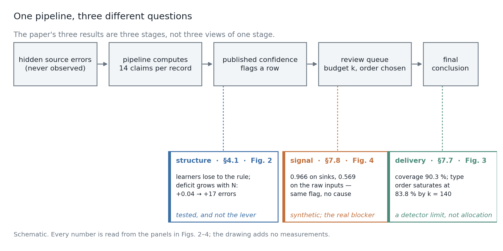
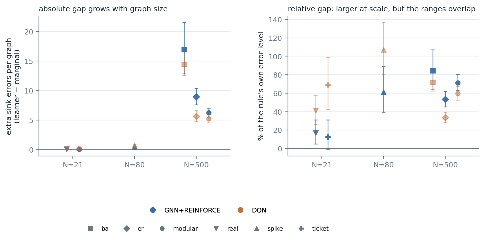
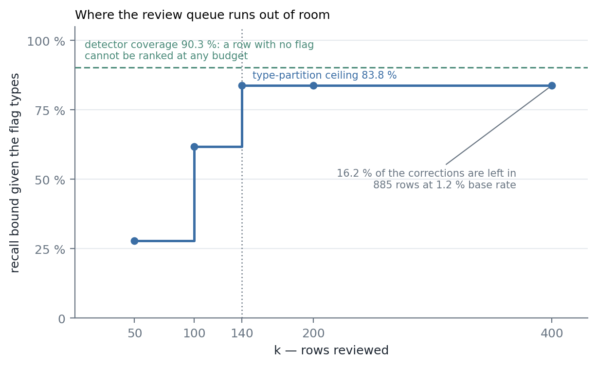
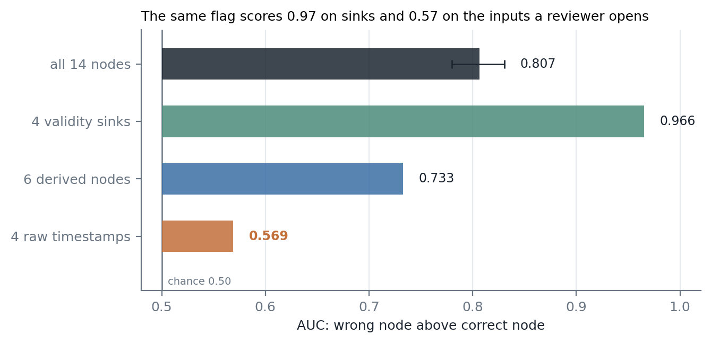

# 스케줄러가 아니라 신호

**의존하는 AI 출력의 예산 제약 검토: 벤치마크, 부정적 결과, 그리고 측정된 경계**

<b>언어:</b> <a href="https://cyracaid.github.io/rl-oversight-dag/PAPER_DRAFT.html">English</a> · <a href="https://cyracaid.github.io/rl-oversight-dag/PAPER_DRAFT_CN.html">中文</a> · <b>한국어</b>

초안 v0.1 · 2026-11-24 · 이 초안의 모든 수치는 커밋된 파일에서 추적 가능하고(부록 A),
그 안의 명령으로 재생성된다. 어떤 수치도 두 번째 사람이 검증하지 않았다 — 그 비용은 §9.3에 적었다.

---

## 초록

AI가 만든 값들이 서로 의존할 때, 그중 일부만 검토하는 사람은 *어느 것을 열지* 결정해야 한다.
우리는 이를 의존성 DAG 위의 예산 제약 노드 선택으로 형식화하고, 방법이 **눈에 띄게 실패하도록**
설계된 벤치마크를 만든다: 여섯 그래프 계열, 여덟 기준선, 동결된 시드 구간, 짝지은 구간.

학습 정책은 진다. 세 아키텍처(GNN+REINFORCE, DQN, PPO), 다섯 시드 구간, 10배 학습 예산이 모두
홀드아웃 그래프에서 한 단계 평균장 규칙(`marginal`)을 앞세운다 — PPO는 그래프당 +0.35~+0.47개,
10배 학습은 +0.262 [+0.165, +0.365]개이며 모든 구간이 0을 배제한다. 검토별 크레딧 할당은
*학습*을 개선하고(4.549 → 2.926개, 5/5 시드) 배포에서는 여전히 진다(결정론적 두 단계 규칙에
+0.180 [+0.021, +0.377]개). 두 진술은 동시에 참이다.

이어서 우리는 규칙과 오라클 사이의 남은 간격에 네 번의 사전등록 실험을 쓰고 모든 기계적 설명을
닫는다: 한 단계 가치가 아니다(−0.049 회수), 믿음의 확률 스케일도 아니다(978개 중 −1개),
지평도 아니다 — *규칙 자신의 모델 안에서* 정확한 다섯 단계 계획은 오라클까지의 5~7개 간격에 대해
0.030개어치다. 남는 것은 신뢰도 채널이 나르지 않는 **정보**다.

실데이터 연구가 그 이유를 설명한다. 1년치 수면일기 파이프라인에서 검토 큐는 측정 가능한
정보 상한을 가진다: 사람이 확인한 오류의 90.3 %만이 행을 표시하는 탐지기로 도달 가능하고,
유형만 쓰는 정책은 k = 140에서 큐의 83.8 %를 소진한다. 파이프라인 자체의 신뢰도 신호는
잘못된 *노드*와 올바른 노드를 통합 AUC 0.807로 구분한다 — 그러나 그 대부분은 자기 검사가
발동할 때만 틀리는 네 개의 타당성 싱크에서 나오고, 검토자가 실제로 열 네 개의 원시 타임스탬프에서는
0.569이며 올바른 원천이 1위로 오지 않는다(hit@1 = 0.003, 우연 0.071). 병목은 스케줄러가 아니라
관측이다. 네 결함 유형 중 셋은 검토보다 데이터 수집에서 고치는 편이 싸고, 하나는 검토로 고칠 수 없다.

---

## 1. 서론

이 설정은 흔하고 과소 명세되어 있다. 파이프라인은 다른 값에 의존하는 값을 내보낸다: 파싱된 날짜가
기간을 만들고, 기간이 비율을 만들고, 비율이 결론을 만든다. 어떤 값은 틀렸다. 검토자는 한정된 수의
값을 열 수 있고, 하나를 고치면 그것이 하류에 만든 오류가 사라진다.

자연스러운 본능은 검토자를 학습하는 것이다. 우리는 그 본능을 시험했고, 이 논문은 대부분 그것이
작동하지 않은 기록이며, 왜인지 설명하는 측정이다. 그 기록이 유용한 산출물이라고 본다. 실패가
튜닝 실패가 아니기 때문이다: 세 아키텍처, 다섯 개의 서로소 시드 구간, 10배 계산량, 더 나은 보상,
그리고 정확해(exact solver)를 모두 통과해 살아남는다.

**기여.**

1. **방법이 실패하는 모습을 보여줄 수 있는 벤치마크.** 여섯 계열(합성 넷 — N=80 하나, N=500 셋 —
   과 N=21 파이프라인 DAG 둘), "검토 없음"에서 진실을 읽는 참조점까지 여덟 기준선, 동결된 분할,
   한 번만 읽는 보고 구간. §3.
2. **메커니즘을 가진 부정적 구조 결과.** 배포 가능한 한 단계 평균장 규칙이 우리가 학습한 모든 정책을,
   모든 계열에서, 모든 학습 시드에서 이긴다. §4. 메커니즘은 옵티마이저가 아니다: 신뢰도 신호를
   파괴하는 소거가 어떤 스케줄링 변경이 회수하는 것보다 더 많이 든다. §5.
3. **규칙 자신의 간격에 대한 닫힌 회계.** 네 번의 사전등록 실험이 한 단계 가치, 믿음의 스케일,
   계획 지평을 제거한다 — 규칙 자신의 모델에 대한 정확한 동적계획을 포함해. §6.
4. **경계를 위치시키는 외적 타당성 연구, 상한 포함.** 실데이터에서 검토 가능한 모집단은 작고 큐는
   증명 가능한 정보 상한을 가진다; 신뢰도 신호는 원인 대신 결과를 가리킨다. §7.

**이 논문이 주장하지 않는 것.** RL이 사람 검토를 몇 퍼센트 줄인다는 것. 그 주장은 초기 파일럿 시드가
떠받쳤고 폐기되었다; 이 초안의 모든 수치는 실행 전에 동결된 구간에서 나온다. 오라클까지의 간격이
완전히 설명되었다고도 주장하지 않는다 — §6.4가 아직 열린 설명 하나를 지목한다.

---

## 2. 형식화

레코드는 DAG `G = (V, E)`이며, 원천(원시 필드), 파생 노드, 선언된 싱크로의 고정 분할을 가진다.
각 노드 `v`는 신뢰도 점수 `c_v ∈ [0,1]`를 공개한다. 정책에게 숨겨지는 것: 어느 노드가 *국소 원천
오류*를 갖는지, 그것을 전파하는 에지 "동전", 검토자의 균등 추출, 그리고 참 싱크 값.

전파는 단조롭다: `u`의 오류는 독립적인 에지 실패로 자손 `v`에 도달하므로, 하나의 원천이 틀린 값의
부분트리를 만든다. `v`를 검토하면 `v`의 국소 원천 오류가 `p_catch` 확률로 고쳐진다(동결된 스위트에서
0.9); 상속된 오류는 자기 원천이 고쳐질 때까지 남는다. 싱크는 각 교정 후 동일한 동전을 모든 정책에
공유해(공통 난수) 재계산되므로, 짝지은 차이는 정확하다.

정책은 매 단계 하나씩, 중복 없이 `B`개의 서로 다른 노드를 고르고, 남은 싱크 오류 수로 채점된다.
보상은 종단이며 `-sink_errors`다.

정책은 공개 상태만 관측한다: 노드 유형, 공개된 신뢰도, 정규화된 싱크 도달도, 원천 사후확률,
평균장 전파 오류 확률, 검토 플래그, 남은 예산, 기하. 이 제약이 비교를 의미 있게 만든다 —
진실을 읽는 정책은 *참조점*으로 포함되고 상한으로 쓰이지 않는다(§3.4).

*그림 1. 세 결과가 놓이는 자리. 도식일 뿐이다: 카드의 내용은 그림 2–4를 다시 말한 것이고,
여기서 새로 잰 것은 없다.*

---

## 3. 벤치마크

### 3.1 계열

| 계열 | n | 예산 | 싱크 | 역할 |
|---|---:|---:|---|---|
| `spike` | 80 | 16 | 마지막 층 (20) | 주 연구 |
| `modular` | 500 | 50 | 자식 없음 | 규모, 군집 구조 |
| `ba` | 500 | 50 | 자식 없음 | 규모, 허브 |
| `er` | 500 | 50 | 자식 없음 | 규모, 무작위 |
| `real` | 21 | 8 | 선언 4개 | 수면 파이프라인 위상 |
| `ticket` | 21 | 8 | 선언 4개 | 합성 티켓 사전확률 |

`n`과 `B`는 계열별로 동결된다: 다른 예산에서의 실행은 다른 벤치마크이며 그렇게 표기한다.

### 3.2 시드 규율

모든 실험은 첫 시드 전에 `PREREGISTER_*.md`에 명명된 구간을 소비하고, 보고 구간(90000–90099)은
한 번 읽혔다. 구간은 방법이나 임계값을 고른 순간 폐기된다. 4600–4799는 무효(스모크 실행만)이며
어디에서도 제외된다.

이는 표를 읽는 방식에 중요하다: 같은 정책이라도 구간마다 원평균이 다르다(확인 구간 A는 더 쉬운
집합이다: `marginal`이 1.130 → 0.885). 반면 *짝지은* 차이는 전이된다. 아래 모든 주장은 짝지은
차이로 진술된다.

### 3.3 기준선

여덟 층: 검토 없음; 무작위; 세 개의 정적 휴리스틱(신뢰도 최저, 허브, 신뢰도 × 싱크 도달도);
유형 사전확률 정책(해당 노드 유형의 최고 기저율); 그래프 인식 평균장 규칙 `marginal`; 진실을 읽는
참조점 `oracle`; 그리고 학습 정책(GNN+REINFORCE, DQN, PPO). `structural`(신뢰도 × 싱크 도달도)은
영향 가중 불확실성 샘플링의 외부 대리물이며, 새 기준선이 아니라 그렇게 명명된다.

유형 사전확률 층은 하중을 받는다: 신뢰도 점수를 버리고 `spike`에서 2.73개만큼 진다. 이것이
공개 점수가 실제 정보를 나르며, 그것을 제거하는 것이 중립적 소거가 아님을 보여준다.

### 3.4 참조점은 상한이 아니다

`oracle`은 진실을 읽는 `marginal`이다: 참 오류 상태를 알고 같은 한 단계 규칙을 돌린다. 참조점이지
최적값이 아니다. 실데이터 재생에서 탐욕적 오라클은 이틀 증거 규칙을 무시하는 학습 정책에 진다
(§7.6). 오라클이 탐욕적이기 때문에만 가능한 일이다.

### 3.5 상시 표

평균 잔여 싱크 오류, 계열당 100 그래프, 짝지은 구간:

| 계열 | `marginal` | `confidence` | `type_prior` | 참조점 | 여유분 |
|---|---:|---:|---:|---:|---:|
| `spike` | **0.66** | 1.03 | 3.76 | 0.52 | 0.14 |
| `modular` | **8.78** | 10.59 | 26.09 | 3.78 | 5.00 |
| `ba` | **20.13** | 29.65 | 67.76 | 13.28 | 6.85 |
| `er` | **16.76** | 21.75 | 37.60 | 9.84 | 6.92 |
| `real` | **0.47** | 0.50 | 1.79 | 0.39 | 0.08 |
| `ticket` | **0.29** | 0.32 | 0.90 | 0.28 | 0.01 |

`spike`에서 `confidence` 대비: `marginal` +0.37 [+0.20, +0.56], 21 승 / 77 무 / 2 패.

여유분 열이 다음 세 절의 논거 전부다: N=80에서 0.14, N=500에서 5~7이다. 그 오류를 만드는 것은
그래프 크기의 성질이지 정책의 행동 공간 성질이 아니다.

**표가 이미 담고 있는 경고.** `ba`에서 `confidence` 대비 평균 이득은 +9.52지만 분할은 39 승 / 16 무 /
45 패다. 평균과 승률은 다른 이야기를 한다; 어긋나는 곳마다 둘 다 보고한다.

---

## 4. 학습자는 진다

### 4.1 세 아키텍처

모두 동일 예산, 홀드아웃 그래프, 학습 시드 셋. Δ = 학습 − `marginal`이므로 양수가 나쁘다.

| 계열 | `marginal` | GNN Δ [95 % 구간] | DQN Δ [95 % 구간] |
|---|---:|---|---|
| `spike` | 0.66 | +0.403 [+0.260, +0.587] | +0.707 [+0.533, +0.903] |
| `real` | 0.47 | +0.080 [+0.023, +0.147] | +0.193 [+0.123, +0.270] |
| `ticket` | 0.29 | +0.037 [−0.003, +0.090] | +0.200 [+0.123, +0.287] |
| `modular` | 8.78 | +6.257 [+5.513, +7.057] | +5.227 [+4.553, +5.920] |
| `er` | 16.76 | +8.947 [+7.557, +10.393] | +5.633 [+4.733, +6.597] |
| `ba` | 20.13 | +16.970 [+12.817, +21.557] | +14.450 [+12.563, +16.730] |

36개 (계열, 학습자, 시드) 셀 모두 점추정이 양수다; 36개 중 34개 구간이 지는 쪽에서 0을 배제하고,
예외 둘은 동점(100 그래프 중 96~97개가 동일)이지 승리가 아니다.

간격은 **그래프 크기와 함께 커진다**: N=21에서 +0.04~+0.08, N=500에서 +5.2~+17.0. 이 순서는
순수 표본 크기 설명에 반하는 증거다. 큰 계열은 에피소드당 *더 많은* 노드를 주지 더 적게 주지 않는다.
메커니즘과는 일관된다: 관측은 노드별 신뢰도와 국소 기하를 나르고, `marginal`을 `oracle`과 가르는
다중 홉 전파는 종단 보상만으로 다시 유도해야 한다. 우리는 이 메커니즘을 이 데이터가 대안과
분리하지 못하는 가설로 진술한다.

규칙 자신의 오류 수준으로 나누면 같은 차이는 N=21에서 13–69 %, N=80에서 61–107 %, N=500에서
34–84 %다: 규모가 클수록 크지만 구간이 서로 겹친다. 그래서 우리가 쓰는 더 날카로운 진술은 절대 순서다.

*그림 2. 적자는 학습자가 아니라 그래프 크기를 따라간다. 진한 표식은 GNN 집계, 옅은 표식은 DQN이며,
수염은 100개 그래프에 대한 짝지은 구간이다. 오른쪽 패널은 같은 차이를 규칙 자신의 오류 수준으로 나눈
것이다 — 규모가 클수록 크지만 크기 사이에서 구간이 겹치며, §4.1이 절대값 형태로 진술하는 이유다.*

10배 학습 예산은 같은 설명을 반대편에서 시험한다. N=80 확인 구간에서 천 번 대신 만 번의 에피소드는
GNN을 1.185 / 1.325 / 1.275에서 1.155 / 1.140 / 1.145로 옮기고, `marginal`은 0.885에 그대로다:
짝지은 간격이 +0.377에서 **+0.262 [+0.165, +0.365]**로 좁아지고 시드 산포가 붕괴한다. 계산량을
늘리면 결손이 줄지만 사라지지 않는다 — 빠진 항이 최적화가 아니라 정보라면 기대할 거동이다.

### 4.2 아무도 읽지 않은 구간에서의 PPO

공정한 반론은 REINFORCE와 DQN이 틀린 옵티마이저라는 것이다. 모든 초모수는 구현이 존재하기 전에
구간 4200–4399에서 동결되었다.

| 시드 | PPO | `marginal` | Δ [95 % 구간] | 승/무/패 |
|---|---:|---:|---|---|
| s1 | 1.225 | 0.875 | +0.350 [+0.230, +0.480] | 2/160/38 |
| s2 | 1.335 | 0.875 | +0.460 [+0.335, +0.600] | 3/138/59 |
| s3 | 1.340 | 0.875 | +0.465 [+0.325, +0.620] | 2/148/50 |

세 시드 모두 양수, 모든 구간이 0을 배제한다. 사전등록된 크기 예측은 PPO가 `marginal`과 REINFORCE
GNN *사이*에 놓인다는 것이었다; 실제로는 REINFORCE 수준이거나 약간 너머에 놓였다. 그 예측은
빗나간 것으로 보고된다.

### 4.3 배포되지 않는 더 나은 보상

검토별 크레딧 할당은 에피소드 수준 수익을 단계별 배분으로 바꾼다. 작동하며, 도움이 되지 않는다:

| 주장 | 증거 | 판정 |
|---|---|---|
| 보상 변경이 학습된 모델을 개선한다 | 4.549 → 2.926개, −1.623 [−2.136, −1.033], 5/5 시드 | 지지됨 |
| 개선된 모델이 배포에서 이긴다 | 2.945 대 두 단계 규칙 2.765, 규칙이 0.180 [0.021, 0.377] 앞섬 | 반증됨 |

둘 다 동시에 참이며, 둘 중 하나만 보고하는 요약은 틀렸다. 이것이 이 절 주장의 가장 날카로운 형태다:
학습 신호는 우리가 개선할 수 있었던 부분이었고, 개선하는 것이 배포 수치를 **틀린 방향으로** 옮겼다.

---

## 5. 여유분의 위치

학습자가 문제가 아니라면 무엇인가? 같은 환경에서의 두 소거가 직접 답한다.

**신호를 파괴한다.** 같은 GNN을 신뢰도 점수를 균등 잡음으로 바꿔 학습: 3.78개(시드별 3.30 / 5.20 /
2.85)로, 정적 임계값(같은 라인에서 2.30)보다 나쁘다. 쓸 만한 신호 없는 학습 정책은 한 줄 규칙보다 나쁘다.

**신호를 완벽하게 한다.** 같은 학습자에게 참 오류를 드러내는 신뢰도 점수를 준다: 0.72(0.80 / 0.70 /
0.65)로, 손상 없는 1.38(1.30 / 1.95 / 0.90)과 비교된다.

> 이 두 행은 동결된 `role3 improvement/` 라인이 아니라 `experiments/` 복제 라인에서 온 것이므로,
> 원값을 §3.5와 비교할 수 없다. 절이 주장하는 것은 *방향*이며, 그것은 두 라인 모두에서 재현된다.

따라서 남은 오류에서 스케줄러의 몫은 작고 신뢰도 모델의 몫은 크다. 이후의 모든 것은 같은 질문을
더 어려운 설정에서 묻는다: **규칙의 모델이 틀렸을 때, 정책은 그것을 알 수 있는가?**

### 5.1 신호 신뢰에 대한 다섯 번의 사전등록 단계

각 단계는 결정 변수를 새로운 곳으로 옮겼고, 이전 실행이 쓰지 않은 그래프에서, 판정은 코드가 계산했다.

| 단계 | 구간 | 판정 | 측정된 효과 |
|---|---|---|---|
| 전역 게이트 | 3000–3199 | 경계 측정됨 | 무해한 −1 이동: 195/200 발동, **+1.82**개; 가려진 +3: 0/200, **+3.21** |
| 게이트 수리 (`verify`) | 3200–3399 | **실패** | −1에서 −0.015이나, 발동한 13개 셀 중 5개가 신뢰보다 나쁨 |
| 노드별 (`shrink`) | 3400–3599 | 성공 | −1에서 +0.105; 오류가 가려진 곳에서 **−0.370**; 무해한 전역 +2 / +3에서 +0.45 / +0.72 |
| 그래프별 (`scope`) | 3600–3799 | 성공 | +3에서 +0.005, 노드별은 +0.81 비용; 112셀 평균 1.303 → **1.203**; −4에서 깨끗한 오라클로 복귀(0.94 대 3.86) |
| 경계 | 3800–3899 | **부분** | 격자 밖 δ 유지(평균 \|δ 오차\| 0.174; 12/12 셀이 노드별을 이김); 동시 두 δ 붕괴(−0.016; 신뢰 2.15 / 노드별 1.89 / 그래프별 1.87) |

좁고 측정된 주장: 검토 16회로 정책은 자기 신뢰도 점수가 쓸 만한지 추정할 수 있고, 아닐 때 안전할 수
있다. 결정 변수는 "어느 노드가 움직였나"라는 질문에서는 노드에, "전부 움직였나"라는 질문에서는
그래프에 속한다. 두 층이 서로 다른 양만큼 움직이면 단일 δ 계열 둘 다 평범한 신뢰로 후퇴한다 —
그리고 그것은 승리가 아니라 *미해결*로 보고된다.

### 5.2 거꾸로 나온 예측

위의 모든 실행은 검토자가 연 오류의 90 %를 잡는다고 가정했다. `p_catch`를 0.60 / 0.75 / 0.90 / 1.00으로
훑어도(구간 4000–4199) 방향은 유지되었고 — 규칙이 네 셀 모두에서 신뢰도 순서를 이긴다,
+0.255 [+0.150, +0.375]에서 +0.530 [+0.370, +0.705] — 사전등록된 크기 예측은 **뒤집혔다**:
검토자가 *더* 신뢰할수록 격차가 커진다. 참조점도 같은 방향으로 움직이므로(+0.355 → +0.820)
규칙이 좋아진 것이 아니라 환경이 수축한 것이다. 동결된 판정은 `inverted`이며 실패한 예측으로 보고된다.

---

## 6. 규칙 자신의 모델 안의 상한

`marginal`은 N=500에서 참조점에 그래프당 5~7개를 잃는다. 설명 셋이 가능했다; 셋 모두 동결되어 새
구간에서 측정되었고, 셋째는 근사가 아니라 정확히 풀렸다.

**6.1 한 단계 가치는 문제가 아니다.** 평균장 점수는 열린 경로가 둘인 원천 오류를 이중 계산한다.
평균장 상위 16개를 샘플링한 짝지은 반사실 이득(256 입자, 구간 4400–4599)으로 재순위하면 회수
−0.049 [−0.087, −0.015]: 200개 그래프 중 45개에서 행동을 바꾸었고 그중 30개를 잃었다. 후보 목록
*안에서* 더 잘 채점하는 것은 회수하는 것보다 더 든다.

**6.2 믿음의 숫자는 문제가 아니다.** 믿음의 순위를 비트 단위로 고정하고 값만
`q = sigmoid(γ · logit(b))`로 왜곡하면(4800–4999) modular에서 `policy-bound`: 최선 셀(γ = 1.25)은
+0.016 [−0.055, +0.072]으로, 46개 그래프 승, 12개 패, 집계를 **978개 중 −1개** 움직인다. γ = 0.5는
1.49개를 잃는다. `spike`에서 라벨은 `calibration-partial`이나 **49개 중 0개**를 닫는다.

**6.3 지평은 문제가 아니다.** 같은 평균장 모델 위의 깊이 2 계획, 공개 입력만(5200–5399):
잡기만 하는 변형은 200개 modular 행동 중 191개를 그대로 두고 923개 중 −5개를 닫으며, 회수는
−0.009 [−0.023, +0.001]. 두 분기 변형은 한 자릿수 나쁘다(−0.833 [−1.071, −0.621]; 923개 중 485개
손실). 환경의 미스 갱신이 휴리스틱이기 때문이다: 계획자는 "이 노드는 아마 놓칠 것이니 믿음이
떨어지겠지"를 개선으로 읽는다. 그것은 계획이 아니라 갱신에 대한 진술이다.

**6.4 정확한 최적해도 동의한다.** 규칙 자신의 믿음 모델에 대한 동적계획(구간 5000–5023, 다섯 예측을
먼저 동결)은 `dp − marginal` = `real`에서 −0.030 [−0.065, −0.008](규칙 잔차의 4.2 %), `ticket`에서
−0.002이며, 간격은 5~7개다.
계획 가치는 준선형(비율 1.81)이고, `dp₃`는 1e-9까지 완전 탐욕과 같으며, 포화 검정은 두 계열 모두에서
성립한다. 첫 실행은 모델 선택 구간 60000–60023에 있었고, 민감도 대조로만 남기며 어떤 판정도 바꾸지
않는다(`outputs/dp-ceiling-fresh/AMENDMENT.md`).

따라서 간격은 전망도, 한 단계 가치도, 확률 스케일도 아니다. 남는 것은 **신뢰도 채널이 나르지 않는
정보**다. 아직 시험되지 않은 설명 하나는 공개 점수보다 많은 정보를 가진 믿음이며, 그것이 무언가를
닫는다고 주장하지 않는다.

한 가지 정정은 각주가 아니라 이 절에 속한다. 계획 예측은 원래 *부호* 비교 `dp − greedy ≤ 0.02`로
검정되었고, 이는 어떤 이득에도 통과한다. 이제 사전등록 자체가 고정한 반증 경계에 대해 크기를 검정한다.
정정된 판정은 더 약하며, 깨끗한 블록으로 옮기면 더 약해진다(`holds — nominal 0.02 missed by
0.0083`, 첫 실행의 0.0019보다 네 배 크고, 사전등록이 반증용으로 고정한 0.05 안에는 여전히 있다).
수정안 둘 다 결과 옆에 커밋되어 있다.
자기 결과를 반증에 더 가깝게 제출하는 사후 편집은 답에 쓴 자유도가 아니다; 부호 검정을 그대로 두는
것이 자유도를 쓰는 일이었을 것이다.

**상한이 정확히 무엇인지.** DP는 POMDP의 최적이 아니라 *규칙이 최적화하는 평균장 모델*의 최적이며,
노드 국소 미스 갱신을 쓴다(원천 노드에서 동일). 따라서 "최적보다 0.030 짧다"는 우리 자신의 근사 안에서
최적보다 짧다는 뜻이다. 더 나은 모델은 상한을 옮길 수 있다; 그것이 열린 칸이다.

### 6.5 배포물이 자기 커버리지에 대해 말할 수 있는 것

남은 오류 수만 보고하는 정책은 검토자가 확인할 수 없는 주장을 건넨다. 사전등록된 *영수증*(receipt)
축(구간 5400–5599)은 더 좁은 질문을 한다: 아직 틀린 모든 싱크에 대해, 그 싱크가 `partial`(상류 원천
일부 검토됨)인지 `untouched`(전혀 아님)인지 정책이 말할 수 있는가? *선언 비율*을 두 라벨 중 하나를
가진 잔존 싱크 오류의 비율이라 하자. 여집합은 모든 상류 원천이 검토되었는데도 잡기 굴림이 놓친
싱크에 있다.

| 계열 | 정책 | 그래프당 오류 | 잔존 싱크 오류 | 선언됨 | 거짓 검토됨 | 선언 비율 |
|---|---|---:|---:|---:|---:|---:|
| `spike` | `marginal` | 0.965 | 193 | 188 | 5 | **0.974** |
| `spike` | `oracle` | 0.725 | 145 | 124 | 21 | 0.855 |
| `modular` | `marginal` | 8.835 | 1767 | 1587 | 180 | 0.898 |
| `modular` | `oracle` | 3.895 | 779 | 663 | 116 | 0.851 |
| `real` | `marginal` | 0.450 | 90 | 88 | 2 | **0.978** |
| `real` | `oracle` | 0.365 | 73 | 57 | 16 | 0.781 |
| `ticket` | `marginal` | 0.275 | 55 | 46 | 9 | 0.836 |
| `ticket` | `oracle` | 0.245 | 49 | 29 | 20 | 0.592 |

다섯 예측을 먼저 동결했다. 셋이 성립한다: 영수증은 어떤 행동도 바꾸지 않고(불일치 0회), 충실도는
모든 곳에서 1.000이며, 모든 계열에 거짓 검토된 싱크가 최소 하나 있다. 둘은 정보를 나른다. 오라클의
선언 비율은 `modular`에서 규칙보다 *낮다*(0.851 대 0.898). 더 나은 정책은 오류를 더 적게 남기고,
그중 더 많은 비율이 잡기 실패 버킷에 있기 때문이다. 그리고 실패한 예측 하나는 0.002만큼 실패했다:
`modular`는 ≥ 0.90으로 예측되었고 0.898(1767 중 1587)로 나왔다. 임계값은 이후에 움직이지 않았다.

그 부족분이 결과다. `modular`에서 잔존 오류의 10.2 %가 모든 상류 원천이 검토된 싱크에 있고,
오라클 아래에서 같은 버킷은 14.9 %다. 더 많이 검토한다고 영수증이 더 진실해지지 않는다.
`p_catch = 0.9`는 "검토됨"이 "깨끗함"일 수 없음을 뜻하기 때문이다. 커버리지만 보고하는 배포물은
많이 검토할수록 자기 자신을 *더* 과장한다 — 영수증이 섬기려는 직관과 반대이며, 이 수치를 통과로
반올림하지 않고 실패한 예측으로 보고하는 이유다.

삭제 검정은 진술을 정책에서 분리한다. 세 갈래가 동일한 정책을 동일한 에피소드에서 돌리고 오직
배포물이 말하는 것만 다르다: 정직한 영수증, 질문에 대한 필드가 없는 `silent` 갈래, 그래도 답하는
`overclaim` 갈래. `silent`의 열은 비어 있다. 그곳에서는 질문에 답이 없는 것이지 틀린 답이 있는 것이
아니다. `overclaim`은 모든 셀에서 잔존 오류 수만큼 정확히 틀린다. 오류의 개수와 *덮이지 않은* 오류의
개수를 가르는 것은 스케줄러가 아니라 보고 필드다.

범위를 밝힌다. 이것이 보정으로 읽히지 않도록: 영수증은 범위에 대한 것이고 진실에 대한 것이 아니다;
에스컬레이션 정책은 사전등록되지 않았고(`judged`는 모든 행에서 1.0); 예산이 도달할 수 없는 싱크는
`untouched`가 보고하는 바로 그것이다. 마지막은 영수증의 결함이 아니라 예산에 대한 발견이다.

---

## 7. 실데이터: 경계, 그리고 신호가 원인을 가리킬 수 없는 이유

벤치마크는 합성이다. 논문의 나머지는 외적 타당성 연구이며, 운영 정의에서 DAG를 인코딩한 1년치
수면일기 파이프라인에서 돌았다(노드 21개, 선언된 싱크 4개). 표본이 작은 곳은 *파일럿*으로 표기하고,
전부 집계만 쓴다.

### 7.1 모집단

일일 레코드 13,990개, 참가자 237명, 사용 가능한 밤 2,652개. 사람이 확인한 교정 75건, 레코드의
0.54 %. 결함은 유형별로 군집한다: 75건 중 57건(76 %)이 순서 오류이고, 라벨 없는 8행과 긴 꼬리가 있다.

### 7.2 레코드 안에는 스케줄링 문제가 거의 없다

타임스탬프 네 개가 모두 완전한 교정 53건(22건 제외), 참가자 36명을 DAG의 14노드 축소 위에서 재생:

- 재생은 교정 파일 자체의 파생 열에 대해 검증된다, 0.02 h 이내 **159/159 셀**;
- 교정된 레코드는 평균 **14개 중 5.92개** 노드가 틀렸고, 원천 결함이 정확히 하나인 37개 레코드에서
  그 결함은 **결론 4개 중 1.84개**를 든다;
- 근본원인 검토자로 **검토 두 번이 레코드를 정리한다**(잔차 0.08)므로, 21개 중 8개라는 운영 예산은
  과제가 필요한 양의 4~8배다;
- 구조는 예산 1에서만 값을 한다(0.19 대 임계값 0.42) 그리고 예산 2에서 사라진다.

이것이 벤치마크 전제가 실패하는 첫 지점이다: 그래프가 작아서 순서가 착취할 것이 거의 없다.

### 7.3 레코드 사이에서는 나쁜 밤 하나가 희석된다 — 그리고 QC 규칙은 이미 있다

참가자당 결론 넷, 하룻밤 예산으로: 검토 없음 0.582, 무작위 0.524, 극값 0.472,
**파이프라인의 기존 QC 플래그 0.014**, 참조점 0.000. 가시적 오염은 QC 규칙이 **99.8 %** 잡고,
조용한 오염은 2.9 %다.

적응적인 무엇이든 무작위가 아니라 0.014를 이겨야 한다. 진짜 위험은 계통 편향이다: 참가자 밤의
25 %를 오염시키면 80.7 %의 참가자에서 결론이 바뀌고, 50 %는 94.0 %를 바꾼다.

### 7.4 검토 단위도 병목이 아니다

196명 참가자, 2,372밤에 대한 블록 검토 MDP, 예산은 읽는 밤 수, 짝지은 시드 20개:

| 오염 | 예산 | 없음 | 밤별 QC | block3 QC | 참조점 |
|---|---|---:|---:|---:|---:|
| 가시적 ±12 h | 2 | 1.73 | 0.20 | **0.15** | 0.16 |
| 가시적 ±12 h | 4 | 1.73 | **0.00** | 0.00 | 0.00 |
| 조용한 90분 | 2 | 0.23 | 0.18 | 0.13 | 0.09 |

블록 이점은 **연속 구간 길이보다 작은 예산 효과**이지 구조적 이점이 아니다: 예산 4에서 밤별 규칙이
그것을 앞서거나 동률이 된다. 예산 2 행만 보고하면 참인 수치로 거짓 문장을 지지했을 것이다.

### 7.5 네 결함 유형 중 셋은 검토 전에 고치는 편이 싸다

| 결함 | 유병률 | 검토로 고칠 수 있나? |
|---|---|---|
| 모든 밤에서 WASO = 0 | 7개 레코드, 3.6 % (82밤) | **아니오** — 밤 자체는 잘 형성됨 |
| WASO = 0을 보고하는 밤 | 933밤, 39.3 % | 아니오; 0 비율을 보고하라 |
| 연속 3밤 이상 WASO = 0 | 88개 레코드, 44.9 % 대 순열 귀무가설 아래 **기대 69.3** | 아니오; 초과분은 약 18개 레코드 |
| ±12 h 이동 하나가 순서 위반 밤을 고침 | 20개 레코드, 10.2 % | **아니오** — 검증 규칙이다 |
| 커버리지 (밤 / 기간) | 중앙값 91.7 %, 21.4 %가 0.8 미만 | 아니오; 분모를 보고하라 |

44.9 % 연속 실행 수치가 경고 사례다: 밤의 39 %가 0이면 3밤 연속은 우연히 35.4 % 발생하므로,
그것에 발동하는 규칙은 자기 귀무가설을 달지 않는 한 약 3분의 2에서 틀린다.

이것이 "검토 가능한 모집단은 잔차다"의 구체적 의미다.

### 7.6 학습 가능한 것은 밤 사이 점수다

관측 가능한 11개 창 특징에 대한 로지스틱 모델, 학습 118 / 홀드아웃 78 참가자는 가시적 계열
(QC 규칙이 이미 이기는 곳)에서 손수 만든 점수와 대등하고, 조용한 계열에서 밤별 규칙을 1.5~2.9배
이긴다(예산 2에서 WASO→0: 0.014 대 0.039). 홀드아웃 AUC 0.991 / 0.816 / 0.840.

같은 실험은 참조점이 상한이 아닌 이유도 보여준다: WASO 계열에서 학습 정책은 탐욕적 오라클을 이긴다.
오라클이 이틀 증거 요건을 무시하기 때문이다.

### 7.7 큐에는 증명 가능한 상한이 있다

같은 파이프라인의 행 수준 검토 큐(참가자 203명, 사람이 확인한 양성 68건):

- **커버리지.** 스케줄러는 탐지기가 표시한 행만 순위 매길 수 있다. 교정 72건 중 65건이 큐에 있고
  (90.3 %), 더 넓은 라벨 집합에서는 85건 중 68건(80.0 %)이다. 무한 예산도 이를 넘을 수 없다.
  빠진 부분은 검토 배분 문제가 아니라 *탐지기* 문제다.
- **유형 정보.** 플래그 유형 안에서 행은 교환 가능하므로, 유형만 쓰는 정책이 할 수 있는 최선은
  양성률이 높은 순서로 집단을 취하는 것이다. 그 상한은 k = 50에서 27.9 %, k = 100에서 61.8 %,
  **k = 140에서 83.8 %**이며 여기서 포화한다: 남은 오류 16.2 %가 양성률 1.2 %인 885행에 있다.

*그림 3. 큐가 여유를 잃는 지점. 점선은 탐지기의 커버리지다 — 행이 표시되지 않아 어떤 예산에서도
순위를 매길 수 없는 교정이다. 표시된 모집단 안에서 기저율 순으로 플래그 유형을 통째로 취하면
포화한다, 남는 것이 1.2 %짜리 한 덩어리이기 때문이다. 포화점 이후 곡선이 평평한 것은 측정이 아니라
구성상 그렇다.*
- **검정력.** 양성 68건으로 이 큐는 약 10퍼센트포인트 미만의 차이를 해상할 수 없다; 두 후보 순서는
  +7.3 % [−8.9 %, +12.8 %]만큼 다르다. 이긴 행이 아니라 구간을 보고한다.

그럴듯한 탈출 셋을 시험했고 셋 다 실패했다: 유형 내 특징(AUC 0.467, 순열 p = 0.53), 최선 단변량
규칙(AUC 0.78이나 precision @100 = 3 %), 참가자 수준 순위(AUC 0.868, k = 400에서 짝지은
Δ +7.3 % [−8.6 %, +10.0 %]). 큐의 기저율은 6.5 %다.

살아남은 탈출 하나는 **회수가 아니라 비용**에 관한 것이다: 규칙의 증인은 충돌하는 두 타임스탬프를
지목하므로 큐레이터는 4개 대신 2개 필드를 읽는다 — 교정된 필드의 96.6 %가 증인 쌍 안에 있고 읽기
비용은 절반이다. 시간 예산 아래에서 이것은 순서 블록의 값을 절반으로 만든다. 83.8 % 상한을 올리지는
않는다.

같은 보고 질문의 큐 수준 판본이 §6.5다: 거기서 배포물은 자기가 *덮지 못한* 것을 선언하며,
보증할 수 없는 오류 버킷은 정책이 더 많이 검토할수록 더 커진다.

### 7.8 신뢰도 신호는 원인이 아니라 결과를 가리킨다

§3이 남긴 보정 간격은 데이터 간격으로 설명되었다: 사람이 감사한 라벨로 오류 모델을 적합하면 상수가
발명되지 않는다. 그것은 절반만 참이며, 틀린 절반이 논문이 필요로 하는 절반이다.

교정 파일은 전부 양성이라 레코드 수준 보정은 여전히 막혀 있다. 그러나 레코드 안에서는 올바른 노드가
음성이므로, 파이프라인 자체의 신호가 틀린 노드를 올바른 노드보다 위에 두는지 물을 수 있다. 재생된
53개 레코드에서, 여기 다른 모든 실데이터 수치가 기대는 바로 그 플래그 규칙을 써서:

| 측정 대상 | 값 | 우연 |
|---|---|---|
| AUC, 14개 노드 전체 (틀림 대 올바름) | 0.807 [0.780, 0.831] | 0.50 |
| AUC, 타당성 싱크 4개 | 0.966 | 0.50 |
| AUC, 파생 노드 6개 | 0.733 | 0.50 |
| **AUC, 원시 타임스탬프 4개** | **0.569** | 0.50 |
| 원천의 국소화 hit@1 / hit@3 | 0.003 / 0.045 | 0.071 / 0.214 |
| 원천의 평균 순위 (14개 중) | 6.4–6.7 | 7.5 |

통합 0.81은 규칙이 오류의 *결과*를 다시 읽은 것이다: 타당성 싱크의 값은 그것을 먹이는 검사가 발동할
때 정확히 틀리므로, 같은 사실이 두 번 세어진다. 검토자가 실제로 열 네 개의 원시 타임스탬프에서는
우연 수준이다. 최상위 노드는 53개 레코드 중 51개에서 `SE_conclusion`인데, 잎 점수가 *자손에 대한
평균*으로 정의되기 때문이다: 설계상 원인은 자기 결과를 앞지를 수 없다.

*그림 4. 하나의 플래그 규칙, 두 번 채점. 통합 AUC 0.807은 타당성 싱크(0.966)가 나른다 — 그 값은
그것을 먹이는 검사가 발동할 때 정확히 틀린다. 검토자가 실제로 열 네 개의 원시 타임스탬프에서는 같은
규칙이 우연 수준(0.569)이다. 신호는 결과를 순위 매기고, 검토자의 입력은 원인이다.*

같은 규칙의 연속 버전(플래그 대신 임계값 초과 시간)은 고치지 못한다: AUC는 0.653으로 떨어지고
hit@1은 0.003에 머물며, 평균 순위는 4.2로, hit@3은 0.25로 개선된다.

**결과.** 감사된 올바른 행이 더 많으면 `P(레코드가 나쁘다)`를 적합할 수 있다; 그것으로
`P(노드 i가 원인이다)`가 결과 점수화된 신호에서 식별 가능해지지는 않는다. 구속 제약은 표본 크기가
아니라 관측의 *방향*이다. 답을 바꿀 것은 원시 타임스탬프에 대한 직접 증거 — 수집 측 QC 점수, 또는
두 번째 독자의 독립 판단 — 이며, 수출본에는 없다.

---

## 8. 관련 연구

**능동 및 불확실성 샘플링.** 기준선 행렬의 정적 층(신뢰도 × 싱크 도달도)은 데이터 정리 문헌의
영향 가중 불확실성 샘플링이며, 우리는 그것을 기여가 아니라 외부 대리물로 명명한다. 차이는 한 노드를
고치면 자손의 값이 바뀐다는 것이므로, 보상이 라벨 개수가 아니라 그래프 범함수다.

**생성 출력의 검토.** 모델 출력에 대한 사람 감독 연구는 보통 *토큰*이나 *항목*에 예산을 준다;
우리의 단위는 유형이 있는 의존성 그래프의 노드이므로 예산이 전파와 상호작용한다. 그 상호작용이
한 단계 평균장 규칙이 경쟁력을 갖는 이유다.

**믿음 공간 제어와 능동 지각.** `marginal`은 평균장 믿음에서의 한 단계 전망이고, §6.4의 DP 상한은
같은 믿음 MDP의 정확한 해다. 그 모델 위의 정확한 계획이 0.030개어치라는 결과는 계획자가 아니라
모델에 대한 진술이며, 남은 간격을 정보 문제로 틀지어 말하는 이유다.

**큐 수준 트리아지.** §7.7의 커버리지와 유형 분할 상한은 재현율 상한의 큐 수준 유사물이다:
탐지기 출력이 고정되면 정책의 도달 집합이 고정되고, 달성 가능한 재현율은 순서가 아니라 플래그
분할의 성질이다.

---

## 9. 논의

### 9.1 대신 무엇을 할 것인가

측정들은 하나의 권고로 수렴하며, 그것은 스케줄러가 아니다. 수집을 고쳐라: 24시간 시간 입력,
각성 기록 여부를 묻는 접수 질문, 모든 평균 옆에 인쇄되는 커버리지 분모. 이것들은 §7.5의 네 결함
유형 중 셋을 제거하며 어떤 정책보다 싸다.

§6.5는 같은 권고에 수치를 붙인 것이다: 남은 오류의 *개수*만이 아니라 덮지 못한 것이 무엇인지
진술하는 배포물은 반증 불가능한 개수를 확인 가능한 개수로 바꾸고, 가장 많이 검토했을 때 정확히
자기 과장을 멈춘다.

### 9.2 방법을 쓰지 말아야 할 때

- 파이프라인이 검토 두 번으로 레코드가 정리될 만큼 작을 때(§7.2).
- 기존 결정론적 규칙이 이미 참조점의 0.014 이내에 있을 때(§7.3).
- 결함이 관례나 누락 필드일 때(§7.5).
- 탐지기의 커버리지 상한이 구속 수치일 때(§7.7).

각 경우에서 학습 스케줄러는 이미 상류에서 해결된 문제에 적용된 진짜 방법이다.

### 9.3 타당성 위협

* **두 번째 검증자 없음.** 모든 수치는 AI 에이전트가 커밋된 코드와 CSV에서 생산했고, 어떤 것도
  사람이 독립적으로 다시 유도하지 않았다. 저장소는 *문서* 표류는 막지만(공개 수치가 산출물과
  어긋나면 테스트가 실패한다) 공유된 오독은 막지 못한다.
* **참조점은 탐욕적이다**, 따라서 "규칙이 오라클에 5~7개를 잃는다"는 최적이 아니라 휴리스틱까지의
  간격을 잰다. §6.4가 상한에 가장 가깝고, 그것은 규칙 자신의 모델을 제한한다.
* **실데이터 재생은 파일럿이다.** 교정 75건 중 53건이 재생된다; 사용 가능한 밤 13개로는 교정 군집
  검정이 무력하므로, 블록 가설을 지지하지도 반박하지도 않는다.
* **큐 연구는 행 수준**이지 그래프 수준이 아니다; 그 상한은 탐지기에 대한 것이고 DAG 형식화로는
  관측에 대한 진술로만 전이된다.
* **사후 수정 하나**(§6.4)와 **탐색적 관측 하나**(§7.8, 연속 심각도)는 해당 위치에 그렇게 표기된다.

### 9.4 무엇이 우리를 바꿀까

한 번만 읽는 구간에서 이기는 학습 정책; 정보량이 공개 점수를 넘어 5~7개 간격의 일부를 닫는 믿음;
결함이 진짜로 하류 의존적이며 검토가 가장 싼 수정인 만큼 드문 도메인. 이 논문이 어느 것도 배제하지
않는다. 배제하는 것은 오류가 사는 곳이 스케줄러라는 주장이다.

---

## 10. 재현성

- 동결 환경 `role3-env-v3`, 정본 측정은 `role2_규리/results/` 아래, 벤치마크 명세와 상시 표는
  `BENCHMARK_SPEC.md`에 있다.
- 모든 사전등록은 첫 시드 전에 명명된 커밋된 파일이다; 저장소의 시드 원장이 각 실험이 어느 구간을
  썼는지 기록한다.
- 테스트: `role3 improvement` 78개 통과, `role2_규리` 4개, 그리고 `experiments/` 아래 20개 테스트
  파일을 손으로 실행한다. 공개 수치가 산출물과 어긋나면 실패하는 문서 표류 가드를 포함한다.
- 실제 참가자 데이터는 저장소에 들어오지 않는다. 집계와 적합된 JSON만 커밋되고, 원본 수출본과
  교정 파일은 로컬에 남는다.

---

## 부록 A — 모든 수치와 그 출처 파일

| § | 수치 | 산출물 |
|---|---|---|
| 3.5 | 상시 표, 여유분 | `BENCHMARK_SPEC.md` §6, `outputs/v3-baselines/benchmark_summary.csv` |
| 3.5 | `ba` 39 승 / 16 무 / 45 패 | 같은 파일 |
| 4.1 | 학습 대 `marginal`, 36셀 | `outputs/v3-learned/learned_vs_marginal.md` |
| 4.2 | PPO 세 시드 | `outputs/ppo-v1/`, `PREREGISTER_PPO.md` |
| 4.3 | 크레딧 할당 4.549 → 2.926; 배포 +0.180 | `role2_규리/results/credit-v1/` |
| 5 | 소거 3.78 / 1.38 / 0.72 | `experiments/results.md` §7 (복제 라인) |
| 5.1 | 다섯 신뢰 단계 | `experiments/results.md` §3–4, `PREREGISTER_*`, 구간 3000–3899 |
| 5.2 | `p_catch` 훑기, 판정 `inverted` | `PREREGISTER_P_CATCH.md`, 구간 4000–4199 |
| 6.1–6.2 | 반사실 가치, 믿음 재스케일 | 구간 4400–4599, 4800–4999 |
| 6.3 | 깊이 2 계획 | `PREREGISTER_PLANNING_V2.md`, 구간 5200–5399 |
| 6.4 | DP 상한, P1–P5, 수정안 | `role3 improvement/outputs/dp-ceiling-fresh/{report,AMENDMENT}.md` |
| 6.5 | 영수증 표, 0.898 대 0.90, 10.2 / 14.9 % | `role3 improvement/outputs/supervisor-v1/receipt_vs_silent.md` |
| 7.1–7.2 | 13,990 / 237; 재생 53; 159/159 | `experiments/replay_manual_corrections.py`, `runs/replay-manual-corrections/` |
| 7.3 | 레코드 간 재생, 99.8 % / 2.9 % | `experiments/cross_record_replay.py`, `runs/cross-record-replay/` |
| 7.4 | 블록 검토 MDP | `runs/block-review-mdp/`, `BLOCK_REVIEW_NOTE.md` |
| 7.5 | 수집 검사 | `experiments/capture_checks.py`, `CAPTURE_CHECKS_INTERPRETATION.md` |
| 7.6 | 학습 창 채점기, AUC 0.991/0.816/0.840 | `runs/learned-window-scorer/` |
| 7.7 | 커버리지 / 유형 상한 / 검정력 | `triage_bench/CEILING.md`, `triage_bench/outputs/ceiling.json` |
| 7.8 | 국소화 AUC 0.807 / 0.569, hit@1 0.003 | `experiments/REAL_CONFIDENCE_RANKING.md`, `runs/real-confidence-ranking/results.json` |
| Figs. 1–4 | plotted values only, no new numbers | `experiments/make_figures.py`, `figures/figure_data.json` |
