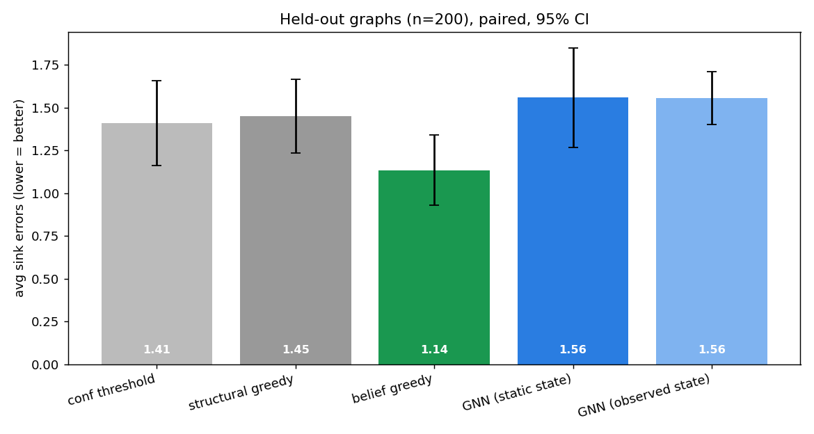
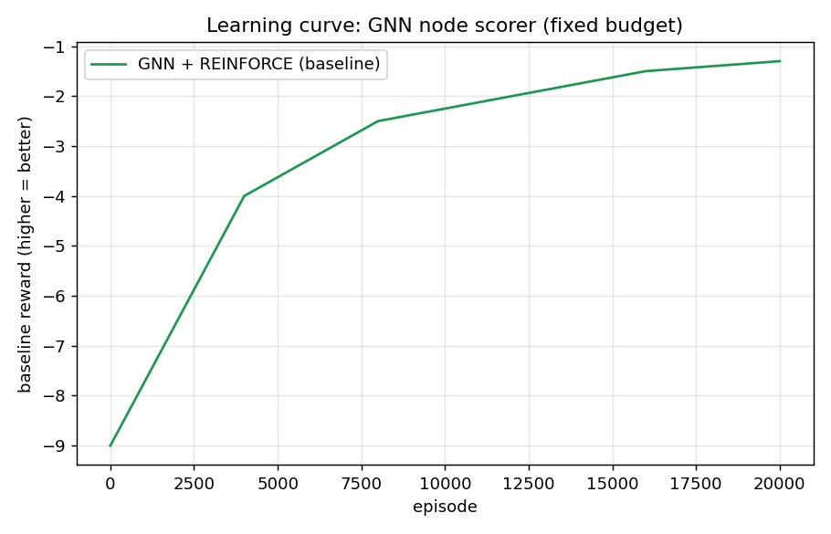
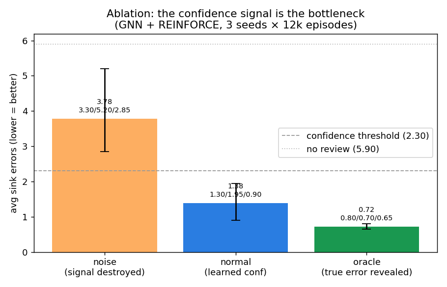
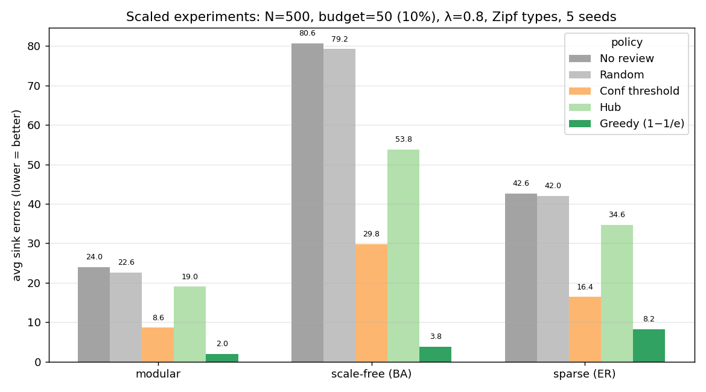
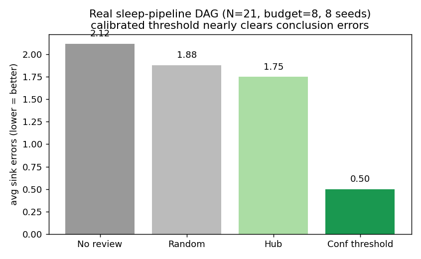

# 依赖图上的审阅调度 —— 项目文档（中文版）

> STA3145 强化学习 · 小组项目 · 深化版 2026-11-09
> 导师：Maia ten Brink, PhD（证据链 / 睡眠数据）· 高张阳, PhD（AI / RL）
> 对应版本：English `PROJECT_EN.md` · 한국어 `PROJECT_KO.md`
> 仓库：https://github.com/cyracaid/rl-oversight-dag

**验证状态**：实验代码和数字由 AI 智能体生成，组员尚未独立重跑。未验证项见第 12 节。

**一句话**：当 AI 的输出互相依赖、而人只能审其中少数几项时，用强化学习学「下一步该审哪个节点」，使到达最终结论的错误更少。

---

## 1. 相比第一版变了什么

1. **从 bandit 到 MDP**。第一版逐项决定放行/送审，把图压平了：校准阈值（2.81）胜过表格 Q-learning（3.38）。现在智能体在依赖图上选下一个要审的节点，一次审阅会改变下游。
2. **从替代数据集到自有数据 + 合成图**。真实纠错数据（75 行）用来说明动机；主实验用合成图。
3. **从计划到结果，再到升级和诚实的负结果**。现在有数字、对照实验、一个公开报告的失败、一个单次跑赢但多种子不稳的方法升级（见第 8 节），以及一个把剩余误差定位到置信度信号的消融。

## 2. 主题
在有限审阅预算下，学习依赖图上应该先审哪个节点。

## 3. 问题与动机
AI 承担了大量研究工作（清洗、标注），其中一部分没有标准答案，只有人能判断对错，而人不可能全查。两个事实让「审什么」比「审多少」更重要：

- **错误按类型聚集**。真实数据中一种类型 `order_error` 占纠错的 **76%**（57/75）。
- **没审的错误在下游被复用，危害到结论才暴露**。

所以证据是一条依赖图。修一个节点就阻止它的错误扩散；早审上游节点可能比在下游审好几个更值。

## 4. 放进 SciForge：对应证据链哪一块

SciForge 已有证据 DAG（论点—证据溯源）、人审收据、审计层。本提案在这条链**上方**加一个「审阅优先级建议器」，不改任何存证规则。

| 概念 | SciForge 对应 | 说明 |
|---|---|---|
| 依赖图 | Evidence DAG | 节点=论点、结论、数据集版本、分析运行 |
| 错误传播 | `derived_from`、`supports` 边 | `contradicts` 不是传播方向 |
| 结论（sink） | 要交付的结论节点 | 让错误不到达这里 |
| 一次审阅 | 一次人审 → 收据 | 字段由证据链负责人定 |
| 审阅预算 | 人一个周期能审的项数 | — |
| RL 输出 | 「下一个审哪个」的排序 | 只建议，不盖章、不产生收据 |

**三条边界（不因引入 RL 放松）**：机器不盖章；建议器只读 / append-only；评论和收据分开。

**未确认**：节点上有没有可用的置信度字段；真实图的规模和边类型是否接近合成假设（约 80 节点、按类型聚集）。

## 5. 强化学习怎么用
带稀疏、延迟奖励的序贯决策 MDP，不是 bandit。

| 要素 | 定义 |
|---|---|
| 状态 | 每节点：类型、置信度、下游影响、已审否 + 剩余预算 |
| 行动 | 选下一个待审节点（＋停止） |
| 转移 | 审一个节点就修它，重算下游（传播切断） |
| 奖励 | 稀疏终局 = −(sink 错误数) |
| 折扣 | γ<1，鼓励尽早审上游 |

**对比方法**

| 方法 | 角色 | 结果 |
|---|---|---|
| 按类型校准阈值 | 静态基线 | 图设定下 2.30 |
| 结构贪心（扇出×可能性） | 手工启发式 | 1.80 |
| Bandit + 表格 Q-learning | 第一版（负结果） | 输给阈值 |
| REINFORCE / PPO（MLP 打分器） | 初版 | 1.40 / 1.60 |
| **GNN 打分器 + REINFORCE（固定预算）** | **主方法** | **mean 1.54 ± 0.46（最佳种子 1.00）** |
| CMDP + PPO-Lagrangian（软预算） | 升级方向 | naive 失败（4.85） |
| DQN（基于价值） | 对照 | 5.10（退化） |

节点打分器是 **GNN**：每节点的（类型、置信度、下游影响）加上图邻域一起编码，照 Mattick et al.（arXiv:2310.00112）。软预算扩展（FALCON 的 CMDP + PPO-Lagrangian）还在做。

### 5.1 数学形式化（规模实验）

设证据图为 DAG \(G=(V,E)\)，节点 \(v\) 的真实状态 \(X_v \in \{0,1\}\)（1=正确）。

**因果传播**。沿边 \((u,v)\)，依赖权重 \(w_{uv}\)：

\[
P(X_v = 0 \mid X_u = 0) = 1 - \exp(-\lambda \, w_{uv}),
\]

传染系数 \(\lambda\)，\(w_{uv}\sim U(0.5, 1.5)\)。审节点 \(v\) 是**因果干预**：强制 \(X_v = 1\)，切断这条边的传染。

**重尾类型**。基础错误率服从 Zipf \(p_t \propto t^{-s}\)，映射到 \([0.02, 0.40]\)：少数致命类型引发大多数崩溃（76% order_error 的规模化对应）。

**规模图（N=500，预算=50 ≈ 10%）**
- *模块化*：10 个簇 × 50 节点；簇内传播高，簇间只经接口节点。
- *Barabási–Albert* 无标度（hub），按索引低→高定向。
- *Erdős–Rényi* 稀疏，按索引低→高定向。

无标度图上守住少数 hub 就能挡住大部分传播——和真实网络一样。

**奖励的信息增益视角。** 除了 \(-\#\text{sink 错误}\)，还可以写

\[
R = \alpha \, \Delta H_v - \beta \, \mathrm{Cost}(v), \qquad
\Delta H_v = H(\text{结论}) - H(\text{结论} \mid \text{审 } v),
\]

即用最少的审阅消除最大的不确定性。我们的贪心基线是它的蒙特卡洛代理：选最能让当前 sink 错误下降的节点。

**CMDP。** 最大化正确率 \(J(\pi)\)，约束 \(C(\pi) \le B\)：

\[
\max_\pi \min_{\lambda \ge 0} \mathcal{L}(\pi,\lambda) = J(\pi) + \lambda\,(B - C(\pi)).
\]

**次模贪心。** 选最能让可达 sink 错误下降的审阅，是单调次模最大化（影响最大化风格）。贪心保证 \((1-1/e) \approx 63\%\) 的最优干预集。我们用这个贪心当结构基线；学到的策略能否超过这个理论近似，是实证问题（第 8 节 / 规模实验）。

## 6. 数据与对照

- **真实数据（动机，内部，永不提交）**。`deidentified_intervalvars_forCD_111325.rds` = **13,990 行 / 237 人**日睡眠日志。**75 处纠错（0.54%）**，其中 `order_error` = **57/75 = 76%**（旧 85.1% 是 57/67，8 行无标签），熵 0.612，p<0.0001。按 SciForge 原始数据防护，CSV 不进 git、不整份交给 agent。
- **合成依赖图（主实验）**。约 80 节点，错误按类型聚集并向下游传播。
- **对照**。打乱哪些项错（破坏聚集）→ 优势消失；压平图（破坏传播）→ 优势消失。优势来自聚集 + 传播，不是模拟器作弊。

## 7. 目前结果

所有数字为 sink 错误数，越低越好。**两张表是不同设置，不可跨表比较**（阈值 2.81 vs 2.30；不审 5.62 vs 5.90）。

**第一版 bandit（公开的负结果）**

| 策略 | sink 错误 |
|---|---:|
| 不审 / 随机16 / 校准阈值 / Q-learning / 全审 | 5.62 / 4.19 / 2.81 / 3.38 / 0.56 |

诊断：逐项审把图压平；一种类型占 76%，最优策略坍缩成静态规则。

**重构为图上主动选节点之后**

| 方法 | sink 错误 | 类型 |
|---|---|---:|
| 不审 | 5.90 | 传统 |
| 置信度阈值 | 2.30 | 传统 |
| 结构贪心 | 1.80 | 传统 |
| REINFORCE（MLP） | 1.40 | 我们（初版） |
| PPO（MLP） | 1.60 | 我们（初版） |
| **GNN + REINFORCE** | **1.54 ± 0.46**（最佳种子 1.00；单次 1.20 是运气） | 我们（升级） |
| DQN | 5.10（退化） | 对照 |
| CMDP 软预算（naive） | 4.85 | 在做 |
| Oracle | 0.00 | 上界 |

- 图本身有价值：结构贪心比阈值低 22%。
- GNN 均值 1.54 **与** MLP REINFORCE（1.40）和结构贪心（1.80）**相当——不是稳定胜出**。最佳种子 1.00 说明有空间。
- DQN 退化：稀疏终局奖励下价值函数拿不到逐步功劳 → 策略梯度才是对的工具。
- CMDP 软预算 naive 版失败（4.85）：stop 动作信用分配太粗，需要 FALCON 式双 critic。

图：`experiments/results_bar.png`、`experiments/learning_curves.png`、`experiments/ablation_conf.png`。

## 8. 消融：置信度信号是瓶颈

GNN + REINFORCE 在三种置信度条件下训练（3 种子 × 12k episode）：

| 条件 | 均值 | 每种子 | 含义 |
|---|---|---|---|
| noise（置信度=均匀噪声） | **3.78** | 3.30 / 5.20 / 2.85 | 打掉信号，性能崩掉（比阈值差，接近不审） |
| normal（学到的置信度） | **1.38** | 1.30 / 1.95 / 0.90 | 与多种子均值一致 |
| oracle（置信度揭示真实错误） | **0.72** | 0.80 / 0.70 / 0.65 | 几乎到达 oracle 上界 0.00 |

两条系统级洞察：

1. **模型在用置信度信号**。打掉它，RL 比静态规则还烂。
2. **噪声预测器是瓶颈，不是调度器**。完美信号下误差从 1.38 降到 0.72。**别继续卷策略——把置信度信号做好。** 剩余误差住在预测器里，不在策略里。

这是「有代价的工程胜利」：我们没假装 RL 必赢，我们定位了剩余误差。

**worst-of-n 可靠性**（一个漏审错误能作废结论——HealthBench 视角）：

| | 均值 | worst-of-5 |
|---|---|---|
| GNN + REINFORCE | 1.54 | 1.90 |
| noise 置信度 | 3.78 | 5.20 |
| oracle 置信度 | 0.72 | 0.80 |

噪声信号伤尾部甚于均值（worst − mean：noise 1.42 vs oracle 0.08）。

**决策指南**

| 场景 | 用什么 |
|---|---|
| 置信度信号校准好 | GNN + REINFORCE，或结构贪心——都行 |
| 置信度噪声大 / 未校准 | **别用 RL**——静态阈值更稳（noise 3.78 > 阈值 2.30） |
| 预算紧、错误按类型聚集 | 结构贪心是便宜强默认 |
| 能改进预测器 | 改置信度校准比改策略收益大 |

## 8b. 规模实验：N=500，三种图族

同样的干预模型（P(X_v=0 | X_u=0) = 1 − e^(−λw)），Zipf 类型率，预算 50（10%）。5 个种子。策略：不审、随机、置信度阈值、hub（最高出度）、**贪心影响最大化**（每步选最能让当前 sink 错误下降的节点；(1−1/e) 风格）。

| 图族 | 不审 | 随机 | 阈值 | hub | 贪心 |
|---|---|---|---|---|---|
| 模块化（10×50） | 24.0 | 22.6 | 8.6 | 19.0 | **2.0** |
| 无标度（BA） | 80.6 | 79.2 | 29.8 | 53.8 | **3.8** |
| 稀疏（ER） | 42.6 | 42.0 | 16.4 | 34.6 | **8.2** |

图：`experiments/scale500.png`。脚本：`graph_scale.py`。

**500 节点告诉我们的（X-factor）：**

1. **贪心影响最大化几乎清空每个图族**——模块化 24→2，无标度 81→4（降 95%），ER 43→8。无标度图上就是 hub 防御的故事：守住少数 hub，大部分传播被切断。
2. **随机 ≈ 不审**，所有图族都这样。这个尺度上，没有结构感知规则的注意力什么也不做。
3. **置信度阈值在无标度图上不稳定**（每种子 6 到 76）。忽略拓扑的静态规则要么大赢要么没用。
4. **Hub 防御在无标度图上有帮助但离贪心还远**。度数是好先验；当前 sink 下降量更好。

**诚实范围**：这批 500 节点数字是**贪心 / 启发式，不是 RL**。这个尺度上的 RL 还没训练。科学主张是：问题在规模下依然有趣，贪心是强的 (1−1/e) 风格基线，任何学到的策略都得打赢它——80 节点的 GNN 即使最佳种子，在这个更大的舞台上还没做到。

## 8c. 真实睡眠管道 DAG（应用）

从 splsleep SCHEMA 编码（`real_pipeline_graph.py`）：原始日记叶子 → 两两差值 → SOL/WASO/TST/TIB/SE → 有效性/结论 sink。N=21，预算 8，λ=0.9，类型对齐 75 条纠错。8 个种子：

| 策略 | sink 错误 |
|---|---|
| 不审 | 2.12 |
| 随机 | 1.88 |
| **置信度阈值** | **0.50** |
| hub | 1.75 |

在**实际实验室管道**上，校准过的置信度阈值几乎清空结论错误。500 节点的结果说证据图变大时怎么办；这 21 节点的结果说**我们今天的数据**怎么办。

## 9. 相关工作

- **Learning to defer**：Mozannar & Sontag（ICML 2020）；FALCON（arXiv:2604.00904，组件最接近，无图传播）；SLTD（arXiv:2109.06312）；Reid 等（arXiv:2409.20489）；KL-PBD（arXiv:2610.15128）；Oversight Has a Capacity（arXiv:2606.08919，最接近的调度框架，审扁平轨迹）；Too Much of the Same（arXiv:2608.28050，类别偏差 ↔ 我们 76% 聚集）。
- **预算 / 延迟反馈 bandit**：Bandits with Knapsacks（FOCS 2013）；Delayed Feedback（ICML 2013）。
- **错误级联**：Data Cascades（CHI 2021）；Finkel 等（EMNLP 2006）；From Spark to Fire（arXiv:2603.04474）；DN-ILDL（arXiv:2405.16474）。
- **预算 + 节点选择 / GNN**：WS-option（arXiv:2502.05537）；Mattick & Mutschler（arXiv:2310.00112）。

### 9.1 与 HealthBench 对比（OpenAI，2025-05）

HealthBench 是最接近的**评估哲学**先例，不是调度先例。

| | HealthBench | 我们 |
|---|---|---|
| 问题 | 这个 LLM 健康对话回答按医生 rubric 够不够好 | 依赖 AI 输出 + 只能查几项的人，先查哪个结论污染最少 |
| 人类标准 | 262 医生，48,562 条加权标准 | 75 条实验室纠错（27 共识 / 48 单人） |
| 打分对象 | 开放文本的质量 | DAG 上有限注意力的分配 |
| 错误动力学 | 每条 rubric，无传播 | 错误传播，惩罚延迟到结论 |
| 可靠性 | worst-of-n | worst-of-5：GNN 1.90 / noise 5.20 / oracle 0.80 |
| 共识 / Hard | 3,671 共识；1,000 Hard | 27 共识 / 48 单人——计划拆，还没评 |
| 非饱和 | HealthBench Hard 仍未解 | oracle conf 仍剩 0.72 |
| RL 调度 | 基准里没有 | 整个项目 |

**采纳**：三原则——*meaningful*（真实管道上的 sink 错误）、*trustworthy*（75 条人审，机器不盖章）、*non-saturated*（oracle 仍剩 0.72）——加上 worst-of-n 和共识/困难拆分作 next step。

**不抄**：社区级医生众包；LLM 给开放文本打分；医疗对话任务本身。

**给 talk 的一段话**。HealthBench 问的是：这个 LLM 回答按医生标准、在真实健康对话上够不够好。我们问的是：一条依赖的 AI 输出链 + 有限人类注意力，先花在哪。他们教领域用 meaningful / trustworthy / non-saturated 的 rubric 和 worst-of-n 评可靠性。我们把这套用到他们没解的问题上：**在依赖图上调度那份注意力**。他们的评分信号恰好是我们消融里说的瓶颈——**改信号比改策略收益大**。

**BioBasicsBench（OpenAI + Ligo，2026-11-06）是 everyday-science 的姊妹篇**。100 个湿实验任务，原始证据（凝胶、平板、显微镜）；最强模型 66.7%；失败模式是假设压过对照、忽略矛盾观察、数错菌落。我们的 76% `order_error` 是同一物种（熟悉的时间顺序假设压过记录的时间戳）。采纳：收据上的偏学分 rubric、把错误检测当作一等技能、显式的「证据尚不支持该结论」动作。我们加上他们没建的：**预算下的序贯审阅 + 依赖图**。

## 10. 差异、局限、可行性

**我们的位置**。每个组件都有先例，但组合**「依赖图错误传播 + 人工审阅预算 + 学习该审哪个节点」无直接先例**（没找到 ≠ 不存在）。最接近：Oversight（扁平动作）+ WS-option（预算+选节点）。我们不同在**依赖图错误传播 + 稀疏延迟奖励**。L2D 多数逐项决定（bandit）；我们在图上选节点。

**实验增加了**。可解释的负结果、修复它的重构、方法对比、证明收益来自结构的对照、把剩余误差定位到置信度信号的消融。

**局限**。主实验合成（约 80 节点）；GNN 多种子但高方差；真实数据仅 75 行（只作动机）；CMDP 软预算未解。

**可行性**。模拟器、基线、REINFORCE、PPO、DQN、GNN 打分器都能跑。剩余：干净的多种子复现、双 critic CMDP、幻灯片。下一步：更大的图、真实证据图、共识/困难拆分。

## 11. SciForge 落地（分期设想）与 AI4Science

1. **离线评估**。合成图 + 导出的脱敏真实证据图；建议器 vs 按置信度排序。不接应用。
2. **只读建议**。审阅界面旁显示「建议先审这几个」+ 理由；人可忽略。
3. **收据契约握手**。记录「是否按建议审的」需要证据链负责人确认；本提案不先定。

**AI4Science 定位**。这个建议器是**科研证据链的审阅层**：前端（代码上划线提问的工具）产生审阅痕迹；中间（这个策略）决定有限人类注意力先花在哪；后端（SciForge DAG + 收据）保证机器不盖章。三者合起来回答：**当 AI 协助科研，有限的人类注意力该花在哪。**

**需要拍板**。老师：bandit → MDP 方向和合成主实验是否接受。证据链负责人：建议器输出能否进审计链。组员：第 12 节分工。

## 12. 验证状态

**核对过**：引文对照摘要；第 7 节百分比与表一致（22.2%、11.1%）；真实数据 2026-11-09 重算。

**未验证——组员需查**：
1. 所有模拟数字、学习曲线、两个对照。
2. 模拟器设计（图、聚集、贪心、超参数）；两张表「不审」不同（5.62 vs 5.90）的原因。
3. 「无直接先例」——再搜一遍；表述为「我们没找到」。
4. 引文全文（只读摘要）。
5. arXiv:2409.20489 的 BestReject 是否等于我们的校准阈值（此说法因未验证已删）。
6. 跨文件「19%」vs「22%」（1.80→1.40 是 22.2%）。
7. GNN 多种子（已有 mean 1.54 ± 0.46）还需更多种子收紧 CI。
8. GNN + PPO 收敛。
9. 双 critic CMDP。
10. SciForge：节点置信度字段；真实图规模 / 边类型。
11. 75 条纠错的共识 / 困难拆分（27 / 48）——标签有，评估没跑。

## 13. 角色与时间线

| 成员 | 主责 | 备份 | 交付 |
|---|---|---|---|
| 1 | 组长 + 叙事 | 全体 | 提案 + 时间线 |
| 2 | 策略梯度（REINFORCE → PPO-Lagrangian） | 3 | 代码 + 学习曲线 |
| 3 | 环境 + 值函数（DQN）+ GNN 打分器 | 2 | 环境模块 + GNN 结果 |
| 4 | 基线 + 对照 | 2 | 对比表 + 打乱/压平 |
| 5（동채하） | 文献 + 真实数据动机 + 写作（若允许英文发表） | 1 | related work + 动机 + 幻灯片 |

发表语言未定：允许英文则 동채하 发表；只许韩语则其他组员发表。

| 日期 | 里程碑 | 负责人 |
|---|---|---|
| ~11/12 | 冻结环境 + 基线；复现 REINFORCE / GNN | 3, 4 |
| ~11/19 | PPO-Lagrangian + 双 critic；方法表 | 2, 3 |
| ~11/26 | 对照 + 曲线 + 负结果段；related work 定稿；共识/困难拆分 | 4, 5 |
| ~12/03 | 幻灯片 + 排练 ≥2 次 | 5, 全体 |
| ~12/05 | 最终发表 | 全体 |

## 14. 发表大纲（精简）

1. 标题
2. 动机：错误聚集（76%）+ 传播到结论
3. 经典 L2D 表述
4. 第一版 bandit：诚实负结果（阈值 2.81 > Q 3.38）
5. 诊断：压平图杀死 RL
6. 重构：主动选节点 = 真 MDP
7. 方法：GNN 打分器 + 策略梯度；CMDP 在做
8. 结果表 + 图
8b. **消融：置信度信号是瓶颈**（noise 3.78 / normal 1.38 / oracle 0.72）+ worst-of-n
9. 对照实验
10. 相关工作 + HealthBench 对比 + 定位
11. AI4Science：证据链的审阅层
12. 分工 + Q&A

**可能的 Q&A**。
- 为什么不直接用阈值？阈值看不到图；贪心证明图有价值；RL 均值相当、最佳种子更好——且消融说该投信号。
- 真提升还是调参？打乱/压平杀掉优势。
- 和 L2D 区别？逐项 bandit vs 图上选节点（MDP + 稀疏延迟奖励）。
- 这个规模有意义吗？方法学 demo；可扩到真实证据图。
- 真实数据？一页动机；核心实验合成（RL 课标准）。
