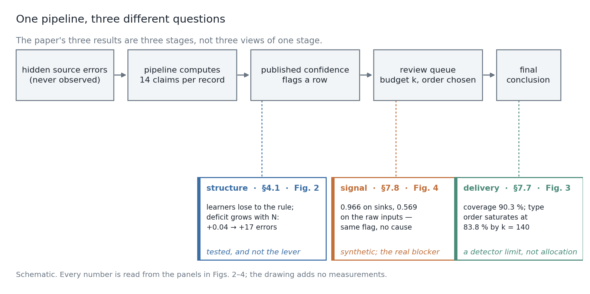

# Review Scheduling on a Dependency Graph

> STA3145 Reinforcement Learning · Group project. Under a limited review budget, we asked whether RL should choose which node of a dependency graph to review next — and measured where that question is worth asking at all.
>
> Sleep data: one year of EMA collaboration with a university sleep-research lab.
> Application: SciForge, developed by Zhangyang Gao (AI4Science, Shanghai AI Lab).

**The paper (2026-11-25).** [English](https://cyracaid.github.io/rl-oversight-dag/PAPER_DRAFT.html) ·
[한국어](https://cyracaid.github.io/rl-oversight-dag/PAPER_DRAFT_KO.html) ·
[中文](https://cyracaid.github.io/rl-oversight-dag/PAPER_DRAFT_CN.html) — *The Signal, Not the Scheduler*.
Four figures. Every number in it is tied to a committed artifact: `experiments/test_published_numbers.py`
(19 checks) fails if the text and the JSON disagree, `experiments/test_figures.py` (6 checks) fails if a
figure drifts from the data it draws, and `experiments/test_retired_numbers.py` (3 checks) fails if a
superseded number comes back.

**What it argues, in three sentences.**

1. **A benchmark that separates structure from signal.** Review scheduling on a DAG is well posed, and the part
   a policy controls — which claim to open next — can be measured apart from the part it cannot — which claim
   looks suspicious.
2. **A negative structural result, with a mechanism.** Learned policies lose to a one-line rule in all 36
   (family, learner, seed) cells, and the deficit *grows* with graph size: +0.04 sink errors at N=21, +17 at
   N=500. Ten times the compute narrows it (+0.377 → +0.262) without closing it, so what is missing is
   information, not optimisation. Where the optimum of the rule's own model is computable, the whole horizon
   is worth 4.2 %.
3. **A boundary study on real sleep data.** The queue saturates at 83.8 % of the reachable errors by k = 140,
   because 16.2 % sit in 885 rows at a 1.2 % base rate; and the same confidence flag that scores 0.966 on
   validity sinks scores 0.569 on the four raw timestamps a reviewer would actually open. The signal ranks
   consequences; the reviewer's inputs are the causes.

**What it does not claim.** "RL reduces human review by X %" appears nowhere and is retired: that phrasing
came from legacy seeds 1–20, and [`RETIRED_NUMBERS.md`](RETIRED_NUMBERS.md) lists it with every other value
that may no longer be written, together with the guard that enforces the list. The paper also does not claim a
deployed saving — the sleep corrections are replayed, not rerun with a policy in the loop.



*One pipeline, three questions (paper Fig. 1). The three results are three stages — structure, signal,
delivery — not three views of one. Every number on the cards is read from the panels in Figs. 2–4.*

| layer | plain question | what we measured | verdict |
|---|---|---|---|
| ranking | which claim do I check next? | optimal policy of the same model is worth 4.2 % where computable (21 nodes, budget ≤ 5); depth-two lookahead is worth 5 of 923 errors at N=500; learned policies lose to the rule at every size, and lose more as graphs grow (paper §4, Fig. 2) | **saturated** — do not invest here |
| signal | why do I suspect *this* claim? | order-preserving rescaling gives nothing; confidence is synthetic; the flag scores 0.966 on validity sinks and 0.569 on the raw inputs a reviewer opens (paper §7.8, Fig. 4) | **unvalidated input** — the real blocker, needs measured calibration |
| delivery | what did I cover, and what did I miss? | receipt names 89.8–97.8 % of surviving errors as uncovered; 800/800 runs unchanged; deleting it removes the question; the queue itself saturates at 83.8 % by k = 140 (paper §7.7, Fig. 3) | **load-bearing interface** — without it the question has no answer |

**The other three panels (paper Figs. 2–4):** [gap vs graph size](figures/fig1_gap_vs_graph_size.png) ·
[queue ceiling](figures/fig2_queue_ceiling.png) · [localisation AUC](figures/fig3_localisation_auc.png).
Regenerate all four with `python3 experiments/make_figures.py`; it reads the committed JSON and CSV and writes
`figures/figure_data.json`, which is what the figure guard compares against.

**Status, 2026-11-25.** The Yonsei course track (STA3145) is frozen at tag `course-freeze-2026-11-10`; the
living artefact is now the paper above. **Parallel track: building SciForge** — see
[`EVIDENCE_CHAIN_DESIGN.md` §10b](https://cyracaid.github.io/rl-oversight-dag/EVIDENCE_CHAIN_DESIGN.html)
for the open items; the build brief lives in the team's Feishu wiki.

**New here?** [One-page reading guide](https://cyracaid.github.io/rl-oversight-dag/READING.html) — who should read which document, five plain words, and what to skip. (中文速览在文末。)

**Course final report — what we can defend, and what we cannot:**
[English](https://cyracaid.github.io/rl-oversight-dag/COURSE_FINAL_REPORT.html) ·
[中文](https://cyracaid.github.io/rl-oversight-dag/COURSE_FINAL_REPORT_CN.html) ·
[한국어](https://cyracaid.github.io/rl-oversight-dag/COURSE_FINAL_REPORT_KO.html).
Every number is paired and regenerated from a committed CSV; the failures are kept in the text.

**Latest RL results · 2026-11-12:** [한국어 결과 요약](experiments/BOUNDARY_RESULTS_KO.md) · [中文详细解释](experiments/BOUNDARY_FULL_V1_INTERPRETATION.md) · [Preregistration](experiments/BOUNDARY_PREREG.md). Five training seeds, 200 development graphs: belief greedy 1.100, two-step greedy 1.020, BC 1.201, BC+FT 1.525 sink errors (lower is better). Current RL policies do not outperform belief greedy; this now replicates on the untouched confirmation set (seeds 2000–2199): GNN − marginal **+0.377 [+0.255, +0.510]**. [Saved synthetic results and checkpoints](runs/boundary-full-v1/).

**Who does what (visual, EN / 한국어 / 中文):** [PLAN.html](PLAN.html) — dependency graph, 8-day schedule, four interfaces, three gates. Built from one source: `python3 tools/build_plan.py`. Text version: [GENERALIZATION_PLAN.md](GENERALIZATION_PLAN.md).

**Two stages — Stage 1 we decide, Stage 2 is SciForge's system:** [TRACKS.md](TRACKS.md)

**Start here — one synthesized design document:**
[Evidence-chain design (EN)](https://cyracaid.github.io/rl-oversight-dag/EVIDENCE_CHAIN_DESIGN.html) ·
[证据链设计 (中文)](https://cyracaid.github.io/rl-oversight-dag/EVIDENCE_CHAIN_DESIGN_CN.html)

**Who claims what (5 people, two tracks):**
[Team claims — who owns what (summary + full EN/한국어/中文 pages)](https://cyracaid.github.io/rl-oversight-dag/TEAM_CLAIMS.html)
(markdown source: [EN](https://cyracaid.github.io/rl-oversight-dag/TEAM_CLAIMS_EN.html) ·
[中文](https://cyracaid.github.io/rl-oversight-dag/TEAM_CLAIMS_CN.html))

**Meeting one-pager (humanized + math, 中文 / EN / 한국어, click to open):**
[中文 PDF](https://cyracaid.github.io/rl-oversight-dag/meeting_proposal_zh.pdf) ·
[English PDF](https://cyracaid.github.io/rl-oversight-dag/meeting_proposal_en.pdf) ·
[한국어 PDF](https://cyracaid.github.io/rl-oversight-dag/meeting_proposal_ko.pdf) ·
[HTML 三语切换](https://cyracaid.github.io/rl-oversight-dag/meeting_proposal.html) ·
[illustrated talk page](https://cyracaid.github.io/rl-oversight-dag/talk.html)

**Full narrative (pick your language):**
[English](https://cyracaid.github.io/rl-oversight-dag/en/index.html) ·
[한국어](https://cyracaid.github.io/rl-oversight-dag/ko/index.html) ·
[中文](https://cyracaid.github.io/rl-oversight-dag/zh/index.html)

**Implementation spec (build from this) — the same document in three languages:**
[中文](https://cyracaid.github.io/rl-oversight-dag/IMPLEMENTATION_SPEC.html) ·
[English](https://cyracaid.github.io/rl-oversight-dag/IMPLEMENTATION_SPEC_EN.html) ·
[한국어](https://cyracaid.github.io/rl-oversight-dag/IMPLEMENTATION_SPEC_KO.html)
(each page carries a language bar at the top, so you can switch without coming back here. The Chinese page is the styled web version; its markdown twin `IMPLEMENTATION_SPEC_CN.md` renders at `IMPLEMENTATION_SPEC_CN.html` and is listed in the document index below.)

Repo: https://github.com/cyracaid/rl-oversight-dag

---

## What this repo is for (two audiences)

**Yonsei RL course (STA3145)** — the assignment, the talk, the synthetic + 80-node RL experiments:

| File | Language | For |
|---|---|---|
| `PROJECT_EN.md` / `PROJECT_KO.md` / `PROJECT_CN.md` | EN / KO / CN | course narrative |
| `COURSE_ALIGNMENT.md` / `_CN.md` | EN / CN | how this maps to the STA3145 rubric; data-search split across the 5 people |
| `TEAM_CLAIMS.md` / `_CN.md` | EN / CN | markdown source behind `TEAM_CLAIMS.html` |
| `presentation_outline.md` / `presentation_outline_ko.md` | EN / KO | slides |
| `IMPLEMENTATION_SPEC.md` / `_KO.md` / `_CN.md` | EN / KO / CN | build constants |
| `index.html` | EN landing | language cards → EN / KO / CN docs |
| `talk.html` | ZH / EN / KO | humanized illustrated talk page |
| `meeting_proposal.html` | ZH / EN / KO tabs | humanized meeting handout |
| `meeting_proposal_zh.pdf` / `_en.pdf` / `_ko.pdf` | ZH / EN / KO | printable one-pagers |
| `PAPER_DRAFT.md` / `_KO.md` / `_CN.md` | EN / KO / CN | the paper: claim ladder, four figures, 19 number guards |
| `figures/` | PNG + JSON | the four figures and every value plotted in them |
| `experiments/` | code | every number |
| `triage_bench/` | code | the **real** review queue: recall@k, no simulator |

**SciForge (AI4Science, Shanghai AI Lab, developed by Zhangyang Gao)** — the evidence-chain review layer, applied to sleep data from the one-year collaboration with a university sleep-research lab:

| File | Language | For |
|---|---|---|
| `proposal_sciforge_en.md` | EN | SciForge-shaped proposal |
| `EVIDENCE_CHAIN_DESIGN.md` / `_CN.md` | EN / CN | architecture, boundaries, landing plan |
| `experiments/real_pipeline_graph.py` | code | N=21 real SCHEMA DAG |
| `experiments/verify_clustering.py` | code | 75-correction clustering (skips if data missing) |

**Local only, never commit:** raw `*.rds` / `*.csv`; anyone else's proposal; long Chinese literature notes (`延迟惩罚审查调度_文献调研/`).

---

## Headline results (canonical, 2026-11-25)

Two lines supply these numbers and they are the ones to quote: `role3 improvement/` (environment, tag
`role3-env-v3`) and `role2_규리/` (measurements). Raw means are **not** interchangeable between the three
implementations — read `CROSS_IMPLEMENTATION_VALIDATION.md` before putting two of them in one table.

The table is the ledger of measurements; the paper is where they are interpreted. If the two ever seem to
disagree about what a row *means*, the paper's claim ladder wins and the row stays as measured.

| Question | Simple rule | Learned policy | Verdict | Source |
|---|---|---|---|---|
| Spike, 200 held-out graphs, budget 16 | adaptive marginal **1.130** | GNN 1.410 / 1.590 / 1.455 | rule wins on all 3 training seeds | `role2_규리/results/confidence-v1/` |
| …same, untouched confirmation 2000–2199 | adaptive marginal **0.885** | GNN 1.185 / 1.325 / 1.275 | rule wins; GNN − marginal **+0.377 [+0.255, +0.510]** | `role2_규리/results/confirm-v1/` |
| …same, 10× training budget (10,000 episodes) | adaptive marginal **0.885** | GNN 1.155 / 1.140 / 1.145 | still loses: GNN − marginal **+0.262 [+0.165, +0.365]** | `role2_규리/results/confirm-10x/` |
| Spike, 100 graphs, same env | marginal **0.66** | GNN 0.96 / 1.17 / 1.06 | rule wins; paired CIs exclude 0 | `role3 improvement/outputs/v3/` |
| Learned baselines on all 6 families (3 seeds, equal budget) | marginal **0.66 / 8.78 / 20.13 / 16.76 / 0.47 / 0.29** | GNN and DQN | rule wins in **all 36 (family, seed) cells**; gap grows with n: +0.04–0.08 at N=21, +5.2–17.0 at N=500; 34/36 CIs exclude 0 | `role3 improvement/outputs/v3-learned/learned_vs_marginal.md` |
| Spike, PPO, fresh block 4200–4399 | marginal **0.875** | PPO 1.225 / 1.335 / 1.340 | third architecture also loses: Δ +0.350 to +0.465, all CIs exclude 0; indistinguishable from REINFORCE, not better | `role3 improvement/outputs/ppo-v1/` |
| Sampled counterfactual value instead of mean-field (block 4400–4599) | modular **8.780** / spike **0.890** | 8.785 / 0.900 | **negative**: recovery −0.049 on modular, unseparated on spike — fixing the independence assumption in the one-step score does not close the oracle gap | `role3 improvement/outputs/value-v1/` |
| Belief values, order preserved: logit temperature (pre-registered, 200 fresh graphs) | modular `marginal` **8.820** | best γ 1.25 → 8.825 | frozen verdict **`policy-bound`**: +0.016 [−0.055, +0.072], 46 better / 142 tie / 12 worse, and **−1 error of a 978-error gap**. Every distortion is neutral at best; γ = 0.5 costs 1.49 errors. The gap is not a probability-scale error. Spike: `calibration-partial` (+0.105 [+0.026, +0.211] pointwise, but **0 of 49** aggregate errors closed) | `role3 improvement/outputs/belief-v1/` |
| Depth-two planning on the same model (pre-registered, 5200–5399) | modular **8.915** / spike **0.860** | `plan2_catch` 8.940 / 0.855 | frozen verdict **`informational`**: modular −0.009 [−0.023, +0.001], **−5 of 923** errors, action unchanged on 191/200 graphs; spike +1 of 49 with the interval starting at zero. The horizon is not the bottleneck at width 6/4. The second variant, which instead trusts the environment's miss update, is **far worse**: −485 of 923 and −259 of 49 | `role3 improvement/outputs/planning-v2/` |
| Exact DP ceiling inside the rule's own model (block 5000–5023, 21 nodes, budget ≤5) | `real` marginal **0.705** / `ticket` **0.404** | optimal `dp5` 0.675 / 0.402 | the whole horizon is worth **4.2 % / 0.5 %** of the rule's errors (−0.030 [−0.065, −0.008], −0.002); exact one-step lookahead equals the rule on 12/12 graphs, so the deployed rule is within single-digit percent of the optimum *of its own model* while the oracle gap asks for a third to a half. The first run sat on the model-selection block 60000–60023 and is kept only as a sensitivity check | `role3 improvement/outputs/dp-ceiling-fresh/` |
| Label-free contrastive representation of review states (pre-registered; train 5024–5119, eval 5120–5159) | own-feature probe **0.967 AUC** | contrastive probe **0.915 / 0.917 / 0.901** | **negative**: RDM ρ +0.051 / +0.091 / +0.011 against a 0.30 threshold; probe **−0.05 AUC** versus its own inputs; scheduler **worse than the rule** by +0.43 / +0.23 / +0.93 (paired, so comparable across blocks; raw means are not). The views masked the only informative channel, and a node-level instance cannot carry the relational order errors that 76 % of real corrections are | `role3 improvement/outputs/contrastive-v1/` |
| Five graph shapes (spike/modular/BA/ER/real) | marginal **0.66 / 8.78 / 20.13 / 16.76 / 0.47** | — | positive vs sort-by-confidence on every shape; real is thin (+0.03 [0.00, 0.07]) | `role3 improvement/outputs/v3/benchmark_summary.csv` |
| Full baseline set with truth-reading reference, 6 families | marginal **0.66 / 8.78 / 20.13 / 16.76 / 0.47 / 0.29** | `oracle` 0.52 / 3.78 / 13.28 / 9.84 / 0.39 / 0.28 | `type_prior` is far worse (3.76 on spike) → confidence carries signal; oracle gap 5–7 errors at N=500 is the measurable headroom | `role3 improvement/outputs/v3-baselines/` |
| Hypothetical ticketing pipeline (synthetic prior, 21 nodes, budget 8) | marginal **0.29** | — | **ties** confidence 0.32: +0.03 [0.00, +0.08], 98/100 ties — no cross-domain advantage | `role3 improvement/outputs/ticket-v1/` |
| Why spike wins and real/ticket tie: budget coverage | gain in caught fraction **+6.2 pp** at 20 % coverage, **+1.3 / +1.6 pp** at 38 %, **≤1 pp with CI touching 0 above 40 %**, exactly 0 at ≥2/3 | — | **one curve, not three findings**: gain decays with budget/n and becomes unmeasurable near 1/3 coverage; 16 reviews give +6.2 pp at n=80 but +0.3 pp at n=21 | `experiments/BOUNDARY_REPORT.md` |
| Confidence corrupted (uniform noise, not recognised) | marginal **4.415** | adaptive marginal **3.150** | −1.265 [−1.545, −0.985] | `role2_규리/results/confidence-v1/` |
| …same, untouched confirmation 2000–2199 | marginal **4.185** | adaptive marginal **2.765** | −1.420 [−1.695, −1.150] | `role2_규리/results/confirm-v1/` |
| Corruption boundary: locality × magnitude × coverage (200 fresh graphs) | trust **0.865** (= clean oracle) | global-mean gate **2.745** in the worst cell | fires 195/200 on a rank-preserving −1 shift (+1.82 error) but 0/200 when real errors are masked (+3.21 error) | `role2_규리/results/corruption-v1/` |
| Probe-then-decide repair of that gate (pre-registered, 200 fresh graphs) | trust **0.935** | verify **0.935** (no worse than trusting at −1) | frozen verdict **failure**: 5 of 13 fired cells worse than trust, trigger still fires on harmless +3 shifts | `role2_규리/results/verify-v1/` |
| Per-node mixture posterior instead of a global gate (pre-registered, 200 fresh graphs) | trust **1.050** (= clean oracle) | shrink **1.055** clean, **−0.370** where errors are masked | frozen verdict **success**: all four predictions hold, +0.105 [0.040, 0.175] at −1; boundary — a harmless *global* +2/+3 shift still loses +0.45 / +0.72 | `role2_규리/results/shrink-v1/` |
| Two-level scope posterior: is the *graph* shifted, and by how much? (pre-registered, 200 fresh graphs) | trust **0.940** (= clean oracle) | scope **0.945** clean, **0.94** at the 100 % −4 shift (trust 3.86, shrink 2.92) | frozen verdict **success**: all six predictions hold; harmless global +3 **+0.005 [+0.000, +0.015]** (shrink +0.81) and +2 +0.010; pays back shrink's masking gain **+0.325 [+0.195, +0.470]**; 112-cell mean 1.303 → 1.266 → **1.203** | `role2_규리/results/scope-v1/` |
| Boundary of the scope model: off-grid δ and two δ at once (pre-registered, 100 fresh graphs) | trust **0.760** (= clean oracle) | off-grid **1.084** vs trust 1.653 and shrink 1.657; two δ **1.870** vs shrink 1.886 | frozen verdict **partial success**: off-grid robustness holds (mean \|δ error\| 0.174, large −shift −2.12, large +shift −0.025 where shrink loses +0.45/+0.72, clean 0.000, 12/12 off-grid cells beat shrink), but the declared boundary prediction failed — with two δ scope is *not* worse than shrink (−0.016) and both sit near plain trust (2.15 / 1.89 / 1.87) | `role2_규리/results/scope-robust-v1/` |
| Reviewer hit rate 0.60 / 0.75 / 0.90 / 1.00 (pre-registered, 200 fresh graphs) | confidence **3.105 / 2.300 / 1.440 / 0.820** | marginal **2.850 / 1.950 / 1.025 / 0.290** | frozen verdict **`inverted`**: the direction holds — marginal − confidence +0.255 [+0.150, +0.375] / +0.350 [+0.220, +0.490] / +0.415 [+0.275, +0.570] / **+0.530 [+0.370, +0.705]**, all excluding 0 — but the advantage **falls** as the hit rate falls, opposite to the prediction; `oracle` follows the same path (+0.355 → +0.820), so this is the environment contracting, not a property of the rule | `role3 improvement/outputs/p-catch-v1/` |
| Two-step planning / residual GNN | — | — | +0.035 [−0.025, +0.100] / +0.022 [−0.018, +0.072]: **not supported** | `role2_규리/results/planning-v1/`, `role2_규리/results/residual-v1/` |
| Per-node scheduling on real data | — | — | four independent nulls | `CROSS_IMPLEMENTATION_VALIDATION.md` §3 |
| Real queue: where its ceiling is (k–recall, type partition) | — | — | **83.8 % of reachable errors by k = 140**, flat after that; the missing 16.2 % sit in 885 rows at 1.2 % base rate; detector coverage caps *any* policy at 90.3 % (80.0 % under the broad label set) | `triage_bench/outputs/ceiling.json`, paper §7.7 |
| Does the confidence flag point at the cause? | — | — | **only at consequences**: AUC 0.966 on the 4 validity sinks, 0.733 on 6 derived nodes, **0.569 on the 4 raw timestamps**; pooled 0.807; source hit@1 0.003 against 0.071 chance | `runs/real-confidence-ranking/results.json`, paper §7.8 |

The claim these support is **estimating which signal to trust, and staying safe when it cannot be trusted** —
not "the RL policy beats the rules". The learned policy loses to a deterministic two-step rule in the same
study that shows it improved (`role2_규리/results/credit-v1/confirmation/`).

**Confirmed on an untouched set (2026-11-24).** Seeds 2000–2199 were never used for development. Re-running
the confidence study there reproduces both core claims and leaves the paired deltas essentially unchanged:
GNN − marginal +0.355 → **+0.377 [+0.255, +0.510]**; signal gate −1.265 → **−1.420 [−1.695, −1.150]**. The
absolute means move (marginal 1.130 → 0.885) because this set is easier, so raw means are **not** comparable
across sets — only the paired deltas transfer. Caveat: the gate separates the synthetic uniform-noise
corruption almost perfectly (199/200 graphs correctly labelled), so it is evidence for *detectable
mean-shift* corruption, not for subtle or local corruption.

**10× compute control (2026-11-24).** Training the same GNN for 10,000 instead of 1,000 episodes narrows the
gap (GNN − marginal 0.377 → **0.262 [+0.165, +0.365]**) and collapses the seed spread (1.185–1.325 →
1.140–1.155), but the held-out validation objective plateaus at ≈0.94–0.96 while the rule sits at 0.885. So
the 1× numbers modestly overstated the gap; the ordering does not change. Under corrupted confidence the
10× model is unchanged (4.703 vs 4.700), consistent with a learner that cannot detect corruption — which is
exactly what the signal gate is for. Caveat: this is one architecture at 10×, not a scaling study.

**Corruption boundary (2026-11-24, exploratory).** The caveat above — the gate only demonstrates
*detectable mean-shift* corruption — was turned into a measurement. On 200 fresh graphs (seeds 3000–3199,
never used before) only public confidence scores were shifted in logit space,
`sigmoid(logit(c) + shift)`, on a deterministic subset of one locality: all 80 nodes (`uniform`), the 20
source nodes, the 20 sink nodes, or the nodes that actually carry a source error. Detection — the gate
labelling a graph `noise` — needs roughly p·|shift| ≈ 0.75–1 for uniform corruption; a 10 % subset stays
invisible even at shift −4. Two failures matter more than where the boundary sits.

(i) *The gate fires hardest exactly where the damage is smallest.* Shifting every score down by −1
preserves the ranking, so trusting the scores is within +0.06 of the clean oracle, yet the gate labels
195/200 graphs as corrupted and falls back to the type prior, for **+1.82 [+1.63, +2.03]** additional
errors relative to trusting the barely damaged scores. Across the 13 cells where the gate fires on ≥50 %
of graphs, its fallback helps in 3 and hurts in 10.

(ii) *Corruption that masks real errors is never detected.* A positive shift on the truly wrong nodes
leaves the gate at 0/200 even at +3, where trust loses +3.21 [+2.94, +3.48] errors and the gate does
nothing at all. Source and sink pools are both 20 nodes, so detectability is similar (139/200 vs 148/200
at 100 %, −3) while regret is not (source +0.39 vs sink +1.24): one graph-mean decision cannot see *where*
the corruption sits. The `error_nodes` and `oracle` rows use the hidden truth and are upper/lower bounds,
not deployable policies. This sweep is exploratory, not a frozen confirmation test, and it measures a fixed
marginal rule rather than a learned scheduler. Korean report:
`role2_규리/results/corruption-v1/corruption.md`; machine summary `corruption.json`; rerun with
`./run_corruption.sh`.

**Probe-then-decide follow-up (2026-11-24, pre-registered, verdict: failure).** Changing the fallback target
is not enough. A pre-registered policy (`role2_규리/PREREGISTER_VERIFY.md`) spends 4 reviews only when the
scores-as-is and rank-restored hypotheses disagree by more than a calibrated threshold, commits once by the
probed flag likelihood ratio, and never falls back to the type prior. On 200 further fresh graphs
(seeds 3200–3399) it removes the false-alarm cost: on the rank-preserving −1 shift it is
**−0.015 [−0.055, +0.025]** versus trusting, where the gate cost +1.845 [+1.630, +2.075]. It still fails its frozen
test. Of the 13 cells it fires on, 5 end worse than trusting (source layer at 100 %, −4: +0.375; uniform
25 %, −3: +0.140), and the trigger keeps firing on harmless positive shifts (195/200 graphs at uniform +3).
The gain is confined to corruption that is one monotone rescaling of every score (uniform 100 %: −2.52 at −4,
−1.98 at −3) and disappears when only part of the graph is corrupted, because restoring all 80 magnitudes
distorts the untouched nodes. Error masking is untouched: +2.985 [+2.710, +3.260] against the oracle, gate
identical. The `max|ΔP|` trigger measures shift magnitude, not harm — a repair needs per-node trust
estimation, not a better global statistic. Korean report: `role2_규리/results/verify-v1/verify.md`; rerun with
`./run_verify.sh`.

**Per-node shrinkage follow-up (2026-11-24, pre-registered, verdict: success).** The decision variable,
not the statistic, was the bug. A pre-registered policy (`role2_규리/PREREGISTER_SHRINK.md`) leaves the marginal
rule and the budget untouched and only replaces each node's posterior with a two-component mixture — the score
came from the clean distribution, or the same distribution shifted by an unknown delta — fitted by one scalar
π = 0.15 on 70000–70029. On 200 further fresh graphs (seeds 3400–3599) it passes all four frozen predictions:
+0.105 [+0.040, +0.175] versus trusting on the rank-preserving −1 shift (gate: +1.915), clean cost +0.005
[−0.025, +0.040], and **−0.370 [−0.520, −0.235]** where real errors are masked at +3 — the first repair that
beats plain trust there. Its boundary is as sharp as the gate's: a harmless *global* upward shift is read as
"clean nodes were pushed up", the true errors fall from rank 5.6 to 9.4, and the policy loses +0.72
[+0.57, +0.88]. 44 of 112 cells are slightly worse than trusting, of which only those two exceed +0.20.
Node-level posteriors identify *which* node moved, not *whether the whole graph did*, and masking still leaves
+2.72 [+2.45, +3.01] errors above oracle. Korean report: `role2_규리/results/shrink-v1/shrink.md`; rerun with
`./run_shrink.sh`.

The decision variable then moved up one level. `shrink` judges each node separately, so a harmless global shift reads as
"every clean node moved": it loses +0.72 at global +3. A pre-registered two-level model (`role2_규리/PREREGISTER_SCOPE_V2.md`)
competes "nothing moved" (q = 0) against "a fraction q of the 80 nodes moved by one shared δ" — one δ per graph, because that
is what the generator does — with p0 = 0.20 fitted only on 70000–70029. On 200 further fresh graphs (seeds 3600–3799) all six
frozen predictions hold: global +3 costs +0.005 [+0.000, +0.015] versus trusting, +2 costs +0.010, clean +0.005, partial 50 %/−3
**−0.515**, and the 112-cell mean falls from trust 1.303 and shrink 1.266 to **1.203**. At a full −4 shift the posterior undoes δ
and the policy lands on the clean oracle (0.94 versus trust 3.86). The payment was declared in advance: a masked graph is
indistinguishable from a clean one by scores alone, so q = 0 wins and shrink's −0.36 gain is given back (+0.325 [+0.195, +0.470]
worse than shrink, still no worse than trusting). 45 of 112 cells beat trusting, 55 are worse, none by more than +0.06.
Korean report: `role2_규리/results/scope-v1/scope.md`; rerun with `./run_scope.sh`.

That model's success rests on two properties of the generator rather than of a real score pipeline, so both were broken
one at a time on 100 further fresh graphs (seeds 3800–3899), with nothing refitted. **Off-grid δ** (±1.6, ±2.37, ±3.6):
the MAP cell still lands on the neighbouring δ (mean |δ error| 0.174, map_q 0.991 at full coverage), a large negative shift
keeps a **−2.12** gain over trusting and all 12 off-grid cells beat shrink (mean −0.57), a large positive shift costs
**−0.025** where shrink loses +0.45/+0.72, clean cost 0.000. **Two δ at once** (source and sink moved by different amounts,
8 cells) was declared out of scope in advance, and the declared prediction was that scope would then be *worse* than shrink.
It is not: scope − shrink = **−0.016**, 3 of 8 cells better and 5 worse, worst +0.43 [+0.24, +0.66]. The honest reading is
that neither single-δ family recovers there — trust 2.15, shrink 1.89, scope 1.87 — and the model says so itself (mean
map_q 0.169, no claim of a global shift). Frozen verdict: **partial success**, with the "shrink wins on two δ" guess withdrawn.
Korean report: `role2_규리/results/scope-robust-v1/scope_robust.md`; rerun with `./run_scope_robust.sh`.

---

## Document index (every page, rendered)

**Start here:** the paper, then the project narrative it summarises in one section (§7c), then the
evidence-chain design and the implementation spec. Everything below is a rendered page — no link opens
raw markdown in the browser. Plans (`RL_PLAN`, `TRACKS`, `GENERALIZATION_PLAN`) are working documents,
not results; `PLAN.html` is their visual summary.

| Document | English | 한국어 | 中文 |
|---|---|---|---|
| Proposal — STA3145 course (phases + pre-registered gate) | [PROPOSAL_COURSE](https://cyracaid.github.io/rl-oversight-dag/PROPOSAL_COURSE.html) | — | — |
| Roadmap — what would make this publishable (and what does not) | [ROADMAP](https://cyracaid.github.io/rl-oversight-dag/ROADMAP.html) | — | — |
| Paper — *The Signal, Not the Scheduler* (claim ladder enforced by tests) | [PAPER_DRAFT](https://cyracaid.github.io/rl-oversight-dag/PAPER_DRAFT.html) | [PAPER_DRAFT_KO](https://cyracaid.github.io/rl-oversight-dag/PAPER_DRAFT_KO.html) | [PAPER_DRAFT_CN](https://cyracaid.github.io/rl-oversight-dag/PAPER_DRAFT_CN.html) |
| Project narrative | [PROJECT_EN](https://cyracaid.github.io/rl-oversight-dag/PROJECT_EN.html) | [PROJECT_KO](https://cyracaid.github.io/rl-oversight-dag/PROJECT_KO.html) | [PROJECT_CN](https://cyracaid.github.io/rl-oversight-dag/PROJECT_CN.html) |
| Evidence-chain design | [EVIDENCE_CHAIN_DESIGN](https://cyracaid.github.io/rl-oversight-dag/EVIDENCE_CHAIN_DESIGN.html) | — | [EVIDENCE_CHAIN_DESIGN_CN](https://cyracaid.github.io/rl-oversight-dag/EVIDENCE_CHAIN_DESIGN_CN.html) |
| Implementation spec | [IMPLEMENTATION_SPEC_EN](https://cyracaid.github.io/rl-oversight-dag/IMPLEMENTATION_SPEC_EN.html) | [IMPLEMENTATION_SPEC_KO](https://cyracaid.github.io/rl-oversight-dag/IMPLEMENTATION_SPEC_KO.html) | [网页版](https://cyracaid.github.io/rl-oversight-dag/IMPLEMENTATION_SPEC.html) · [md 渲染](https://cyracaid.github.io/rl-oversight-dag/IMPLEMENTATION_SPEC_CN.html) |
| Canonical line + reproduction receipts | [CROSS_IMPLEMENTATION_VALIDATION](CROSS_IMPLEMENTATION_VALIDATION.md) | [CROSS_IMPLEMENTATION_VALIDATION_KO](CROSS_IMPLEMENTATION_VALIDATION_KO.md) | — |
| Benchmark specification — task, splits, baseline matrix, acceptance rules | [BENCHMARK_SPEC](BENCHMARK_SPEC.md) | — | — |
| Boundary map — where graph-aware triage pays (budget coverage × graph shape) | [BOUNDARY_REPORT](experiments/BOUNDARY_REPORT.md) | — | — |
| Label-free contrastive pilot — can an unsupervised representation close the residual gap? | [PREREGISTER](../role3%20improvement/PREREGISTER_CONTRASTIVE.md) · [report](../role3%20improvement/outputs/contrastive-v1/report.md) | — | [CONTRASTIVE_PILOT_CN](CONTRASTIVE_PILOT_CN.md) |
| Order-aware benchmark v2 / v2.1 — can the real data's dominant failure mode exist in the simulator? | [PREREGISTER](../PREREGISTER_ORDERED_BENCHMARK.md) · [v2.1](../PREREGISTER_ORDERED_BENCHMARK_V21.md) · [correction](../role3%20improvement/outputs/ordered-gate-v2/CORRECTION.md) | — | closed without spending v3: order is information, not latent structure |
| Measurement layer — what review receipts can and cannot answer | [MEASUREMENT_LAYER](triage_bench/MEASUREMENT_LAYER.md) | — | — |
| SciForge export protocol (frozen pre-registration) + mock report | [PROTOCOL](sciforge_review/export/PROTOCOL.md) · [REPORT](sciforge_review/export/REPORT.md) | — | — |
| Error card — known failure modes, error budget, what is not comparable | [ERROR_CARD](ERROR_CARD.md) | — | — |
| Open requests to Person 4 / 5 | [TEAM_REQUESTS_P4_P5](TEAM_REQUESTS_P4_P5.md) | — | — |
| Team claims | [TEAM_CLAIMS_EN](https://cyracaid.github.io/rl-oversight-dag/TEAM_CLAIMS_EN.html) | [TEAM_CLAIMS (三语同页)](https://cyracaid.github.io/rl-oversight-dag/TEAM_CLAIMS.html) | [TEAM_CLAIMS_CN](https://cyracaid.github.io/rl-oversight-dag/TEAM_CLAIMS_CN.html) |
| Course alignment | [COURSE_ALIGNMENT](https://cyracaid.github.io/rl-oversight-dag/COURSE_ALIGNMENT.html) | — | [COURSE_ALIGNMENT_CN](https://cyracaid.github.io/rl-oversight-dag/COURSE_ALIGNMENT_CN.html) |
| SciForge proposal | [proposal_sciforge_en](https://cyracaid.github.io/rl-oversight-dag/proposal_sciforge_en.html) | — | — |
| Slide outline | [presentation_outline](https://cyracaid.github.io/rl-oversight-dag/presentation_outline.html) | [presentation_outline_ko](https://cyracaid.github.io/rl-oversight-dag/presentation_outline_ko.html) | — |
| Meeting one-pager | [HTML (tabs)](https://cyracaid.github.io/rl-oversight-dag/meeting_proposal.html) · [PDF](https://cyracaid.github.io/rl-oversight-dag/meeting_proposal_en.pdf) | [PDF](https://cyracaid.github.io/rl-oversight-dag/meeting_proposal_ko.pdf) | [PDF](https://cyracaid.github.io/rl-oversight-dag/meeting_proposal_zh.pdf) |
| Experiment plan (gates, diagnostics) | [RL_PLAN](https://cyracaid.github.io/rl-oversight-dag/RL_PLAN.html) | — | — |
| Course vs SciForge split | [TRACKS](https://cyracaid.github.io/rl-oversight-dag/TRACKS.html) | — | — |
| Generalization work packages | [GENERALIZATION_PLAN](https://cyracaid.github.io/rl-oversight-dag/GENERALIZATION_PLAN.html) | — | — |
| Visual work plan (HTML) | [PLAN.html](https://cyracaid.github.io/rl-oversight-dag/PLAN.html) | — | — |
| Illustrated talk | [talk.html](https://cyracaid.github.io/rl-oversight-dag/talk.html) | [talk.html](https://cyracaid.github.io/rl-oversight-dag/talk.html) | [talk.html](https://cyracaid.github.io/rl-oversight-dag/talk.html) |

The same index is on the site landing page: <https://cyracaid.github.io/rl-oversight-dag/#documents>.

---

## Core Principles (non-negotiable)

1. **Data red line (highest priority).** Internal real data (13,990 sleep-log rows, 75 manual corrections) **never goes on this repo and never leaves a member's own machine**. Even when de-identified, it is IRB-restricted research data. Share it privately if needed; do not commit it.
2. **Honesty first.** Every AI-generated result (numbers, code, figures) is labelled "unverified" until a team member independently reproduces it. Section 8 of the proposal is this principle made concrete.
3. **Reproducible.** Any member, after cloning this repo, can run the synthetic experiments without your machine and without the real data. Hard-coded local paths are either configurable or auto-skipped when the file is missing.
4. **Synthetic first, real data second.** Core experiments use a synthetic dependency graph; the real data is only one motivation slide.
5. **Numbers are traceable.** Every number maps to one script and one seed. **Change a number by changing the script, never by hand-editing a table.** Tables are generated by scripts (`final_table.md` ← `rl_final.py`).

---

## Repository structure

```
PAPER_DRAFT.md / _KO / _CN      The paper, three languages, same 630 numeric tokens
figures/                        Its four figures + figure_data.json (every plotted value)
experiments/make_figures.py     Draws them from committed JSON/CSV; adds no numbers
experiments/test_figures.py     Fails if a figure, its JSON, or a caption drifts
experiments/test_published_numbers.py  Paper (and project docs) number -> artifact, 19 checks
experiments/test_retired_numbers.py   Registry guard: retired values may not return
RETIRED_NUMBERS.md              Every superseded number, its replacement, and why
PROJECT_POSITIONING.md          Claim ladder: which sentence may appear where

PROJECT_EN.md                   Project narrative (English) — §7c maps it to the paper
PROJECT_KO.md                   Project narrative (한국어)
PROJECT_CN.md                   Project narrative (中文)
COURSE_ALIGNMENT.md / _CN.md    Course-rubric mapping + data-search split (EN / CN)
TEAM_CLAIMS.md / _CN.md         Markdown source for TEAM_CLAIMS.html (EN / CN)
proposal_sciforge_en.md         SciForge / AI4Science proposal (EN)
presentation_outline.md         Presentation outline (EN)

experiments/                    (simulation & experiments)
  belief.py                     Confidence model + particle-filter belief (what a deployable policy may know)
  spike_active_selection.py     Dependency-graph environment + baselines (incl. belief greedy)
  dependency_review_sim.py      First version: bandit (negative result)
  rl_methods_compare.py         REINFORCE / PPO / DQN with an MLP node scorer
  rl_cmdp_gnn.py                CMDP + PPO-Lagrangian + GNN
  rl_final.py                   Final table + figures, read from gnn_results.json /
                                methods_compare.json / cmdp_result.json (no training, no typed numbers)
  rl_gnn_multiseed.py           GNN + REINFORCE, static vs observed state, held-out paired eval
  graph_scale.py                N=500 experiments: modular / BA / ER
  real_pipeline_graph.py        Real sleep-pipeline DAG (N=21, from SCHEMA)
  verify_clustering.py          Real-data clustering check (skips if data missing)
  final_table.md                Final table
  results_bar.png, learning_curves.png, ablation_conf.png, scale500.png
```

**Canonical since 2026-11-24:** `role3 improvement/` (frozen environment, tag `role3-env-v3`) and
`role2_규리/` (canonical measurements). `experiments/` above is the earlier replica; see
`CROSS_IMPLEMENTATION_VALIDATION.md` before quoting any number.

```
CROSS_IMPLEMENTATION_VALIDATION.md   Which line is canonical, what may not be compared, reproduction receipts
BENCHMARK_SPEC.md                    The primary benchmark: frozen suite, splits, baselines, acceptance rules
role3 improvement/                   Frozen environment (dag_role3, 34 tests, hashed checkpoints, benchmark CSVs)
role2_규리/                          Role 2 measurements: confidence robustness, planning, credit, KAIST nights
CLAIM_GRAPH_CONTRACT.md              Review-coverage interface to an external case repository (what may be cited)
claim_graph/                         Read-only layer that turns an external case's claim tables into a coverage receipt
```

---

## How to reproduce

| Want | Run | Needs real data? |
|---|---|---|
| Structural value (threshold vs greedy) | `python3 spike_active_selection.py` | No |
| Three RL methods (MLP scorer) | `python3 rl_methods_compare.py` | No |
| GNN upgrade | `python3 rl_cmdp_gnn.py` | No |
| Final table + figures (after the three training scripts) | `python3 rl_final.py` | No |
| GNN static vs observed state vs belief greedy (held-out, paired) | `python3 rl_gnn_multiseed.py` (~6 min, 8 cores) | No |
| N=500 heuristics incl. belief vs oracle greedy | `python3 graph_scale.py && python3 plot_scale.py` | No |
| Real-data clustering | `python3 verify_clustering.py` | **Yes (auto-skips if missing)** |
| Real queue recall@k (Table 1) | `python3 triage_bench/run_bench.py` | **Yes (auto-skips if missing)** |
| M4-only headroom | `python3 triage_bench/run_m4_mining.py` | **Yes (auto-skips if missing)** |
| Canonical benchmark (5 graph families, frozen checkpoints) | `cd "role3 improvement" && python3 run_benchmark.py --checkpoints outputs/v3/train_*/{dqn,gnn}_spike*.pt` | No |
| Full baseline set (rules + truth-reading reference), 6 families | `cd "role3 improvement" && python3 run_benchmark.py --seeds 100 --start-seed 90000 --out outputs/v3-baselines` | No |
| Learned baselines on the other 5 families (3 seeds, same budget) | `cd "role3 improvement" && python3 run_learned_baselines.py --jobs 4` | No |
| Pair the learned policies against `marginal` (spec §7) | `cd "role3 improvement" && python3 report_learned_baselines.py` | No |
| Canonical Role 2 contrasts (confidence, planning) | `cd role2_규리 && python3 evaluate_conditions.py --out … && python3 evaluate_planning.py --out …` | No |
| The paper's four figures + `figures/figure_data.json` | `python3 experiments/make_figures.py` | No |
| Paper guards (numbers, figures, retired values) | `python3 experiments/test_published_numbers.py && python3 experiments/test_figures.py && python3 experiments/test_retired_numbers.py` | No |

Dependencies: `python3`, `numpy`, `torch`, `matplotlib` (`pip install numpy torch matplotlib`).

---

## Data note

- **All core experiments are synthetic** — the dependency graph is generated in code, so anyone can clone and run.
- **Real data** (sleep logs) is read only by `verify_clustering.py`, which points to a local path (`~/Documents/splsleep`). If the file is absent it prints "file missing" and skips; this does not affect the synthetic experiments.
- **Never commit the real data** (see `.gitignore` and Core Principle 1).

---

## Honest caveats (please read)

- **One claim is retired and must not come back.** "RL reduces human review by X %" is not a result of this project — it came from legacy seeds 1–20 and reproduced nowhere. `RETIRED_NUMBERS.md` lists each retired value with its replacement, and `experiments/test_retired_numbers.py` fails the build if one reappears in any tracked markdown file.
- **The figures are generated, never drawn by hand.** `experiments/make_figures.py` reads the committed JSON/CSV; `experiments/test_figures.py` re-derives every plotted value from the same files, so a picture cannot silently disagree with the table beside it.

- **Deployable belief greedy beats every learned policy.** On 200 held-out graphs (paired): belief greedy 1.14, GNN static state 1.56, GNN observed state 1.56; GNN − belief greedy = +0.42 ± 0.15. Giving the GNN its review outcomes did not help (−0.00 ± 0.08). See `experiments/gnn_vs_greedy_table.md` (`rl_gnn_multiseed.py`).
- **The old N=500 "greedy" read the true error state** — it was an oracle. It is now reported as "oracle greedy (reads truth)", next to the deployable belief greedy (`belief.py`).
- **CMDP soft-budget (PPO-Lagrangian + stop action), naive version: 2.15 with a fixed seed (4.85 in an earlier unseeded run)** — its stop-action credit assignment is too coarse and needs a FALCON-style reward-critic + cost-critic. This is our open problem.
- **GNN + PPO had not converged (~5.60)**, the MLP-only `rl_methods_compare.py` PPO. The pre-registered GNN+PPO on spike is a different script and it did converge — and lost anyway: 1.225 / 1.335 / 1.340 vs `marginal` 0.875 (row above, `role3 improvement/outputs/ppo-v1/`).
- **N=500 results are heuristics, not RL.** Deployable belief greedy: BA 12.8 vs threshold 37.6; on modular/ER it is only slightly better than the threshold.
- **Real-pipeline DAG (N=21): threshold 0.50 vs no-review 2.12** — the application-value result on our actual lab pipeline.
- **Real review queue (1,048 flags, 68 human-confirmed errors, 6.5% precision):** one rule ("M1-bearing first") reaches **83.8 % of the reachable errors by k = 140**; the pipeline's own order is *worse than random*. Errors cluster inside participants (variance/mean 2.00 vs null 1.10, p=0.0005), but ranking participants adds **no significant** gain over the row rule (@400 +7.3% [−8.6%, +10.0%]). Inside the 885 M4-only flags a grouped model gets **AUC 0.467** and adaptive belief **P@200 1.5%** vs 1.24% base — no headroom. That makes 84% an **information ceiling**, not a win: 7 of 72 corrections are never flagged at all, so no ranking policy can reach them. See `triage_bench/CEILING.md`.
- All numbers were produced by an AI agent and have not been independently verified, except the 2000–2199 confirmation re-run above, which the repository owner executed end-to-end from the committed scripts; Section 12 of `PROJECT_EN.md` lists the full checklist.
