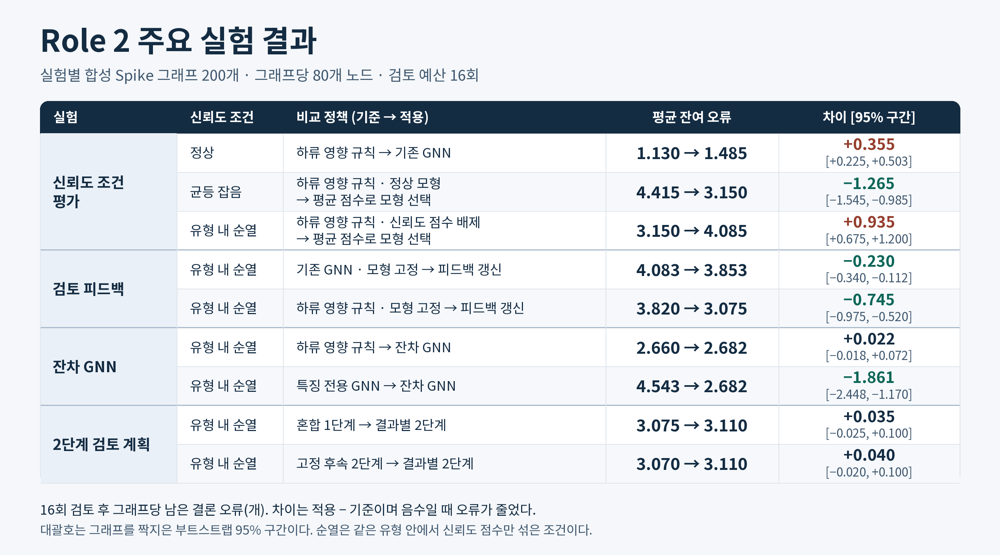

# Role 2 실험 결과

아래 표와 이미지는 초기 네 실험을 다룬다. 부분 손상, 행동별 보상, 공개 수면일기 결과는 별도 요약에 담았다. [후속 실험 결과](../후속실험결과.md) · [후속 결과 그림](후속실험요약.png)

검토 16회로 하류 결론 오류를 얼마나 줄일 수 있는지 네 차례 비교했다. **하류 영향 규칙은 균등 잡음에서 평균 점수로 신호 모형을 골라 잔여 오류를 4.415개에서 3.150개로 줄였다.** 유형 내 점수 순열에서는 검토 중 발견·미발견을 반영해 **3.820개에서 3.075개**로 줄였다. 잔차 GNN과 2단계 계획의 주 비교에서는 각각의 1단계 기준선과의 차이의 95% 구간이 0을 포함했다.

## 평가 기준

각 실험은 합성 Spike 그래프 200개에서 정책마다 80개 노드 중 16개를 검토했다. 주 지표는 **결론 노드 20개에 남은 오류의 그래프당 평균**이며 낮을수록 좋다. 같은 그래프의 정책과 신호 조건은 원천 오류, 전파 결과, 노드별 검토자 난수를 공유했다. 유형 내 순열은 같은 노드 유형 안에서만 공개 신뢰도 점수를 섞어 점수 분포와 평균을 유지한 조건이다.

차이는 반올림 전 평균으로 계산했다. 95% 구간은 같은 그래프의 짝을 유지해 10,000회 재표집했다. GNN 시드 평균을 비교한 구간에는 시드 간 변동도 반영했다. 평가 시드 구간이 실험마다 달라 정책 차이는 각 실험 안에서 읽는다. 아래에는 200개 그래프로 완료한 본 실험을 담았다.

## 1. 신뢰도 조건별 평가

Role 3의 기존 `observed` GNN 세 체크포인트와 하류 영향 규칙(`marginal`)을 비교했다. `observed` GNN은 신뢰도와 검토 이력을 입력받는다. 균등 잡음의 두 열은 같은 사례에서 신호 해석을 바꾼 결과다. 평균으로 모형을 고르는 정책은 공개 점수의 그래프 평균을 별도 보정 집합에서 구한 두 모형의 평균과 비교한다.

| 정책 | 정상 | 균등 잡음 · 정상으로 해석 | 균등 잡음 · 잡음으로 해석 | 유형 내 순열 |
|---|---:|---:|---:|---:|
| 신뢰도 순서 | 1.545 | 5.260 | 5.260 | 4.785 |
| 유형 사전확률 순서 | 4.065 | 4.065 | 4.065 | — |
| 하류 영향 규칙 | 1.130 | 4.415 | 3.150 | 4.085 |
| 평균으로 모형 선택 + 하류 영향 | 1.130 | 3.150 | 3.150 | 4.085 |
| 기존 GNN, 시드 3개 평균 | 1.485 | 4.857 | 4.192 | 4.342 |

- 정상 신뢰도에서 GNN의 오류 발견율은 44.1%, 하류 영향 규칙은 36.2%였다. 검토 후 결론 오류는 규칙이 그래프당 **0.355개** 더 적게 남겼다(95% 구간 0.225~0.503개 감소).
- 균등 잡음에서 평균 점수로 모형을 선택한 하류 영향 규칙은 정상 모형을 그대로 썼을 때보다 오류를 **1.265개** 적게 남겼다(95% 구간 0.985~1.545개 감소).
- 유형 내 순열 뒤에도 평균 기반 정책은 200개를 모두 정상으로 분류했다. 잔여 오류는 **4.085개**였고, 신뢰도 점수를 배제하고 유형 사전확률로 하류 영향을 계산한 정책은 **3.150개**였다(차이 +0.935개, 95% 구간 +0.675~+1.200).

## 2. 발견·미발견으로 신호 모형 갱신

기존 GNN 가중치를 고정했다. 각 정책은 같은 신호 모형에서 출발했다. 피드백 방식은 두 모형의 예측을 실제 발견·미발견과 대조하고 더 가능성이 높은 모형을 다음 선택에 사용했다.

| 신뢰도 조건 | 정책 | 모형 고정 | 피드백 갱신 | 갱신 − 고정 [95% 구간] |
|---|---|---:|---:|---:|
| 정상 | 하류 영향 규칙 | 0.995 | 1.005 | +0.010 [0.000, +0.025] |
| 정상 | 기존 GNN | 1.227 | 1.228 | +0.002 [−0.010, +0.013] |
| 균등 잡음 | 하류 영향 규칙 | 2.835 | 2.855 | +0.020 [−0.005, +0.050] |
| 균등 잡음 | 기존 GNN | 3.920 | 3.928 | +0.008 [−0.020, +0.043] |
| 유형 내 순열 | 하류 영향 규칙 | 3.820 | **3.075** | **−0.745 [−0.975, −0.520]** |
| 유형 내 순열 | 기존 GNN | 4.083 | **3.853** | **−0.230 [−0.340, −0.112]** |

주 비교인 순열에서 피드백을 적용한 GNN은 오류를 줄였다. 같은 피드백을 적용한 하류 영향 규칙은 GNN보다 그래프당 오류를 **0.778개** 더 적게 남겼다(95% 구간 0.442~1.100개 감소).

## 3. 하류 영향 점수에 잔차 GNN 추가

잔차 GNN은 하류 영향 점수에 학습한 보정값을 더했다. 특징 전용 GNN은 같은 점수를 입력받아 GNN 출력으로 순위를 정했다. 두 구조를 시드 5개에서 각각 384에피소드 학습하고 별도 검증 그래프로 체크포인트를 골랐다. 기존 GNN은 학습 이력이 다른 참고값이다.

| 신뢰도 조건 | 하류 영향 규칙 | 기존 GNN | 특징 전용 GNN | 잔차 GNN | 잔차 − 규칙 [95% 구간] |
|---|---:|---:|---:|---:|---:|
| 정상 | 0.905 | 1.147 | 4.058 | 0.904 | −0.001 [−0.009, +0.005] |
| 균등 잡음 | 2.595 | 3.578 | 4.567 | 2.611 | +0.016 [−0.016, +0.053] |
| 유형 내 순열 | 2.660 | 3.502 | 4.543 | 2.682 | **+0.022 [−0.018, +0.072]** |
| 세 조건 동일 가중 | 2.053 | 2.742 | 4.389 | 2.066 | +0.012 [−0.007, +0.037] |

순열에서 잔차 GNN은 특징 전용 GNN보다 오류를 **1.861개** 줄였다(95% 구간 1.170~2.448개 감소). 하류 영향 규칙과의 차이는 0을 포함했다. 잔차 GNN이 같은 공개 상태에서 해당 규칙과 다른 노드를 고른 비율은 8.9%였다. 5개 시드 중 1개는 검증에서 보정값이 0인 초기 체크포인트를 골랐다.

## 4. 발견·미발견별로 다음 검토까지 계획

혼합 1단계는 정상·잡음 모형의 하류 영향 점수를 현재 모형 확률로 평균한다. 두 계획 정책은 그 점수 상위 6개를 첫 후보로 고려하고 두 번째 검토의 가치를 합산했다. 고정 후속 정책은 두 결과에 같은 후속 후보를, 결과별 정책은 결과마다 다른 후속 후보를 고려했다. 두 정책 모두 실제 검토 결과가 들어오면 다시 계획했다.

| 신뢰도 조건 | 단일 모형 1단계 | 혼합 1단계 | 고정 후속 2단계 | 결과별 2단계 | 결과별 2단계 − 혼합 1단계 [95% 구간] |
|---|---:|---:|---:|---:|---:|
| 정상 | 0.970 | 0.930 | 0.930 | 0.925 | −0.005 [−0.030, +0.015] |
| 균등 잡음 | 2.910 | 3.005 | 2.975 | 3.015 | +0.010 [−0.085, +0.110] |
| 유형 내 순열 | 3.145 | 3.075 | 3.070 | 3.110 | **+0.035 [−0.025, +0.100]** |

순열에서 후속 검토가 가능한 첫 15회 중 발견·미발견에 따라 두 번째 후보가 갈린 비율은 38.2%였다. 현재 선택도 혼합 1단계와 18.8% 달랐다. 16회 뒤에는 혼합 1단계 대비 결과별 계획이 오류를 적게 남긴 그래프가 5개, 같은 그래프가 183개, 더 많이 남긴 그래프가 12개였다. 결과별 2단계에서 고정 후속 2단계를 뺀 차이도 **+0.040개**였다(95% 구간 −0.020~+0.100).

## 상세 보고서와 원자료

| 실험 | 평가 그래프 시드 | 상세 보고서 | 그래프별 원자료와 실행 설정 |
|---|---|---|---|
| 신뢰도 조건 | 91000–91199 | [조건 비교](confidence-v1/comparison.md) · [유형 내 순열](confidence-v1/shuffle_control.md) | [CSV](confidence-v1/episodes.csv) · [순열 결과 JSON](confidence-v1/shuffle_control.json) · [설정](confidence-v1/manifest.json) |
| 검토 피드백 | 92000–92199 | [피드백 비교](feedback-v1/feedback.md) | [CSV](feedback-v1/episodes.csv) · [설정](feedback-v1/manifest.json) |
| 잔차 GNN | 93000–93199 | [잔차 비교](residual-v1/residual.md) · [선택 사례](residual-v1/decision.md) | [CSV](residual-v1/eval/episodes.csv) · [설정](residual-v1/eval/manifest.json) |
| 2단계 계획 | 94000–94199 | [계획 정책 비교](planning-v1/planning.md) | [CSV](planning-v1/episodes.csv) · [검토 기록](planning-v1/trace.csv) · [설정](planning-v1/manifest.json) |

[실험별 재현 명령](../README.md#실행)
