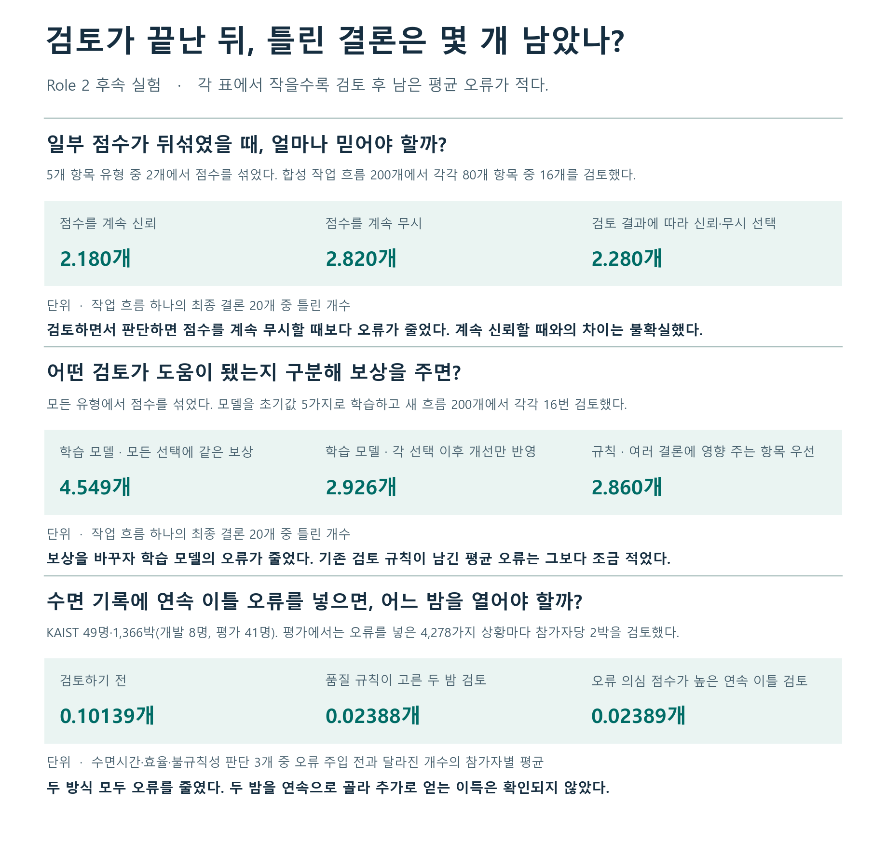

# 같은 검토 횟수로 틀린 결론을 얼마나 줄였나

이 실험을 시작한 이유는 초기 세 차례의 개발 결과에서 찾을 수 있다. [처음부터 읽는 Role 2 개선 과정](개선과정.md)

**가장 뚜렷한 개선은 강화학습 모델에 각 검토의 성과를 알려 주는 방법을 바꿨을 때 나왔다.** 같은 16회 검토에서 최종 결론 20개 중 틀린 결론이 평균 4.549개에서 2.926개로 줄었다. 새 그래프에서 기존 규칙과 직접 비교했을 때는 두 번의 검토를 앞서 계산하는 규칙이 개선한 모델보다 오류를 적게 남겼다. [학습 비교](results/credit-v1/credit.md) · [독립 확인](results/credit-v1/confirmation/confirmation.md)

## 1. 컴퓨터 점수가 일부 항목에서만 엉뚱할 때

컴퓨터는 검토 전에 각 항목에 신뢰도 점수를 붙인다. 예를 들어 오류가 있는 항목의 낮은 점수가 멀쩡한 항목에 붙으면 사람이 잘못된 곳부터 볼 수 있다. 이 상황을 만들기 위해 항목을 5개 유형으로 나누고 일부 유형 안에서 점수만 서로 바꿨다. **모든 방식이 같은 작업 흐름의 80개 항목 중 16개를 검토**했다. 표의 값은 그 뒤에 최종 결론 20개 중 몇 개가 여전히 틀렸는지를 200개 작업 흐름에서 평균 낸 수다.

| 5개 중 점수를 섞은 유형 수 | 항목 점수를 계속 신뢰 | 항목 점수를 계속 무시 | 검토 결과로 신뢰 여부 갱신 |
|---|---:|---:|---:|
| 2개 · 사전에 정한 주 비교 | 2.180개 | 2.820개 | 2.280개 |
| 3개 · 탐색 비교 | 2.675개 | 2.820개 | 2.500개 |

두 유형에서 섞었을 때 검토 결과로 신뢰 여부를 바꾸면 점수를 처음부터 무시하는 것보다 평균 **0.540개** 적게 틀렸다(95% 구간 0.345–0.735개 감소). 계속 믿는 방식과의 차이는 불확실했다. 세 유형에서 섞었을 때는 갱신 방식이 두 고정 방식보다 적은 오류를 남겼다. 실전에서는 몇 개 유형의 점수가 섞였는지 미리 알 수 없으므로, 이 수치로 현장에서 쓸 손상 기준을 정할 수는 없다. 유형마다 다른 갱신 규칙을 시험하기로 한 조건에는 도달하지 않아 그 실험은 실행하지 않았다. [6개 조건 전체 결과](results/partial-v1/partial.md) · [추가 실험의 실행 조건](유형별확인계획.md)

## 2. 어떤 검토 덕분에 좋아졌는지 모델이 배우게 하면

예를 들어 첫 5번의 검토에서 오류 2개를 바로잡았다고 하자. 기존 방식은 16회가 끝난 뒤의 총성과를 여섯 번째 선택에도 반영했다. 새 방식은 여섯 번째 선택을 평가할 때 **그 선택 직전부터 끝까지**의 개선만 반영했다. 두 방식 모두 같은 사례에서 기준 규칙이 거둔 성과를 빼서 학습했다.

모델 구조와 학습량을 맞춘 5쌍을 새 그래프 200개에서 비교했다. 기존 방식은 이전 학습 기록과 가중치를 검증해 재사용했다. 모든 유형 안에서 신뢰도 점수를 뒤섞은 조건에서 **4.549 → 2.926개**, 평균 **1.623개 감소**였다(95% 구간 1.033–2.136개 감소). 학습 시드 5개 모두 같은 방향이었다. 이는 이 모델과 예산에서 보상을 나눠 주는 방식이 성능에 기여했음을 보여준다. [보상 비교와 시드별 결과](results/credit-v1/credit.md)

그 다음에는 학습을 마친 모델을 고정하고 **또 다른 그래프 200개**에서 기존 규칙과 비교했다. 모델 **2.945개**, 점수를 계속 무시하는 규칙 **2.770개**, 검토 결과로 점수를 갱신하는 규칙 **2.860개**, 두 번의 검토를 앞서 계산하는 규칙 **2.765개**였다. 마지막 규칙은 모델보다 평균 **0.180개** 적게 틀렸다(95% 구간 0.021–0.377개 감소). 나머지 두 규칙과 모델의 차이는 불확실했다. [독립 평가 결과](results/credit-v1/confirmation/confirmation.md)

## 3. 수면일기에서 한 사람당 이틀만 검토할 때

연구실 비식별 일자별 원본과 사람이 정정한 기록은 제공되지 않아 해당 실험은 중단했다. 프로젝트가 외부 검증 자료로 지정한 **KAIST 공개 수면일기**로 별도 재생 평가를 했다. 49명의 일기 중 야간 각성시간 누락 6박을 제외한 1,366박을 사용했다. 개발 8명과 평가 41명을 분리했다. 기상 시각을 침대에서 나온 시각의 대용값으로 썼고, 이 대응으로 계산한 침대 체류시간이 원본 1,372박의 공개 값과 일치하는지 확인했다. [공개 원자료와 저작자](https://doi.org/10.6084/m9.figshare.28509740.v1) · [자료 변환](prepare_kaist_panel.py)

평가 참가자의 연속된 두 밤에 시간 입력 오류를 넣고, 어느 두 밤을 열어보느냐에 따라 **수면시간·효율·불규칙성 판단** 중 몇 개가 원래 일기에서 계산한 판단과 달라진 채 남는지 셌다. 열어본 밤의 오류를 발견하고 바로잡는다고 가정했다. 참가자 41명의 4,278개 주입 사례를 평가했고 참가자마다 같은 가중치를 줬다.

| 참가자당 검토한 밤 | 3개 판단 중 원래와 달라진 개수, 참가자당 평균 |
|---|---:|
| 검토 전 | 0.10139개 |
| 기존 품질 규칙이 가장 의심한 두 밤 | 0.02388개 |
| 품질 신호가 가장 많이 모인 연속 두 밤 | 0.02389개 |
| 첫날에 오류를 발견하면 인접한 밤을 우선 | 0.02341개 |

두 밤을 연속해서 고르는 방법과 기존 규칙의 차이는 **+0.000014개**였고 95% 구간은 −0.001407~+0.001216개였다. 이 예산에서는 연속 선택이나 첫날 피드백의 추가 이득이 확인되지 않았다. 실제 기록을 바탕으로 실험자가 넣은 오류를 측정했으며, 사람이 실제로 고친 오류나 소요시간에 대한 결과는 없다. [수면 실험 결과와 한계](results/sleep-v1/sleep.md)
